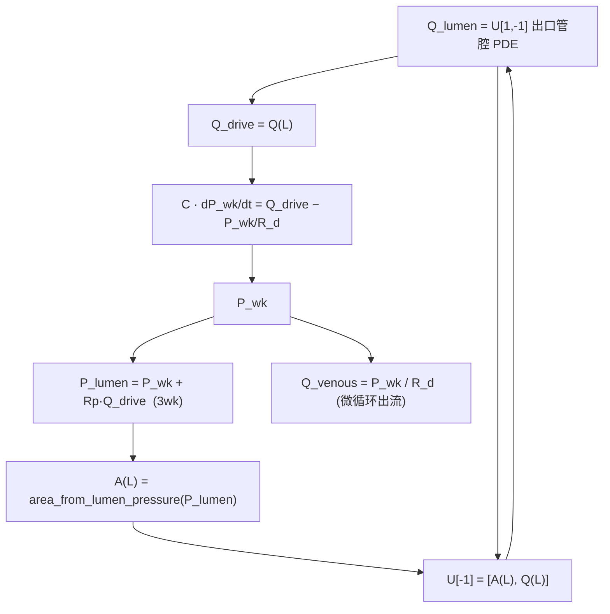
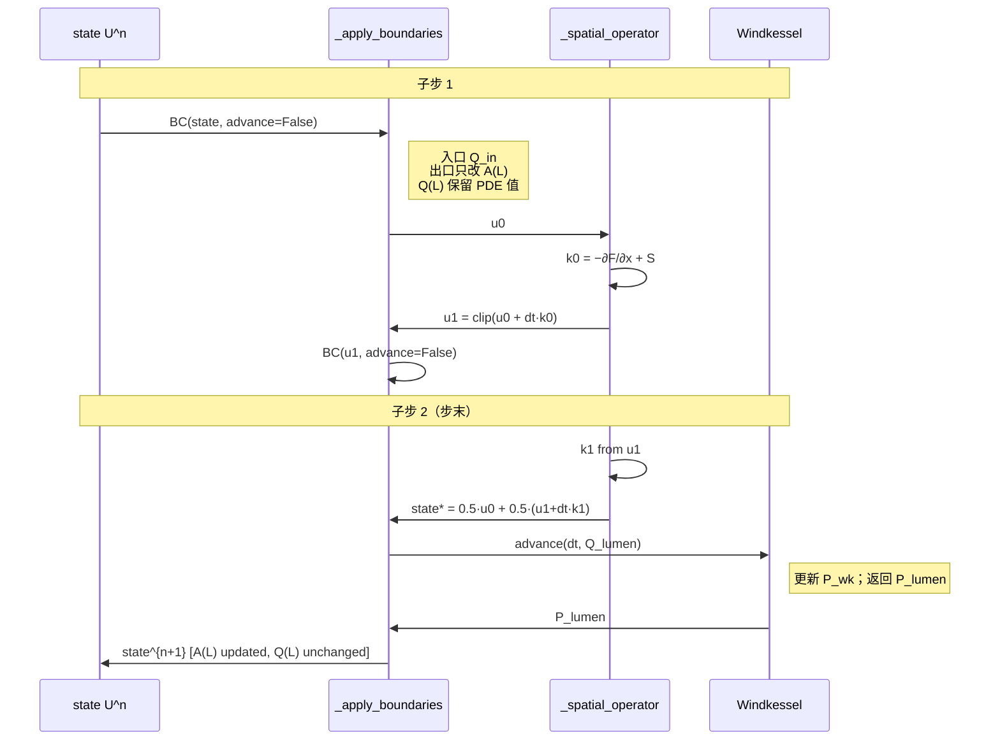
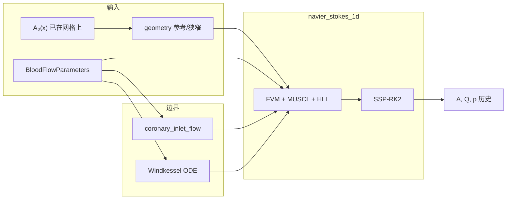

# 一维冠脉血流求解器说明（`navier_stokes_1d.py`）

本文档说明 `navier_stokes_1d.py` 的物理模型、数值方法、输入输出、API 用法及与 `coronary_inlet.py`、`coronary_outlet.py` 的衔接方式。

---

## 目录

1. [概述](#1-概述)
2. [环境与依赖](#2-环境与依赖)
3. [物理模型与单位](#3-物理模型与单位)
4. [数值方法](#4-数值方法)
5. [边界条件](#5-边界条件)
6. [快速开始](#6-快速开始)
7. [输入数据：管腔面积剖面](#7-输入数据管腔面积剖面)
8. [参数类 `BloodFlowParameters`](#8-参数类-bloodflowparameters)
9. [求解器 `NavierStokes1D`](#9-求解器-navierstokes1d)
   - [9.4 压力诊断](#94-压力诊断)
   - [9.6 适定性诊断（跨临界 / 壅塞 / 面积钳位）](#96-适定性诊断跨临界--壅塞--面积钳位)
10. [后处理与 FFR](#10-后处理与-ffr)
11. [与离线 Windkessel 对比](#11-与离线-windkessel-对比)
12. [参数调优建议](#12-参数调优建议)
13. [限制与扩展方向](#13-限制与扩展方向)
    - [13.1 改为定压（压力驱动）入口](#131-改为定压压力驱动入口)
14. [常见问题](#14-常见问题)
15. [文件关系速查](#15-文件关系速查)

---

## 1. 概述

`navier_stokes_1d.py` 实现**单支冠状动脉**在轴向 \(x \in [0, L]\) 上的一维可变形管血流传播。以截面积 \(A(x,t)\) 与体积流量 \(Q(x,t)\) 为求解变量，**管腔标量压** \(p(x,t)\) 由弹性 tube law 从 \(A\) 闭合，入口/出口边界分别由专用模块提供。

| 项目 | 说明 |
|------|------|
| 控制方程 | 1D 守恒型 Navier-Stokes（含 Poiseuille 摩擦源项） |
| 管壁 | \(p = P_{\mathrm{ref}} + \beta(\sqrt{A}-\sqrt{A_0})\) |
| 空间离散 | 有限体积 + MUSCL + minmod TVD + HLL |
| 时间离散 | SSP-RK2 |
| 入口 | `coronary_inlet.coronary_inlet_flow` |
| 出口 | 与 `coronary_outlet` 一致的 Windkessel ODE（在线耦合） |
| 主输入 | 与网格等长的 \(A_0\) + `BloodFlowParameters`（构造时自动检测狭窄） |

> 本模块**不依赖** `demo/navier_stokes.py`；`demo/` 目录下为早期原型，接口与边界实现不同，请勿混用。

---

## 2. 环境与依赖

| 依赖 | 用途 |
|------|------|
| Python 3.10+ | 类型注解、`float \| None` 等语法 |
| `numpy` | 数组与数值计算 |
| `matplotlib` | `plot_results()` 绘图（可选） |
| `coronary_inlet.py` | 入口脉动流量 |
| `coronary_outlet.py` | Windkessel 参数约定与离线参考压力 |
| `geometry.py` | 近/远端参考选取与狭窄检测 |
| `coronary_constants.py` | 共享公开全局常量（`P_INLET_REF_MMHG`、`MMHG_TO_DYNE_PER_CM2` 等） |

安装示例：

```bash
pip install numpy matplotlib
```

无图形界面时：

```bash
# Windows PowerShell
$env:MPLBACKEND = "Agg"
python navier_stokes_1d.py
```

---

## 3. 物理模型与单位

### 3.1 控制方程（当前正确形式）

文献中一维可变形管血流的标准出发点为（Formaggia / Sherwin / Ghigo–Delestre–Lagrée 等）：

\[
\partial_t A + \partial_x Q = 0,
\qquad
\partial_t Q + \partial_x\!\left(\alpha\frac{Q^2}{A}\right)
+ \frac{A}{\rho^*}\partial_x p
= -\frac{8\pi\nu Q}{A}.
\]

写成有限体积所用的通量–源项形式：

\[
\frac{\partial U}{\partial t} + \frac{\partial F}{\partial x} = S,
\quad
U = \begin{bmatrix} A \\ Q \end{bmatrix}
\]

\[
F = \begin{bmatrix} Q \\ \alpha Q^2/A \end{bmatrix},
\quad
S = \begin{bmatrix}
  0 \\[4pt]
  -\dfrac{A}{\rho^*}\partial_x p \;-\; \dfrac{8\pi\nu Q}{A}
\end{bmatrix}
\]

| 符号 | 含义 |
|------|------|
| \(A\) | 血管截面积 |
| \(Q\) | 体积流量（沿 \(x\) 正向为出口方向） |
| \(\rho^*\) | 与 mmHg 制管腔压配对的动量有效密度（`momentum_rho()`） |
| \(\alpha\) | 动量修正系数（层流常取 1.1） |
| \(\nu\) | 运动粘度（cm²/s，= 动力粘度/\(\rho\)） |
| 压力驱动 | **源项** \(-(A/\rho^*)\partial_x p\)，\(p\) 由 tube law 在单元中心计算 |
| 摩擦项 | Poiseuille 型 \(-8\pi\nu Q/A\) |

实现上：HLL/物理通量只处理对流部分 \(F\)；\(\partial_x p\) 在单元中心用中心差分（端点用单侧差分）离散。当 \(A\equiv A_0\) 时 \(p\equiv P_{\mathrm{ref}}\)，故 \(\partial_x p=0\)，静止平衡无虚假轴向力。

侧支开口处连续方程另含质量汇 \(-Q_b/\Delta x\)（见边界条件节）。

#### 3.1.1 既往通量错误（已修正）

**错误写法**（旧版代码与旧文档）：把管腔压放进动量通量，且**不**补几何等价源项：

\[
F_1^{\mathrm{(wrong)}} = \alpha\frac{Q^2}{A} + \frac{p\,A}{\rho^*},
\qquad
S_Q^{\mathrm{(wrong)}} = -\frac{8\pi\mu Q}{A}.
\]

由乘积法则：

\[
\frac{A}{\rho^*}\partial_x p
= \partial_x\!\left(\frac{p A}{\rho^*}\right)
- \frac{p}{\rho^*}\partial_x A.
\]

因此若通量含 \(pA/\rho^*\)，右端必须同时含 \((p/\rho^*)\partial_x A\)，才与标准式 \((A/\rho^*)\partial_x p\) 等价。旧实现缺少该项，在 \(A_0(x)\) 变化（狭窄、锥度）处会引入虚假压力梯度，表现为狭窄附近非物理压力巨跳、近端面积塌缩，进而出现入口压低于出口压等不合理结果。

文献对照（守恒型 + geometrical source / well-balanced）：

- Ghigo et al., *J. Comput. Phys.* 2016, https://doi.org/10.1016/j.jcp.2016.11.032
- Delestre & Lagrée, *Int. J. Numer. Meth. Fluids* 2013（well-balanced blood flow）
- Formaggia, Lamponi, Quarteroni, *J. Eng. Math.* 2003

本仓库采用更直接的 **压力梯度源项形式**（§3.1），而不采用「\(pA/\rho^*\) 进通量再补 \((p/\rho^*)\partial_x A\)」的等价改写。

### 3.2 管壁弹性律（Tube Law）

\[
p(A, x) = P_{\mathrm{ref}} + \beta(x)\,\bigl(\sqrt{A} - \sqrt{A_0(x)}\bigr)
\]

- \(A_0(x)\)：用户给定的**参考管腔面积**（无应力或影像分割得到的基线面积）
- \(\beta(x)\)：管壁刚度（mmHg / cm）
- \(P_{\mathrm{ref}}\)：参考压力（默认 `coronary_constants.P_INLET_REF_MMHG`）

**压力不单独求解散射方程**，每个时间步由当前 \(A\) 通过上式在网格中心得到 \(p_i\)，并用于动量源项中的 \(\partial_x p\)。

#### 3.2.1 管腔压 \(p\) 的物理含义

\(p\) 是**各向同性的热力学标量压**（mmHg），**不是**轴向或径向的应力矢量分量，也**不应**与「垂直于截面（轴向）」或「管壁法向（径向）」混为一谈——后两者在几何上互相垂直。

| 用途 | 机制 |
|------|------|
| **tube law** | 将标量 \(p\) 与截面积 \(A\) 耦合，描述管腔**径向胀缩**（壁弹性） |
| **动量源项** \(-(A/\rho^*)\partial_x p\) | 沿 \(x\) 的**压力梯度**驱动轴向体积流量 \(Q\) |
| **`pressure[i]`** | 轴向位置 \(x_i\) 处的管腔压取值；`p(x)` 表示沿程分布，非方向性矢量 |

小扰动压力波速（与 §4.3 CFL 及 `_wave_speed` 一致；由 tube law 线性化 \(\partial p/\partial A\) 得到）：

\[
c(A) = \sqrt{\frac{\beta\sqrt{A}}{2\rho^*}},
\qquad
\rho^* = \rho / 1333.22 \;\text{（mmHg 动量耦合有效密度）}
\]

### 3.3 默认单位制（CGS + mmHg 展示）

| 量 | 单位 |
|----|------|
| 轴向位置 \(x\) | cm |
| 截面积 \(A\) | cm² |
| 体积流量 \(Q\) | cm³/s |
| 入口模块输出 | mL/s（**1 mL = 1 cm³**，数值与 cm³/s 一致） |
| 密度 \(\rho\) | g/cm³（默认 1.06） |
| 运动粘度 \(\nu\) | cm²/s（默认 0.033 = 3.5 cP ÷ 1.06 g·cm⁻³） |
| 管壁刚度 \(\beta\) | mmHg/cm（因 \(\beta(\sqrt A-\sqrt{A_0})\) 中 \(\sqrt A\) 单位为 cm） |
| 压力 \(p\)（`pressure`、`history_pressure`） | mmHg；沿 \(x\) 各点的**管腔标量压**，非方向分量 |
| 时间 \(t\) | s |

> **为什么摩擦项用运动粘度而非动力粘度**
>
> 动量方程（动力粘度形式）为
> \(\rho\bigl(\partial_t Q+\partial_x(\alpha Q^2/A)\bigr)+A\,\partial_x p=-8\pi\mu_{\rm dyn}Q/A\)。
> 两边同除以 \(\rho\) 得
> \(\partial_t Q+\partial_x(\alpha Q^2/A)+(A/\rho)\,\partial_x p=-8\pi\nu Q/A\)，
> 其中 \(\nu=\mu_{\rm dyn}/\rho\) 为运动粘度。因本实现已把 \(p\) 用 mmHg 表达并折算进
> \(\rho^*\)，摩擦项**不再含 \(\rho\)**，故 `mu` 必须填 \(\nu\)（cm²/s）。
> 该式与 Poiseuille 解析解 \(\Delta p=8\mu_{\rm dyn}LQ/(\pi R^4)\) 数值上完全一致（比值 1.000000）。

---

## 4. 数值方法

### 4.1 空间：有限体积 + MUSCL + TVD + HLL

1. 在单元中心存储 \(U_j^n\)，界面 \(j+\tfrac{1}{2}\) 用中心差分估计梯度，经 **minmod** 限制得斜率 \(\sigma_j\)。
2. MUSCL 重构：
   - \(U_L = U_j + \tfrac{1}{2}\sigma_j\)
   - \(U_R = U_{j+1} - \tfrac{1}{2}\sigma_{j+1}\)
3. 重构后的 \(A\) 不低于 \(0.8\,A_0\)（`MINIMUM_AREA_RATIO`，防止非物理负面积）。
4. 内部界面用 **HLL** 近似黎曼解得到数值通量 \(\hat{F}_{j+1/2}\)；边界界面用物理通量 \(F(U)\)。

### 4.2 时间：SSP-RK2

在空间离散中，通过有限体积法，获得每一个单元 \(i\) 的离散守恒式方程形式：

\[
\frac{\mathrm{d}\bar{U}_i}{\mathrm{d}t}
+ \frac{1}{\Delta x}\bigl(F_{i+\frac{1}{2}} - F_{i-\frac{1}{2}}\bigr)
= S
\]

即

\[
\frac{\mathrm{d}\bar{U}_i}{\mathrm{d}t}
= -\frac{1}{\Delta x}\bigl(F_{i+\frac{1}{2}} - F_{i-\frac{1}{2}}\bigr) + S
\]

将右侧视为关于 \(U,\,t\) 的函数

\[
\mathcal{L}(t, U)
= -\frac{1}{\Delta x}\bigl(F_{i+\frac{1}{2}} - F_{i-\frac{1}{2}}\bigr) + S
\]

Runge–Kutta 2 阶（SSP-RK2 / Heun）形式如下：

\[
\begin{cases}
\bar{U}_i^{n+1}
= \bar{U}_i^{n}
+ \Delta t\bigl(\tfrac{1}{2}k_1 + \tfrac{1}{2}k_2\bigr) \\[0.4em]
k_1 = \mathcal{L}\bigl(t^{n},\; \bar{U}_i^{n}\bigr) \\[0.4em]
k_2 = \mathcal{L}\bigl(t^{n+1},\; \bar{U}_i^{n} + \Delta t\,k_1\bigr)
\end{cases}
\]

提供 \(t=0\) 时的初值 \(\bar{U}_i^{0}\) 进行迭代求解。

实现上与上式等价的写法（见 `_ssp_rk2_step`）为：

\[
\begin{aligned}
U^{(1)} &= \mathrm{BC}\bigl(U^{n} + \Delta t\,\mathcal{L}(U^{n})\bigr) \\
U^{n+1} &= \mathrm{BC}\left(
\tfrac{1}{2}U^{n} + \tfrac{1}{2}\bigl(U^{(1)} + \Delta t\,\mathcal{L}(U^{(1)})\bigr),\
\text{advance outlet}\right)
\end{aligned}
\]

- \(\mathcal{L}(U) = -\partial_x \hat{F} + S\)（自治情形可略去显式 \(t\) 依赖）
- **边界条件**在每个子步施加；Windkessel 状态仅在**完整步末**推进（`advance_outlet=True`）。

### 4.3 CFL 条件

时间步长由 **CFL（Courant–Friedrichs–Lewy）条件**自适应选取，保证显式双曲部分（对流 + 弹性波）在数值上稳定。实现见 `NavierStokes1D._stable_timestep` 与 `_wave_speed`。

\[
\Delta t = \min\left(
  \mathrm{CFL}\cdot\frac{\Delta x}{\lambda_{\max}},\;
  \Delta t_{\max}
\right),
\qquad
\lambda_{\max} = \max_{x}\bigl(\,|u(x)| + c(x)\,\bigr)
\]

#### 公式中各符号

| 符号 | 含义 | 单位 | 代码/来源 |
|------|------|------|-----------|
| \(\Delta x\) | 轴向网格间距 \(L/(n_x-1)\) | cm | `solver.dx` |
| \(u(x)\) | **轴向流体速度**，\(u = Q/A\) | cm/s | `state[1] / state[0]` |
| \(c(x)\) | **小扰动弹性波速**（管壁顺应性引起的压力–面积波沿 \(x\) 传播的速度） | cm/s | `_wave_speed` |
| \(\lambda_{\max}\) | 全网格上特征速度上界 \(\|u\|+c\) 的最大值 | cm/s | `np.max(np.abs(u) + c)` |
| \(\mathrm{CFL}\) | 稳定性安全系数，\(0<\mathrm{CFL}\lesssim 1\) | — | `BloodFlowParameters.cfl`（默认 0.8） |
| \(\Delta t_{\max}\) | 时间步**硬上限**（避免单步过大、便于与 Windkessel 耦合） | s | `BloodFlowParameters.dt_max_s`（默认 \(4\times10^{-4}\)） |

#### \(u\)：对流速度

\[
u = \frac{Q}{A}
\]

- \(Q\)：该网格点的体积流量（cm³/s）
- \(A\)：该网格点的管腔截面积（cm²）
- \(u\) 描述**血液沿血管轴向 \(x\) 方向的输运**；\(|u|\) 越大，信息沿 \(x\) 传播越快，所需 \(\Delta t\) 越小

#### \(c\)：弹性波速

由 tube law 线性化得到的小扰动波速（与 HLL 求解器中 `_wave_speed` 一致）：

\[
c(A) = \sqrt{\frac{\beta\sqrt{A}}{2\rho^*}},
\qquad
\rho^* = \frac{\rho}{1333.22}
\]

| 量 | 说明 |
|----|------|
| \(\beta(x)\) | 管壁刚度（mmHg/√cm）；\(\beta\) 越大 → 管壁越硬 → \(c\) 越大 |
| \(A\) | 当前截面积（cm²） |
| \(\rho\) | 血液密度（g/cm³，默认 1.06） |
| \(\rho^*\) | 与 mmHg 制管腔压配对的**动量有效密度**（`momentum_rho()`） |

物理上，\(c\) 刻画**压力扰动沿管轴传播**的快慢：顺应性越小（\(\beta\) 越大）或管腔越大，波速越高，CFL 对 \(\Delta t\) 的限制越严。

#### 为何取 \(|u|+c\)

一维可变形管方程在双曲意义下有两族特征线，其有效传播速度约为 \(u \pm c\)。CFL 条件要求在一个时间步内，对流与弹性波**不应跨越超过约一个网格单元**：

\[
\Delta t \lesssim \frac{\Delta x}{|u| + c}
\]

取全网格 \(\max_x(|u|+c)\) 作为最严格（最小 \(\Delta t\)）的约束；再乘以 \(\mathrm{CFL}<1\) 留出数值安全裕度（MUSCL–HLL + SSP-RK2 仍建议 \(\mathrm{CFL}\approx 0.35\)–\(0.5\)）。

#### 默认参数与调参

| 参数 | 默认值 | 说明 |
|------|--------|------|
| `cfl` | 0.5 | 减小可抑制振荡、提高稳定性，但步数增多 |
| `dt_max_s` | \(5\times10^{-4}\) s | 即使 \(\lambda_{\max}\) 很小也不超过此步长 |

**典型量级**（冠脉尺度）：\(u \sim 10\)–\(50\) cm/s，\(c \sim 10\)–\(30\) cm/s，\(\Delta x \sim 0.05\)–\(0.2\) cm → \(\Delta t\) 常为 \(10^{-4}\)–\(10^{-3}\) s 量级，常由 `dt_max_s` 截断。

**退化情况**：若 \(\lambda_{\max} < 10^{-14}\)（近乎静止），代码回退 \(\Delta t = 10^{-4}\) s，避免除零。

---

## 5. 边界条件

### 5.1 入口（\(x=0\)）

由 `coronary_inlet.coronary_inlet_flow` 提供 \(Q_{\mathrm{in}}(t)\)：

```text
U[1, 0] = Q_in(t)          # 定流量
U[0, 0] = U[0, 1]          # 截面积零梯度外推
```

入口参数通过 `BloodFlowParameters` 传入（心率、心输出量、冠脉分流比例、傅里叶系数等）。波形细节见 [`coronary_inlet_说明.md`](coronary_inlet_说明.md)。

平均冠脉流量：

\[
Q_{\mathrm{mean}} = \frac{\mathrm{CO}\times 1000 \times f_{\mathrm{cor}}}{60}
\quad\text{(mL/s)}
\]

### 5.2 出口（\(x=L\)）— Windkessel 耦合

与 `coronary_outlet.py` 文档中的微循环模型一致，求解器内维护状态 \(P_{\mathrm{wk}}\)：

**二元 Windkessel（`outlet_windkessel="2wk"`）**

\[
C\,\frac{\mathrm{d}P_{\mathrm{wk}}}{\mathrm{d}t}
= Q_{\mathrm{drive}} - \frac{P_{\mathrm{wk}}}{R_d},
\quad
P_{\mathrm{lumen}} = P_{\mathrm{wk}}
\]

**三元 Windkessel（`outlet_windkessel="3wk"`）**

\[
C\,\frac{\mathrm{d}P_{\mathrm{wk}}}{\mathrm{d}t}
= Q_{\mathrm{drive}} - \frac{P_{\mathrm{wk}}}{R_d},
\quad
P_{\mathrm{lumen}} = P_{\mathrm{wk}} + R_p\, Q_{\mathrm{drive}}
\]

其中：

\[
Q_{\mathrm{drive}} = Q(L)
\]

即 Windkessel ODE 由**出口管腔 PDE 流量**驱动，实现 0D–1D 质量闭合。

\[
Q_{\mathrm{venous}} = \frac{P_{\mathrm{wk}}}{R_d}
\]

仅在 \(dP_{\mathrm{wk}}/dt=0\) 时才有 \(Q(L) \approx Q_{\mathrm{venous}}\)；脉动过程中二者可分离。

出口边界施加（`_apply_boundaries`）：

```text
Q(L)   ← 保留 PDE 演化值（不强制为 P_wk/R_d）
A(L)   ← tube law 反解，使 p(A(L)) = P_lumen
P_wk   ← 步末 advance：C·dP_wk/dt = Q_drive − P_wk/R_d
```

**物理回路**：

```text
入口 Q_in(t) ──► 1D 管腔 PDE ──► Q(L) ──► Windkessel(C, P_wk) ──► Q_venous = P_wk/R_d ──► 静脉
                                      └──► P_lumen ──► A(L) via tube law
```

默认 \(R_d = P_{\mathrm{ref}} / Q_{\mathrm{mean}}\)，\(R_p = 0.12\, R_d\)（与 `coronary_outlet` 默认标定一致）。详见 [`coronary_outlet.md`](coronary_outlet.md)。

### 5.2.1 侧支 Windkessel（压力驱动分流）

每个侧支开口接独立的 0D Windkessel（`branch_outlets[k]`），与主支出口同构；Murray 份额 \(f_i\) **只用于**按 \(1/f_i\) 放大 \(R_d,R_p\)、按 \(f_i\) 缩小 \(C\)，使并联终端标定与总冠脉阻力一致。

**耦合方式（与出口相反）**：

| | 主支远端出口 | 侧支开口 |
|---|---|---|
| 1D 提供 | \(Q(L)\)（PDE） | \(P_{\mathrm{ostium}}=p(A_j)\)（tube law） |
| 0D 反解 | \(P_{\mathrm{lumen}}\) → 定 \(A(L)\) | \(Q_b\) → 质量汇 \(-Q_b/\Delta x\) |
| 不强制 | \(Q(L)=P_{\mathrm{wk}}/R_d\) | 开口 \(A_j\)（由主支方程自由演化） |

分流量：

\[
Q_b = \frac{P_{\mathrm{ostium}} - P_{\mathrm{wk}}}{R_{\mathrm{coup}}},
\qquad
R_{\mathrm{coup}} =
\begin{cases}
R_p & \text{3wk}\\
R_d & \text{2wk}
\end{cases}
\]

ODE 仍为 \(C\,\mathrm{d}P_{\mathrm{wk}}/\mathrm{d}t = Q_b - P_{\mathrm{wk}}/R_d\)。因此当狭窄抬高近端开口压时，\(Q_b\) 自动增大——即“狭窄越重、近端侧支分得越多”。

RK 节拍与出口相同：子步 `apply_substep_from_pressure`（冻结 \(P_{\mathrm{wk}}\)），完整步末 `advance_from_pressure`。

### 5.3 物理下限

面积下限统一由常量 `MINIMUM_AREA_RATIO = 0.8`（`coronary_constants.py`）控制，在**三处**同时生效：

| 位置 | 函数 | 行为 |
|------|------|------|
| MUSCL 重构 | `_muscl_states` | 左右重构态 \(A_L,A_R \ge 0.8\,A_0\) |
| 状态钳位 | `_clip_state` | 每步末 \(A \ge 0.8\,A_0\) |
| tube law 正/反解 | `lumen_pressure_mmhg` / `area_from_lumen_pressure_mmhg` | 内部先钳位再加压 |

> **注意**：该下限是**数值保护**，不是物理约束。一旦求解过程中 \(A\) 大范围触及 \(0.8\,A_0\)，tube law 已被非线性削平，压力场不再可信。请用
> `solver.wellposedness_diagnostics()` 的 `n_clamp` / `clamp_fraction` 检查（见 §9.6）。

### 5.4 边界变量 vs 内部自由度（示意图）

有限体积离散在单元中心存储 \(U_j=[A_j,Q_j]^\mathsf{T}\)。边界条件**不直接修改通量公式**，而是在每个 RK 子步先强制边界节点上的 \(U\)，再由 `_spatial_operator` 用边界上的物理通量 \(F(U)\) 作为 `f_face[0]`、`f_face[-1]`。

#### 5.4.1 沿程：prescribed / free / derived

```mermaid
flowchart LR
    subgraph IN["入口 x = 0"]
        direction TB
        IN_Q["Q₀ = Q_in(t)  ✓ prescribed"]
        IN_A["A₀ = A₁       ~ extrapolated"]
        IN_P["p₀ = tube_law(A₀)  derived"]
    end

    subgraph INT["内部 j = 1 … nx−2"]
        direction TB
        INT_A["A_j  ✓ free"]
        INT_Q["Q_j  ✓ free"]
        INT_P["p_j = tube_law(A_j)  derived"]
    end

    subgraph OUT["出口 x = L"]
        direction TB
        WK["P_wk  ✓ ODE state"]
        OUT_P["P_lumen = f(P_wk, Q_drive)  ✓ prescribed"]
        OUT_Q["Q(L)  ✓ free (PDE)"]
        OUT_QV["Q_venous = P_wk/R_d  ◇ diagnostic"]
        OUT_A["A(L) = inv_tube_law(P_lumen)  derived"]
    end

    IN -->|"HLL 通量传播"| INT
    INT -->|"HLL 通量传播"| OUT
```



**图例**

| 标记 | 含义 |
|------|------|
| prescribed（图中红色节点） | 边界**直接强制**的变量 |
| free（图中绿色节点） | **内部自由度**，由 PDE 时间推进 |
| derived（图中紫色节点） | **派生量**：每步由 tube law 从 \(A\) 得到标量 \(p\)，不单独求解 |
| extrapolated / ODE state（图中黄色节点） | \(A_0\) 外推、或 Windkessel 状态 \(P_{\mathrm{wk}}\) |

#### 5.4.2 1D 管段上的变量角色

```text
  入口 x=0              内部单元 j=1…nx−2              出口 x=L
  ─────────            ─────────────────────           ─────────
       │                        │                          │
  Q ───●─── prescribed          ○─── free                   ○─── free (PDE)
       │    Q_in(t)             │   evolve by              │   Q(L) 保留
       │                        │   −∂F/∂x+S               │   不强制 P_wk/R_d
  A ───○─── extrapolated        ○─── free                   ○─── derived
       │    A₀=A₁               │                          │   A(L) from P_lumen
       │                        │                          │
  p ───◇─── derived             ◇─── derived                ◇─── drives A(L)
       │    tube law            │   tube law               │   via inv tube law
       │                        │                          │
       │                        │                    P_wk ──●── ODE state
       │                        │                    Q_venous= P_wk/R_d (0D 出流)
       │                        │                          │   C·dP_wk/dt =
       │                        │                          │   Q_drive−Q_venous
       ▼                        ▼                          ▼
   F(U₀) 边界通量          F̂_{j+1/2} HLL 内通量         F(U_{n−1}) 边界通量
```

符号：`●` prescribed，`○` free，`◇` derived。

#### 5.4.3 守恒变量 **U = [A, Q]** 的约束一览

| 位置 | \(A\) | \(Q\) | \(p\) | 决定方式 |
|------|-------|-------|-------|----------|
| **入口** \(j=0\) | 外推 \(A_1\) | **\(Q_{\mathrm{in}}(t)\)** | tube law | `_apply_boundaries` |
| **内部** \(j=1…n{-}2\) | **自由** | **自由** | tube law | SSP-RK2 + HLL + 源项 |
| **出口** \(j=n{-}1\) | **反解** \(A(L)\)（配 \(P_{\mathrm{lumen}}\)） | **自由** \(Q(L)\)（PDE） | **\(P_{\mathrm{lumen}}\)** | Windkessel + tube law |

**内部自由度总数**：\(2(n_x - 2)\)（每个内部点的 \(A_j,\,Q_j\) 各 1 个）。入口主要约束 \(Q\)；出口经 Windkessel 约束 \(P_{\mathrm{lumen}}\) 与 \(A(L)\)，**不**强制 \(Q(L)=P_{\mathrm{wk}}/R_d\)。

#### 5.4.4 出口 Windkessel 与管腔的耦合



\(Q(L)\) 由 1D PDE 与入口 \(Q_{\mathrm{in}}(t)\) 经沿程传播决定，再经 \(Q_{\mathrm{drive}}\) 反馈到 Windkessel；\(P_{\mathrm{lumen}}\) 经 tube law 闭合 \(A(L)\)。**勿将 \(Q_{\mathrm{venous}}=P_{\mathrm{wk}}/R_d\) 写入 \(Q(L)\)**，否则破坏 0D–1D 质量闭合。

#### 5.4.5 一个 SSP-RK2 步内边界何时介入

与 §4.2 一致：Windkessel 状态 \(P_{\mathrm{wk}}\) **仅在完整步末**（`advance_outlet=True`）积分；RK 中间子步只 `apply_substep`，\(P_{\mathrm{wk}}\) 冻结。



#### 5.4.6 快速记忆

```text
        prescribed          free                 free + derived
           │                  │                         │
    Q_in ──┤                  │                    Q(L) PDE 演化
           │                  │                         │
           │            A_j, Q_j  evolve                 │
           │                  │                         │
    A←A₁ ──┤                  │         P_lumen ──→ A(L)
           │                  │              P_wk/R_d = Q_venous (0D only)
           └────── 双曲 PDE + 源项 传播 ───────────────┘
                         tube law → p_j  everywhere
```

**一句话**：入口为**定流量泵** \(Q_{\mathrm{in}}(t)\)；出口为 **Windkessel 定压（经 tube law 转为 \(A(L)\)）**，管腔流量 \(Q(L)\) 由 PDE 与入口经沿程传播耦合；微循环侧出流 \(Q_{\mathrm{venous}}=P_{\mathrm{wk}}/R_d\) 仅出现在 0D ODE 中。

### 5.5 初值与构造时初始化

`NavierStokes1D(...)` 构造时一次性完成几何处理、PDE 初值与出口 Windkessel 重置（**已无** `set_lumen_area_profile`）：

| 量 | 初值 | 依据 |
|----|------|------|
| \(A(x,0)\) | \(A_0(x)\)（经近/远端参考段平整后） | tube law → \(p \approx P_{\mathrm{ref}}\) |
| \(Q(x,0)\) | \(Q_{\mathrm{in}}(0)\) | 与入口定流量 BC 一致（**非** \(Q_{\mathrm{mean}}\)） |
| \(P_{\mathrm{wk}}(0)\) | \(Q_{\mathrm{mean}}\, R_d\) | Windkessel 稳态标定 |
| \(P_{\mathrm{lumen}}(0)\)（3wk） | \(P_{\mathrm{wk}} + R_p\, Q_{\mathrm{in}}(0)\) | `outlet.reset(q_drive=…)` |
| \(P_{\mathrm{ref}}\)（3wk） | 构造末写为 \(P_{\mathrm{wk}}+R_p Q_{\mathrm{mean}}\) | 与出口管腔压锚点对齐；2wk 不改写 |

**参数标定链**：

```text
CO, coronary_fraction  →  Q_mean
R_d：显式 outlet_r_distal…，或 None 时 R_d = P_ref / Q_mean
outlet_proximal_fraction  →  R_p = fraction · R_d（若未显式给 Rp）
```

默认 `outlet_r_distal_mmhg_s_per_ml=20` 时，\(P_{\mathrm{wk}}(0)=Q_{\mathrm{mean}}\cdot 20\)，**不必**等于初始 `p_ref_mmhg`；三元模型随后会把 `p_ref_mmhg` 抬到与出口稳态管腔压一致。

**`OutletWindkesselState.reset(p_wk=None, q_drive=None)`**

| 参数 | 默认 | 说明 |
|------|------|------|
| `p_wk` | `Q_mean · R_d` | 顺应性节点压 |
| `q_drive` | `Q_in(0)` | 三元模型 \(P_{\mathrm{lumen}}=P_{\mathrm{wk}}+R_p Q_{\mathrm{drive}}\) |

建议 `duration_s` 取 ≥2–3 个心动周期再统计。

---

## 6. 快速开始

### 6.1 运行内置示例

```bash
python navier_stokes_1d.py
```

调用 `demo()`：从 `data/pred_masks…/area.npy` 读入面积、高斯平滑后构造求解器，默认模拟约 3 s，并用 `plot_results_1()`（Plotly）展示。

### 6.2 最小脚本

```python
import numpy as np
from navier_stokes_1d import NavierStokes1D, BloodFlowParameters

L, nx = 30.0, 151
x = np.linspace(0.0, L, nx)
# area 长度即节点数 n_x，单位 cm²（已在求解网格上，构造时不再插值）
area = np.pi * (0.40 - 0.08 * x / L) ** 2

par = BloodFlowParameters(
    heart_rate_bpm=75.0,
    coronary_flow_fraction=0.03,
    outlet_windkessel="3wk",
    cfl=0.8,
)

solver = NavierStokes1D(area, L, par)
A_hist, Q_hist, p_hist, t_hist = solver.run(duration_s=2.4, record_interval_steps=25)
print("FFR ≈", solver.ffr_ratio())
solver.plot_results()          # matplotlib
# solver.plot_results_1()      # Plotly 交互图
```

### 6.3 推荐工作流

```text
准备 A₀ → BloodFlowParameters → NavierStokes1D(area, L, par) → run → 后处理 / plot_results[_1]
```

---

## 7. 输入数据：管腔面积剖面

### 7.1 在构造函数中传入 \(A_0\)

参考面积在构造时直接给出（**不再**提供 `set_lumen_area_profile`）：

```python
NavierStokes1D(
    area,                 # A₀，shape (n_x,)，单位 cm²；n_x = len(area)
    vessel_length_cm,     # L (cm)
    parameters=None,
)
```

| 要求 | 说明 |
|------|------|
| `area` | 一维数组，长度 ≥ 3；点 \(i\) 对应 \(x_i=i\cdot L/(n_x-1)\)，其中 \(n_x=\mathrm{len}(area)\) |
| 单位 | cm²（若原始数据为 mm²，需自行换算，如 `/100`） |
| 插值 | **无**：请先在外部插值/平滑到求解网格 |

构造内还会：

1. \(\beta(x)\leftarrow\) 常数 `beta_mmhg_per_cm`（全段一致，狭窄段**不**放大）
2. `geometry.select_reference_indices` → 近/远端参考下标 `prox_idx`, `dist_idx`
3. `geometry.detect_stenoses` → 自动检测狭窄段 `lesions`（仅用于诊断/绘图标注，不改 β）
4. 近端段 \(x\le x_{\mathrm{prox}}\)、远端段 \(x\ge x_{\mathrm{dist}}\) 的 \(A_0\) 分别平整为参考点面积
5. `outlet.reset(...)`；若 `3wk` 则更新 `p_ref_mmhg` 与出口稳态管腔压对齐
6. \(A=A_0\)，\(Q=Q_{\mathrm{in}}(0)\)，刷新 `pressure`

### 7.2 由半径构造面积

```python
radius_cm = ...  # 沿程半径，长度即节点数
area = np.pi * radius_cm**2
solver = NavierStokes1D(area, L, par)
```

### 7.3 自动狭窄检测（`geometry.py`）

| 步骤 | 函数 / 行为 |
|------|-------------|
| 近/远端参考 | `select_reference_indices`：前/后约 15% 区段内取面积最大（远端面积 ≤ 近端） |
| 狭窄段 | `detect_stenoses`：近远端之间找 MLA，段宽约 \(\pm 5\%\,n_x\)，最多 3 段 |
| \(\beta\) | **不随狭窄放大**，全段取常数 `beta_mmhg_per_cm` |

> 说明：早期版本曾在狭窄 mask 上做 \(\beta \leftarrow \beta\cdot A_{0,\mathrm{prox}}/A_{0,\mathrm{MLA}}\)。
> 因 tube law \(p=P_{\mathrm{ref}}+\beta(\sqrt A-\sqrt{A_0})\) 中 \(\beta\) 被放大数倍后，
> \(A\) 上不足 1% 的数值误差即被放大成上百 mmHg（狭窄段出现负压与压力尖峰），
> 该操作已移除。狭窄的压降应由几何变窄（对流加速与局部损失）承担，而非管壁刚度。

面积狭窄率（相对近端参考）：

\[
\text{stenosis\%} \approx \left(1 - \frac{A_{0,\mathrm{MLA}}}{A_{0,\mathrm{prox}}}\right)\times 100\%
\]

### 7.4 参数数量级参考

| 参数 | 典型量级 |
|------|----------|
| \(A_0\) | 0.05–1.0 cm² |
| \(\beta\) | 3500 mmHg/cm（默认）；可调，但不宜 >10⁴（tube law 误差放大） |
| \(L\) | 10–50 cm |
| \(Q_{\mathrm{mean}}\) | 约 2.5–4 mL/s（由 CO 与冠脉比例决定） |

---

## 8. 参数类 `BloodFlowParameters`

`@dataclass`，构造时可覆盖任意字段。

### 8.1 流体与数值

| 字段 | 默认 | 说明 |
|------|------|------|
| `rho` | 1.06 | 密度 (g/cm³) |
| `alpha` | 1.1 | 动量修正系数 |
| `mu` | 0.033 | 运动粘度 ν (cm²/s) = 3.5 cP ÷ 1.06 g·cm⁻³ |
| `cfl` | 0.8 | CFL 数 |
| `dt_max_s` | 4e-4 | 时间步上限 (s) |

### 8.2 管壁

| 字段 | 默认 | 说明 |
|------|------|------|
| `p_ref_mmhg` | 75.0 | tube law 参考压 (mmHg)，= `P_INLET_REF_MMHG`；`3wk` 构造末可能被抬到出口稳态管腔压 |
| `beta_mmhg_per_cm` | 3500.0 | 管壁刚度 β (mmHg/cm)；因 \(\beta(\sqrt A-\sqrt{A_0})\) 中 \(\sqrt A\) 单位为 cm。**全段常数，不随狭窄放大** |

### 8.3 入口（→ `coronary_inlet_flow`）

| 字段 | 默认 | 说明 |
|------|------|------|
| `heart_rate_bpm` | 75 | 心率 |
| `cardiac_output_l_per_min` | 8 | 心输出量 (L/min)。静息 5、充血态 8 |
| `coronary_flow_fraction` | 0.03 | 冠脉占 CO 比例 |
| `inlet_min_flow_fraction` | 0.25 | 流量下限 = 该比例 × \(Q_{\mathrm{mean}}\) |
| `inlet_phase_offset_rad` | 0 | 波形相位偏移 |
| `inlet_fourier_coefficients` | None | 自定义谐波；None 用模块内置默认系数 |

方法：

- `mean_coronary_flow_ml_s()` → \(Q_{\mathrm{mean}}\)
- `inlet_flow(t)` → 入口流量数组
- `resolve_outlet_resistances()` → \((R_d, R_p)\)
- `momentum_rho()` → 与 mmHg 压配对的有效密度 \(\rho^*\)

### 8.4 出口 Windkessel

| 字段 | 默认 | 说明 |
|------|------|------|
| `outlet_windkessel` | `"3wk"` | `"2wk"` 或 `"3wk"` |
| `outlet_r_distal_mmhg_s_per_ml` | 20 | \(R_d\)；`None` 则 \(P_{\mathrm{ref}}/Q_{\mathrm{mean}}\) |
| `outlet_r_proximal_mmhg_s_per_ml` | None | \(R_p\)；None 则 `proximal_fraction * R_d` |
| `outlet_compliance_ml_per_mmhg` | 0.05 | 顺应性 \(C\) |
| `outlet_proximal_fraction` | 0.12 | 三元模型近端阻力比例 |

Windkessel ODE 驱动流量固定为出口管腔流量 \(Q(L)\)，无额外配置项。

---

## 9. 求解器 `NavierStokes1D`

### 9.1 构造

```python
NavierStokes1D(
    area: np.ndarray | list,          # A₀，单位 cm²；n_x = len(area)
    vessel_length_cm: float,
    parameters: BloodFlowParameters | None = None,
)
```

| 属性 | 说明 |
|------|------|
| `length`, `nx`, `dx` | 长度、节点数、间距 |
| `x` | 节点坐标 (cm)，shape `(nx,)` |
| `area_ref`, `beta` | 参考几何与刚度，shape `(nx,)` |
| `prox_idx`, `dist_idx` | 近/远端参考下标 |
| `lesions` | `geometry.detect_stenoses` 结果列表 |
| `state` | 守恒变量 `[A, Q]`，shape `(2, nx)` |
| `pressure` | 沿程管腔标量压 \(p(x)\) (mmHg)，shape `(nx,)`；由 tube law 从 \(A\) 派生 |
| `outlet` | `OutletWindkesselState` 实例 |
| `time` | 当前物理时间 (s) |

### 9.2 `run(duration_s, record_interval_steps=20)`

返回四元组：

| 输出 | shape | 说明 |
|------|--------|------|
| `history_area` | `(n_save, nx)` | \(A\) 历史 |
| `history_flow` | `(n_save, nx)` | \(Q\) 历史 |
| `history_pressure` | `(n_save, nx)` | 管腔标量压 \(p\) 历史 (mmHg) |
| `history_time` | `(n_save,)` | 保存时刻 (s) |

同时写入对象属性 `solver.history_*`。保存帧数约为 `1 + floor(n_steps / record_interval_steps)`。

结束时自动调用两个诊断并打印：

- `print_pressure_diagnostics()` — 近/远端压力对照、是否出现 \(p_{\text{prox}}<p_{\text{dist}}\)（字段说明见 §9.4）
- `print_wellposedness_diagnostics()` — Froude 数、特征线方向、临界流量、面积钳位（§9.6）

### 9.3 绘图

| 方法 | 说明 |
|------|------|
| `plot_results()` | matplotlib 2×2：\(A(t,x)\)、沿程平均 \(Q\)、指定点 \(p(t)\)、末时刻 \(A\)/\(p\) |
| `plot_results_1(show=True, renderer=None)` | Plotly 交互版同类四图；`demo()` 默认调用此接口 |

### 9.4 压力诊断

| 方法 | 说明 |
|------|------|
| `pressure_diagnostics(warmup_fraction=0.5)` | 返回压力统计字典（见下表），用后 `1-warmup_fraction` 段数据 |
| `print_pressure_diagnostics(...)` | 打印上述统计，并在 `p_prox < p_dist` 时给出告警 |

返回字段：

| 字段 | 含义 |
|------|------|
| `p_ref_mmhg` | tube law 参考压 |
| `p_in_mean` / `p_out_mean` | 入口 / 出口压力均值 |
| `p_prox_mean` / `p_dist_mean` | 近 / 远端参考点压力均值 |
| `dp_prox_minus_dist` | \(\Delta p_{\text{prox}\to\text{dist}}\)，**应 > 0** |
| `dp_in_minus_out` | 进出口压差 |
| `p_prox_min` / `p_prox_max` | 近端压力脉动范围 |
| `p_dist_min` / `p_dist_max` | 远端压力脉动范围 |
| `inversion_fraction` | \(p_{\text{prox}}<p_{\text{dist}}\) 的时间占比，**应 ≈ 0** |

> 若 `dp_prox_minus_dist < 0` 或 `inversion_fraction` 显著大于 0，说明压力沿程出现倒置，通常是边界条件或阻力标定有问题。

### 9.5 模块级工具函数

| 函数 | 说明 |
|------|------|
| `lumen_pressure_mmhg(A, A0, beta, p_ref)` | tube law：由 \(A\) 算管腔标量压 |
| `area_from_lumen_pressure_mmhg(p, A0, beta, p_ref)` | tube law 反解 \(A\) |
| `integral_mean(y, x)` | 梯形法积分均值 \(\int y\,\mathrm{d}x / \int \mathrm{d}x\)，用于 FFR 的周期均值 |
| `_wave_speed(A, beta, rho*)` | 小扰动波速 \(c=\sqrt{\beta\sqrt A/(2\rho^*)}\) |
| `_minmod(a, b)` | minmod TVD 限制器 |
| `_muscl_states(U, A0)` | 界面左右重构态（含面积下限钳位） |
| `_flux_vector(A, Q, alpha)` | 物理通量 \(F=[Q,\ \alpha Q^2/A]^\mathsf{T}\) |
| `_hll_flux(...)` | HLL 近似黎曼通量 |
| `resample_axial_profile(...)`（`geometry.py`） | 沿程面积/侧支重采样到目标 `nx` |
| `roi_process(roi_idx, ...)` | 按 ROI 下标裁剪面积与侧支 |
| `demo()` / `example(...)` | 内置算例（`example` 读 `data/stenoses_data`） |

**`NavierStokes1D` 内部方法速查**（便于定位与覆写）：

| 方法 | 职责 |
|------|------|
| `_main_flow_profile(q_in)` | 按 Murray 份额沿程累减侧支分流后的初值流量剖面 |
| `_update_pressure(state=None)` | 由当前 \(A\) 经 tube law 刷新 `self.pressure` |
| `_apply_side_branches(state, advance)` | 侧支：由开口管腔压经 Windkessel 反解 \(Q_b\)（质量汇） |
| `_spatial_operator(state)` | 有限体积右端项 \(-\partial_x\hat F+S\)（对流 + 压力梯度 + 摩擦 + 侧支汇） |
| `_apply_boundaries(state, advance)` | 施加入口/侧支/出口边界条件 |
| `_clip_state(state, area_ref)` | 面积下限钳位（`MINIMUM_AREA_RATIO`） |
| `_stable_timestep(state)` | CFL 自适应时间步 |
| `_ssp_rk2_step(dt)` | 单步 SSP-RK2 推进 |

`OutletWindkesselState` 内部方法：`reset()`、`lumen_pressure()`、`coupling_resistance()`（3wk 用 \(R_p\)、2wk 用 \(R_d\)，用于由管腔压反解流量）、`flow_from_lumen_pressure()`、`outlet_flow_from_state()`、`apply_substep()` / `advance()`（流量驱动）、`apply_substep_from_pressure()` / `advance_from_pressure()`（压力驱动，用于侧支）。

### 9.6 适定性诊断（跨临界 / 壅塞 / 面积钳位）

一维双曲系统 \(U=[A,Q]^\mathsf{T}\) 的系数矩阵为

\[
\mathcal{A} = \begin{pmatrix}
0 & 1\\[2pt]
c^2-\alpha u^2 & 2\alpha u
\end{pmatrix},
\qquad u=\frac{Q}{A},\quad c=\sqrt{\frac{\beta\sqrt A}{2\rho^*}}
\]

其特征值为

\[
\boxed{\;\lambda_{\pm} = \alpha u \pm \sqrt{c^{2}+\alpha(\alpha-1)u^{2}}\;}
\]

当 \(\alpha=1\) 时退化为熟悉的 \(\lambda_\pm = u\pm c\)。

#### 三种流态

| 流态 | 判据 | 特征线方向 | 边界条件个数（入口/出口） |
|------|------|------------|--------------------------|
| **亚临界** | \(\lvert u\rvert < c\) | \(\lambda_-<0<\lambda_+\) | 1 / 1（各一个，适定） |
| **临界** | \(\lvert u\rvert = c\)（\(\mathrm{Fr}=1\)） | \(\lambda_-=0\) | 喉部状态，需特别处理 |
| **跨临界 / 壅塞** | \(\lvert u\rvert > c\) | \(\lambda_-\) **亦变号** | 入口 2 / 出口 0（**当前 BC 不适定**） |

> **物理含义**：跨临界时该处的两条特征线同向（都指向下游），出口的定压 Windkessel 条件与特征线方向矛盾。数值上会向上游反射虚假波，表现为狭窄段压力剧烈振荡、出现负压。这与喷管的气动壅塞（choking）同源。

#### 三个可用判据（等价，推荐组合使用）

**判据一：Froude 数**（最直观）

\[
\mathrm{Fr} = \frac{\lvert u\rvert}{c},\qquad \mathrm{Fr} > 1 \Rightarrow \text{跨临界}
\]

**判据二：特征线方向**（最本质，直接判定 BC 适定性）

\[
\lambda_- = \alpha u - \sqrt{c^{2}+\alpha(\alpha-1)u^{2}} > 0
\;\Rightarrow\; \text{该处出口 BC 无法施加}
\]

**判据三：临界流量**（工程上最易读）

\[
Q_{\text{crit}}(x) = c(A)\,A
\]

即「该截面的声速流量上限」。比较实际流量峰值与 \(Q_{\text{crit}}\) 即可判断壅塞程度及需要削减多少流量。

#### 使用方法

```python
solver.run(duration_s=3.0)
# run() 结束时会自动打印（无需手动调用）：
# [WP diag max over last 50%T] Fr_max=1.369 @ idx=92 (x=2.681 cm, c=452.2, u=620.6 cm/s)
#   | lam- max=+184.7, lam+ min=+603.9
#   !! 跨临界/壅塞: 9 个节点 lambda- > 0，x ∈ [2.565, 2.798] cm ...
#      该处 Q_crit = c·A = 3.913 mL/s，实际 Q_peak = 5.412 mL/s (超 1.38 倍)
#   !! 面积钳位: 7681 个采样点触及 A/A0 = 0.80 下限 (1.9%) ...

stats = solver.wellposedness_diagnostics()   # 只取字典，不打印
```

返回字段：

| 字段 | 含义 |
|------|------|
| `fr_max` | 全流域最大 Froude 数（用后 `1-warmup_fraction` 段数据） |
| `transcritical` | 是否跨临界（`fr_max > 1`） |
| `fr_worst_idx` / `fr_worst_x` | 最危险节点下标 / 位置 (cm) |
| `n_choked` | \(\lambda_->0\) 的节点数；`0` 表示适定 |
| `choked_x_min` / `choked_x_max` | 壅塞区 x 范围 (cm) |
| `lam_minus_max` | 全流域 \(\lambda_-\) 最大值（**应 < 0**） |
| `lam_plus_min` | 全流域 \(\lambda_+\) 最小值（**应 > 0**） |
| `well_posed` | `n_choked == 0` 的布尔快捷判断 |
| `q_crit_worst` / `q_peak_worst` | 最危险处临界流量 / 实际峰值流量 (mL/s) |
| `c_worst` / `u_worst` | 最危险处波速 / 流速 (cm/s) |
| `n_clamp` / `clamp_fraction` | 触及 `0.8·A₀` 下限的采样点数 / 占比 |

#### 与 CFL 的关系（注意区别）

CFL 用的是 \(\lambda_{\max}=\max(\lvert u\rvert+c)\)，只关心**数值稳定性**，即使跨临界也不会报错——它保证的是「不崩」，不保证「适定」。因此**必须单独做上面的适定性检查**。

#### 诊断实例（本项目 `data/stenoses_data`，`nx=200`）

| 驱动方式 | \(\mathrm{Fr}_{\max}\) | \(\lambda_-\) 最大值 | 壅塞节点数 | 结论 |
|----------|------------------------|---------------------|-----------|------|
| 定流量入口（当前默认） | **1.369** | **+184.7** | **9** | 跨临界，BC 不适定 |
| 定压入口（见 §13） | **0.754** | < 0 | **0** | 亚临界，适定 |

壅塞点定位（定流量算例，\(t=2.798\) s）：

| idx | x (cm) | A/A₀ | c (cm/s) | u (cm/s) | Fr | 状态 |
|-----|--------|------|----------|----------|-----|------|
| 88 | 2.565 | 1.411 | — | — | 0.988 | 近临界 |
| 89 | 2.594 | 1.268 | — | — | **1.104** | 跨临界 |
| 92 | 2.681 | 0.836 | 452.2 | 620.6 | **1.369** | 峰值 |
| 93 | 2.711 | **0.800** | — | — | 1.289 | 已触面积下限 |

#### 回到亚临界的三种途径

| 途径 | 改动 | 效果 |
|------|------|------|
| **改定压入口** | 入口 BC 由 \(Q_{\text{in}}(t)\) 改为 \(p_{\text{in}}(t)\) | 流量自动下降，\(\mathrm{Fr}_{\max}\to0.75\)，壅塞清零 |
| 降低峰值流量 | 约需降 **28–34%**（\(Q_{\text{crit}}\approx3.6\text{–}3.9\) mL/s） | 治标，且改变生理工况 |
| 加狭窄局部损失项 | \(\Delta p=K\rho Q^2/(2A^2)\) | 从机理上抑制喉部超速，可与定压入口组合 |

> **关于面积钳位与跨临界的因果关系**：实测表明跨临界**先于**钳位发生（idx 89–92 的 \(\mathrm{Fr}>1\) 时钳位未生效），因此钳位是结果而非跨临界的成因。真实成因是**定流量入口把峰值流量强行压过过小的喉部截面**。

---

## 10. 后处理与 FFR

### 10.1 读取场数据

```python
A, Q, p, t = solver.run(2.0)

# 末时刻沿程压力
import matplotlib.pyplot as plt
plt.plot(solver.x, p[-1])
plt.ylabel("p (mmHg)")
plt.show()

# 入口流量时间序列
plt.plot(t, Q[:, 0])
plt.show()
```

### 10.2 导出 NumPy

```python
np.savez(
    "coronary_1d_result.npz",
    x=solver.x,
    times=solver.history_time,
    A=solver.history_area,
    Q=solver.history_flow,
    p=solver.history_pressure,
    area_ref=solver.area_ref,
    beta=solver.beta,
)
```

### 10.3 `ffr_ratio()`

当前实现为**简化指标**：

\[
\text{ratio} = \frac{\langle p \rangle_{x,\,t}}{p_{\mathrm{mean}}(x=0)}
\]

其中 \(\langle p \rangle_{x,\,t}\) 为各网格点在**全部保存时刻**上的时间平均管腔标量压，再与入口网格平均压之比（见源码：先 `mean(history_pressure, axis=0)`，再除以 `p_mean[0]`）。比较的是**沿 \(x\) 不同位置**的 \(p\)，非某一方向的应力分量。

> 与临床导管 FFR（远端/主动脉压比）定义不同，仅用于模型内相对比较；正式分析建议自定义近端/远端分区或取狭窄远心端网格。

---

## 11. 与离线 Windkessel 对比

求解器**不再**提供 `NavierStokes1D.reference_outlet_pressure`。若需离线参考曲线，直接调用 `coronary_outlet`：

```python
from coronary_outlet import coronary_outlet_pressure

t = np.linspace(0, 2.0, 2000)
# 默认用 coronary_inlet_flow 作驱动；也可传入 q_in=
p_out = coronary_outlet_pressure(t, model="3wk", ...)
# 或与 solver.history_pressure[:, -1] 对比相位/幅值
```

离线以入口（或给定）\(Q(t)\) 驱动；耦合求解以 **`Q(L)`** 驱动，含沿程传播延迟，曲线不必逐点重合。

**质量守恒诊断**（`demo()` 中有类似输出）：

```python
q_in  = np.mean(solver.history_flow[:, 0])
q_out = np.mean(solver.history_flow[:, -1])
print(f"Q_in={q_in:.3f}, Q_out={q_out:.3f}")  # 时间平均应接近
# 勿将 Q(L) 与 outlet.p_wk/outlet.r_d 逐点对比
```

---

## 12. 参数调优建议

| 目标 | 建议 |
|------|------|
| 更高空间精度 | 加长 `area`（提高分辨率）；略减小 `cfl` |
| 加快计算 | 缩短 `area`（降采样）或减小 `duration_s`；增大 `record_interval_steps` |
| 不稳定 / 振荡 | 减小 `cfl`；检查 \(\beta\) 是否过大；确认单位一致 |
| 周期性稳态 | `duration_s` 取 2–4 个心动周期（HR=75 → \(T\approx 0.8\) s，建议 ≥1.6 s） |
| 更重狭窄 | 几何 \(A_0\) 更窄；狭窄压降由变窄断面承担；必要时加密网格 |

计算量：每步 2 次空间算子（SSP-RK2），复杂度 \(O(n_x)\)。

---

## 13. 限制与扩展方向

1. **单支主通道 + 侧支质量汇** 1D 模型；侧支为 0D Windkessel 压力驱动分流（非完整 1D 分叉树）。
2. 出口为 **Windkessel–tube law 耦合**，非特征非反射边界；与纯 prescribed \(P(t)\) 或纯 \(Q\) 外推不同。
3. 摩擦为线性 Poiseuille，未含湍流、弯曲损失等。
4. **FFR** 为简化压比，非临床标准。
5. 初值为 \(A=A_0,\; Q=Q_{\mathrm{in}}(0)\)；`3wk` 下 `p_ref` 会与出口稳态对齐；脉动工况建议 ≥2 个心动周期再取统计量。
6. \(A_0\) 须已在求解网格上，构造函数**不做**空间插值。
7. **入口为定流量驱动**。这会使近端压力成为结果（狭窄越重、所需近端压越高），且在小截面喉部可能跨临界壅塞（见 §9.6）。

扩展思路：子类化 `NavierStokes1D` 并重写 `_apply_boundaries`；将影像半径/面积在外部插值到目标网格后传入构造；多支血管可在外层循环或多段拼接。

### 13.1 改为定压（压力驱动）入口

**动机**：生理上冠脉由主动脉压驱动，流量是结果。定压入口可让近端压力锚定在生理值，并顺带消除跨临界壅塞。

**前提**：亚临界（\(\lvert u\rvert<c\)）。若已跨临界，需先解决壅塞。

**实现**（重写 `_apply_boundaries` 的入口段，出口与侧支保持不变）：

```python
def _apply_boundaries(self, state, advance=False):
    u = state.copy()
    t_now = self.time + (self._outlet_dt if advance else 0.0)

    # 入口 1 个 BC：给定压力 → tube law 反解 A
    p_in = self.paras.inlet_pressure(t_now)          # 需新增
    u[0, 0] = area_from_lumen_pressure_mmhg(
        p_in, self.area_ref[0], self.beta[0], self.paras.p_ref_mmhg
    )
    # Q 由出流特征线外推（零阶近似；严格做法用 Riemann 不变量）
    u[1, 0] = u[1, 1]

    self._apply_side_branches(u, advance=advance)

    q_lumen = float(u[1, -1])
    if advance and self._outlet_dt > 0.0:
        _, p_out = self.outlet.advance(self._outlet_dt, q_lumen)
    else:
        _, p_out = self.outlet.apply_substep(q_lumen)
    u[0, -1] = area_from_lumen_pressure_mmhg(
        p_out, self.area_ref[-1], self.beta[-1], self.paras.p_ref_mmhg
    )
    return u
```

**配套改动（易漏）**：

| 项目 | 说明 |
|------|------|
| 新增压力波形 | `inlet_pressure(t)`，例如 \(95+20\sin(2\pi t/T)\) mmHg |
| `inlet_mode` 开关 | `"flow"`（默认）/ `"pressure"`，保持向后兼容 |
| **重新标定 `p_ref`** | 不应再等于出口稳态管腔压；建议取入口均值附近，并**关闭** `align_p_ref_to_outlet` |
| 重新标定阻力 | 定压下流量是结果；若需目标流量 4 mL/s，按 \(R=(p_{\text{in}}-p_{\text{venous}})/Q_{\text{target}}\) 反标 |

**实测对比**（`data/stenoses_data`, `nx=200`，详见 `docs/边界条件分析报告.md`）：

| 指标 | 定流量 | 定压 |
|------|--------|------|
| \(Q_{\text{in}}\) 均值 (mL/s) | 4.13 | 1.76 |
| \(p(0)\) 均值 (mmHg) | **186.0** | **95.0** |
| 瞬时 \(p\) 范围 (mmHg) | 30.7~249.4 | 33.2~116.6 |
| \(\mathrm{Fr}_{\max}\) | **1.369** | **0.754** |
| 壅塞节点数 | **9** | **0** |
| FFR（积分均值） | 0.589 | 0.613 |

> 流量下降 62% 不是缺陷：定流量驱动靠抬高近端压把狭窄阻力「藏」起来了，定压驱动如实反映了狭窄造成的灌注下降。

---

## 14. 常见问题

**Q：`demo/navier_stokes.py` 与本模块有何区别？**  
A：`demo/` 为旧原型（不同边界类与 import 路径）。新项目请只用根目录 `navier_stokes_1d.py` + `coronary_inlet/outlet` + `geometry.py`。

**Q：入口 mL/s 与求解器流量单位？**  
A：1 mL = 1 cm³，数值可直接作为 cm³/s 使用。

**Q：`run()` 后 `ffr_ratio()` 大于 1？**  
A：可能尚未达到周期稳态，或指标定义与临床 FFR 不同；延长 `duration_s` 或用 `prox_idx`/远端网格自定义压比（`demo()` 中有按近端参考归一的示例）。

**Q：如何改入口波形？**  
A：修改 `BloodFlowParameters` 中心输出量、冠脉比例、傅里叶系数等；细节见 [`coronary_inlet_说明.md`](coronary_inlet_说明.md)。

**Q：如何改出口阻力/顺应性？**  
A：设置 `outlet_r_distal_mmhg_s_per_ml`、`outlet_compliance_ml_per_mmhg` 等；与 `coronary_outlet` 中参数含义相同。

**Q：无 GUI 如何出图？**  
A：matplotlib：`MPLBACKEND=Agg` 后自行 `savefig`；Plotly：`plot_results_1(show=False)` 再 `fig.write_html(...)`。

**Q：如何设置管腔面积？还有 `set_lumen_area_profile` 吗？**  
A：**已删除**。请准备沿程 `area`（cm²），传入 `NavierStokes1D(area, L, par)`；节点数由 `len(area)` 决定。狭窄由 `geometry.detect_stenoses` 自动检测（仅用于诊断与绘图标注，**不**修改 \(\beta\)）。

**Q：为何初值用 \(Q_{\mathrm{in}}(0)\) 而非 \(Q_{\mathrm{mean}}\)？**  
A：入口 BC 为 \(Q(0,t)=Q_{\mathrm{in}}(t)\)；\(t=0\) 时若管内初值与 BC 不一致会产生启动跳变。\(P_{\mathrm{wk}}\) 用 \(Q_{\mathrm{mean}} R_d\) 标定；`3wk` 时还会改写 `p_ref` 以对齐出口管腔压。

**Q：`pressure` 是沿 x 轴方向的压力吗？**  
A：否。\(p\) 是各向同性**标量**管腔压（mmHg），`pressure[i]` 只是位置 \(x_i\) 处的取值。详见 [§3.2.1](#321-管腔压-p-的物理含义)。

**Q：出口 `Q(L)` 为何不等于 `P_wk/R_d`？**  
A：\(P_{\mathrm{wk}}/R_d\) 是 Windkessel **微循环侧出流** \(Q_{\mathrm{venous}}\)，不是管腔出口流量。耦合求解中 \(Q(L)\) 由 1D PDE 保留。详见 [§5.2](#52-出口xlwindkessel-耦合)。

**Q：运行日志里的 `[WP diag]` 是什么？出现「跨临界/壅塞」要紧吗？**  
A：那是适定性诊断（§9.6）。**要紧**。它表示某处 \(\lvert u\rvert\ge c\)、\(\lambda_->0\)，出口定压边界条件与特征线方向矛盾，会反射虚假波（表现为压力振荡、负压）。此时结果不可用于定量分析。解决办法见 §9.6「回到亚临界的三种途径」。

**Q：CFL 检查通过、仿真没崩，为什么还会跨临界？**  
A：两者是不同的事。CFL 只保证数值稳定性（\(\Delta t \le \mathrm{CFL}\cdot\Delta x/\lambda_{\max}\)），**不保证物理适定性**。跨临界由流量与截面几何决定，必须用 §9.6 单独检查。

**Q：`Fr`、`u/c`、`Q_crit` 是同一件事吗？**  
A：是同一判据的三种写法。\(\mathrm{Fr}=\lvert u\rvert/c\)；\(Q_{\text{crit}}=cA\) 是 \(\mathrm{Fr}=1\) 对应的流量。注意含 \(\alpha\) 修正的严格判据用 \(\lambda_\pm=\alpha u\pm\sqrt{c^2+\alpha(\alpha-1)u^2}\)，跨临界区间会比简化的 \(\lvert u\rvert>c\) 略宽（本项目实测 9 个节点 vs 7 个）。

**Q：能把参考压力 `p_ref` 绑到近端压力吗？**  
A：**不能达到你认为的效果**。`p_ref` 只是 tube law 的零点，平移它会让整条压力曲线整体平移，而 \(A/Q\) 场**完全不变**（gauge 不变性）。且只改 `p_ref` 不同步平移出口 Windkessel 压力会算错出口面积。若要近端压力落在生理值，必须改**入口驱动方式**（→ §13.1）。详见 `docs/边界条件分析报告.md`。

---

## 15. 文件关系速查

```text
FFR_1D/
├── navier_stokes_1d.py      # 本求解器 ★
├── docs/navier_stokes_1d.md # 本文档
├── geometry.py              # 近远端参考与狭窄检测
├── coronary_constants.py    # 共享公开全局常量
├── coronary_inlet.py        # 入口 Q(t)
├── coronary_outlet.py       # Windkessel 出口模型与离线压力
└── demo/                    # 早期原型（勿与根目录求解器混用）
```

**数据流示意：**



---

*本文档是 `navier_stokes_1d.py` 的**规范说明**，不是附带参考。修改算法模块时必须同步更新本文档（见 `.cursor/rules/` 中的算法-文档同步规则）。若二者不一致，视为缺陷。*
