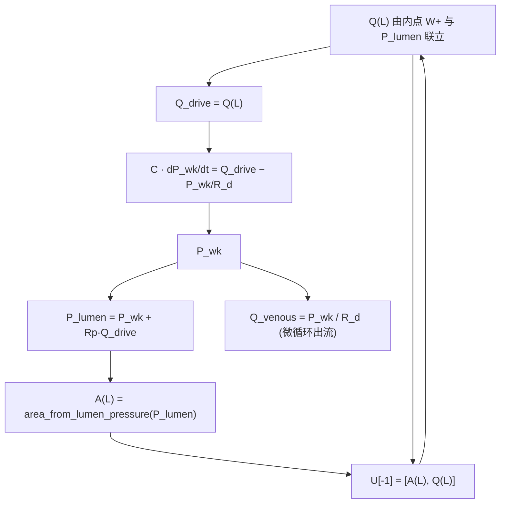
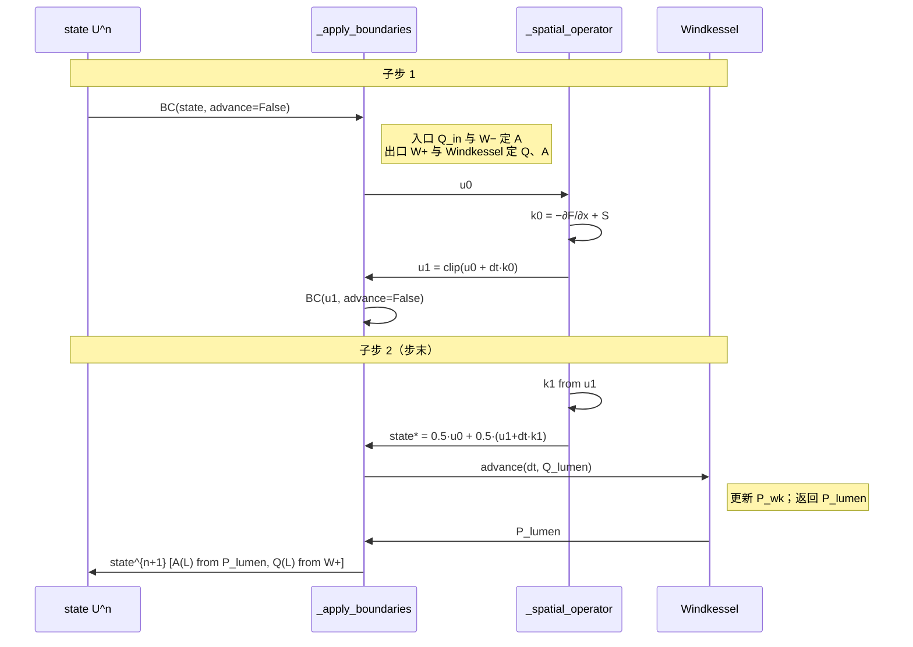
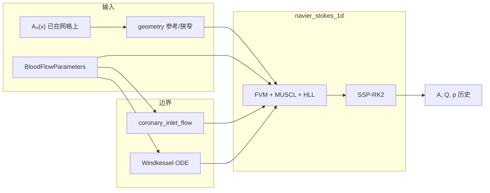

# 一维冠脉血流求解器说明（`SimuCoronary/navier_stokes_1d.py`）

本文档说明 `SimuCoronary/navier_stokes_1d.py` 的物理模型、数值方法、输入输出、API 用法及与 `SimuCoronary/coronary_inlet.py`、`SimuCoronary/coronary_outlet.py` 的衔接方式。

---

## 目录

1. [概述](#1-概述)
2. [环境与依赖](#2-环境与依赖)
3. [物理模型与单位](#3-物理模型与单位)
4. [数值方法](#4-数值方法)
5. [边界条件](#5-边界条件)
6. [快速开始](#6-快速开始)
7. [输入数据：管腔面积剖面](#7-输入数据管腔面积剖面)
8. [参数类 `BloodFlowParameters`](#8-参数类-bloodflowparameters)
9. [求解器 `NavierStokes1D`](#9-求解器-navierstokes1d)
   - [9.4 压力诊断](#94-压力诊断)
   - [9.6 适定性诊断（跨临界 / 壅塞 / 面积钳位）](#96-适定性诊断跨临界--壅塞--面积钳位)
10. [后处理与 FFR](#10-后处理与-ffr)
11. [与离线 Windkessel 对比](#11-与离线-windkessel-对比)
12. [参数调优建议](#12-参数调优建议)
13. [限制与扩展方向](#13-限制与扩展方向)
    - [13.1 用 q_scale 外环标定入口峰值压](#131-用-q_scale-外环标定入口峰值压)
    - [13.2 改为定压（压力驱动）入口](#132-改为定压压力驱动入口)
14. [常见问题](#14-常见问题)
15. [文件关系速查](#15-文件关系速查)

---

## 1. 概述

`SimuCoronary/navier_stokes_1d.py` 实现**单支冠状动脉**在轴向 \(x \in [0, L]\) 上的一维可变形管血流传播。以截面积 \(A(x,t)\) 与体积流量 \(Q(x,t)\) 为求解变量，**管腔标量压** \(p(x,t)\) 由弹性 tube law 从 \(A\) 闭合，入口/出口边界分别由专用模块提供。

| 项目 | 说明 |
|------|------|
| 控制方程 | 1D 守恒型 Navier-Stokes（含 Poiseuille 摩擦源项） |
| 管壁 | \(p = P_{\mathrm{ref}} + \beta(\sqrt{A}-\sqrt{A_0})\) |
| 空间离散 | 有限体积 + MUSCL + MC-TVD 限制器 + HLL |
| 时间离散 | SSP-RK2 |
| 入口 | `coronary_inlet.coronary_inlet_flow`（经 `BloodFlowParameters.inlet_flow`；`coronary_fraction * q_scale`） |
| 出口 | 与 `coronary_outlet` 一致的 Windkessel ODE（在线耦合） |
| 流量标定 | 可选外环 `calibrate_q_scale_to_inlet_peak`：二分 `q_scale`，使入口峰值压落入目标窗（§13.1） |
| 主输入 | 与网格等长的 \(A_0\) + `BloodFlowParameters`（构造时自动检测狭窄） |

> 本模块**不依赖** `demo/navier_stokes.py`；`demo/` 目录下为早期原型，接口与边界实现不同，请勿混用。

---

## 2. 环境与依赖

| 依赖 | 用途 |
|------|------|
| Python 3.10+ | 类型注解、`float \| None` 等语法 |
| `numpy` | 数组与数值计算 |
| `matplotlib` | `plot_results()` 绘图（可选） |
| `SimuCoronary/coronary_inlet.py` | 入口脉动流量 |
| `SimuCoronary/coronary_outlet.py` | Windkessel 参数约定与离线参考压力 |
| `SimuCoronary/geometry.py` | 近/远端参考选取与狭窄检测 |
| `SimuCoronary/coronary_constants.py` | 共享公开全局常量（`P_INLET_REF_MMHG`、`MMHG_TO_DYNE_PER_CM2` 等） |

安装示例：

```bash
pip install numpy matplotlib
```

所有算法模块都位于 **`SimuCoronary/` 包**内，须在**仓库根目录**下执行，`SimuCoronary` 才能被导入。推荐的两种用法：

```python
# 方式一：从包集中导入（常用入口已在 SimuCoronary/__init__.py 导出）
from SimuCoronary import NavierStokes1D, BloodFlowParameters

# 方式二：从子模块精确导入
from SimuCoronary.navier_stokes_1d import NavierStokes1D
```

包内模块之间一律使用**相对导入**（如 `from .geometry import build_stenosis_segment`），因此不能再用 `python SimuCoronary/xxx.py` 直接跑脚本，需改为模块方式（见 §6.1）。

无图形界面时：

```bash
# Windows PowerShell
$env:MPLBACKEND = "Agg"
python -m SimuCoronary.navier_stokes_1d
```

---

## 3. 物理模型与单位

### 3.1 控制方程（当前正确形式）

文献中一维可变形管血流的标准出发点为（Formaggia / Sherwin / Ghigo–Delestre–Lagrée 等）：

\[
\partial_t A + \partial_x Q = 0,
\qquad
\partial_t Q + \partial_x\!\left(\alpha\frac{Q^2}{A}\right)
+ \frac{A}{\rho^*}\partial_x p
= -\frac{8\pi\nu Q}{A}.
\]

写成有限体积所用的通量–源项形式：

\[
\frac{\partial U}{\partial t} + \frac{\partial F}{\partial x} = S,
\quad
U = \begin{bmatrix} A \\ Q \end{bmatrix}
\]

\[
F = \begin{bmatrix} Q \\ \alpha Q^2/A \end{bmatrix},
\quad
S = \begin{bmatrix}
  0 \\[4pt]
  -\dfrac{A}{\rho^*}\partial_x p \;-\; \dfrac{8\pi\nu Q}{A}
\end{bmatrix}
\]

| 符号 | 含义 | 单位 |
|------|------|------|
| \(A\) | 血管截面积 | \(\mathrm{cm}^2\) |
| \(Q\) | 体积流量（沿 \(x\) 正向为出口方向） | \(\mathrm{cm}^3/\mathrm{s}\) |
| \(\rho\) | 血液真实密度（`BloodFlowParameters.rho`） | \(\mathrm{g/cm}^3\)（默认 1.06） |
| \(\rho^*\) | 与 mmHg 制管腔压配对的**动量有效密度**（见下） | \(\mathrm{mmHg}\cdot\mathrm{s}^2/\mathrm{cm}^2\)（**不是** \(\mathrm{g/cm}^3\)） |
| \(\alpha\) | 动量修正系数（层流常取 1.1） | — |
| \(\nu\) | 运动粘度（= 动力粘度/\(\rho\)） | \(\mathrm{cm}^2/\mathrm{s}\) |
| \(p\) | 管腔压（tube law） | \(\mathrm{mmHg}\) |
| 压力驱动 | **源项** \(-(A/\rho^*)\partial_x p\) | 使 \(\partial_t Q\) 为 \(\mathrm{cm}^3/\mathrm{s}^2\) |
| 摩擦项 | Poiseuille 型 \(-8\pi\nu Q/A\) | 同上 |

#### \(\rho^*\) 的定义与单位（对应上式中的 \((A/\rho^*)\partial_x p\)）

CGS 文献标准式使用真实密度 \(\rho\) 与压强单位 \(\mathrm{dyne/cm}^2\)：

\[
\partial_t Q+\partial_x\!\left(\alpha\frac{Q^2}{A}\right)+\frac{A}{\rho}\partial_x p_{\mathrm{dyne}}
=-\frac{8\pi\nu Q}{A}.
\]

本仓库 tube law 输出 \(p\) 为 **mmHg**。换算

\[
1\,\mathrm{mmHg}=1333.2\,\mathrm{dyne/cm}^2
=\texttt{MMHG\_TO\_DYNE\_PER\_CM2}
\quad(10\times 133.32),
\]

故 \(\partial_x p_{\mathrm{dyne}}=\texttt{MMHG\_TO\_DYNE\_PER\_CM2}\cdot\partial_x p_{\mathrm{mmHg}}\)。代入后

\[
\frac{A}{\rho}\partial_x p_{\mathrm{dyne}}
=\frac{A}{\rho^*}\partial_x p_{\mathrm{mmHg}},
\qquad
\boxed{\;\rho^*=\dfrac{\rho}{\texttt{MMHG\_TO\_DYNE\_PER\_CM2}}
=\dfrac{\rho}{1333.2}\;}
\]

（代码：`momentum_rho()` → `rho_for_mmhg_pressure_coupling`）。默认 \(\rho=1.06\) 时 \(\rho^*\approx 7.951\times 10^{-4}\,\mathrm{mmHg}\cdot\mathrm{s}^2/\mathrm{cm}^2\)。

**量纲核对**（混合单位下 \(\rho^*\) 不再是 \(\mathrm{g/cm}^3\)）：

| 量 | 单位 |
|----|------|
| \(\rho\) | \(\mathrm{g/cm}^3\) |
| \(\texttt{MMHG\_TO\_DYNE}\) | \(\mathrm{dyne}/(\mathrm{cm}^2\cdot\mathrm{mmHg})=\mathrm{g}/(\mathrm{cm}\cdot\mathrm{s}^2\cdot\mathrm{mmHg})\) |
| \(\rho^*=\rho/\texttt{MMHG\_TO\_DYNE}\) | \(\mathrm{mmHg}\cdot\mathrm{s}^2/\mathrm{cm}^2\) |
| \((A/\rho^*)\partial_x p\) | \(\mathrm{cm}^2\big/(\mathrm{mmHg}\cdot\mathrm{s}^2/\mathrm{cm}^2)\cdot(\mathrm{mmHg/cm})=\mathrm{cm}^3/\mathrm{s}^2\) |

与 \(\partial_t Q\) 的单位一致。波速 \(c=\sqrt{\beta\sqrt{A}/(2\rho^*)}\) 用同一 \(\rho^*\)，使 \(c\) 为 \(\mathrm{cm/s}\)。**摩擦项不使用 \(\rho^*\)**（已用运动粘度 \(\nu\) 归一化）。

实现上：HLL/物理通量只处理对流部分 \(F\)；\(\partial_x p\) 在单元中心用中心差分（端点用单侧差分）离散。当 \(A\equiv A_0\) 时 \(p\equiv P_{\mathrm{ref}}\)，故 \(\partial_x p=0\)，静止平衡无虚假轴向力。

侧支开口处连续方程另含质量汇 \(-Q_b/\Delta x\)（见边界条件节）。

#### 3.1.1 既往通量错误（已修正）

**错误写法**（旧版代码与旧文档）：把管腔压放进动量通量，且**不**补几何等价源项：

\[
F_1^{\mathrm{(wrong)}} = \alpha\frac{Q^2}{A} + \frac{p\,A}{\rho^*},
\qquad
S_Q^{\mathrm{(wrong)}} = -\frac{8\pi\mu Q}{A}.
\]

由乘积法则：

\[
\frac{A}{\rho^*}\partial_x p
= \partial_x\!\left(\frac{p A}{\rho^*}\right)
- \frac{p}{\rho^*}\partial_x A.
\]

因此若通量含 \(pA/\rho^*\)，右端必须同时含 \((p/\rho^*)\partial_x A\)，才与标准式 \((A/\rho^*)\partial_x p\) 等价。旧实现缺少该项，在 \(A_0(x)\) 变化（狭窄、锥度）处会引入虚假压力梯度，表现为狭窄附近非物理压力巨跳、近端面积塌缩，进而出现入口压低于出口压等不合理结果。

文献对照（守恒型 + geometrical source / well-balanced）：

- Ghigo et al., *J. Comput. Phys.* 2016, https://doi.org/10.1016/j.jcp.2016.11.032
- Delestre & Lagrée, *Int. J. Numer. Meth. Fluids* 2013（well-balanced blood flow）
- Formaggia, Lamponi, Quarteroni, *J. Eng. Math.* 2003

本仓库采用更直接的 **压力梯度源项形式**（§3.1），而不采用「\(pA/\rho^*\) 进通量再补 \((p/\rho^*)\partial_x A\)」的等价改写。

### 3.2 管壁弹性律（Tube Law）

\[
p(A, x) = P_{\mathrm{ref}} + \beta(x)\,\bigl(\sqrt{A} - \sqrt{A_0(x)}\bigr)
\]

- \(A_0(x)\)：用户给定的**参考管腔面积**（无应力或影像分割得到的基线面积）
- \(\beta(x)\)：管壁刚度（mmHg / cm）
- \(P_{\mathrm{ref}}\)：参考压力（默认 `coronary_constants.P_INLET_REF_MMHG`）

**压力不单独求解散射方程**，每个时间步由当前 \(A\) 通过上式在网格中心得到 \(p_i\)，并用于动量源项中的 \(\partial_x p\)。

#### 3.2.1 管腔压 \(p\) 的物理含义

\(p\) 是**各向同性的热力学标量压**（mmHg），**不是**轴向或径向的应力矢量分量，也**不应**与「垂直于截面（轴向）」或「管壁法向（径向）」混为一谈——后两者在几何上互相垂直。

| 用途 | 机制 |
|------|------|
| **tube law** | 将标量 \(p\) 与截面积 \(A\) 耦合，描述管腔**径向胀缩**（壁弹性） |
| **动量源项** \(-(A/\rho^*)\partial_x p\) | 沿 \(x\) 的**压力梯度**驱动轴向体积流量 \(Q\) |
| **`pressure[i]`** | 轴向位置 \(x_i\) 处的管腔压取值；`p(x)` 表示沿程分布，非方向性矢量 |

小扰动压力波速（与 §4.3 CFL 及 `_wave_speed` 一致；由 tube law 线性化 \(\partial p/\partial A\) 得到）：

\[
c(A) = \sqrt{\frac{\beta\sqrt{A}}{2\rho^*}},
\qquad
\rho^* = \rho / 1333.22 \;\text{（mmHg 动量耦合有效密度）}
\]

### 3.3 默认单位制（CGS + mmHg 展示）

| 量 | 单位 |
|----|------|
| 轴向位置 \(x\) | cm |
| 截面积 \(A\) | cm² |
| 体积流量 \(Q\) | cm³/s |
| 入口模块输出 | mL/s（**1 mL = 1 cm³**，数值与 cm³/s 一致） |
| 密度 \(\rho\) | g/cm³（默认 1.06） |
| 运动粘度 \(\nu\) | cm²/s（默认 0.033 = 3.5 cP ÷ 1.06 g·cm⁻³） |
| 管壁刚度 \(\beta\) | mmHg/cm（因 \(\beta(\sqrt A-\sqrt{A_0})\) 中 \(\sqrt A\) 单位为 cm） |
| 压力 \(p\)（`pressure`、`history_pressure`） | mmHg；沿 \(x\) 各点的**管腔标量压**，非方向分量 |
| 时间 \(t\) | s |

> **为什么摩擦项用运动粘度而非动力粘度**
>
> 动量方程（动力粘度形式）为
> \(\rho\bigl(\partial_t Q+\partial_x(\alpha Q^2/A)\bigr)+A\,\partial_x p=-8\pi\mu_{\rm dyn}Q/A\)。
> 两边同除以 \(\rho\) 得
> \(\partial_t Q+\partial_x(\alpha Q^2/A)+(A/\rho)\,\partial_x p=-8\pi\nu Q/A\)，
> 其中 \(\nu=\mu_{\rm dyn}/\rho\) 为运动粘度。因本实现已把 \(p\) 用 mmHg 表达并折算进
> \(\rho^*\)，摩擦项**不再含 \(\rho\)**，故 `mu` 必须填 \(\nu\)（cm²/s）。
> 该式与 Poiseuille 解析解 \(\Delta p=8\mu_{\rm dyn}LQ/(\pi R^4)\) 数值上完全一致（比值 1.000000）。

---

## 4. 数值方法

### 4.1 空间：有限体积 + MUSCL + TVD + HLL

1. 在单元中心存储 \(U_j^n\)，界面 \(j+\tfrac{1}{2}\) 的斜率用 **MC（monotonized central）** 限制器给出（`_minmod`，van Leer 型三参数 minmod）。记 \(\Delta_-=U_j-U_{j-1}\)、\(\Delta_+=U_{j+1}-U_j\)、\(\sigma^{\rm CD}=\tfrac{1}{2}(U_{j+1}-U_{j-1})\)，则

   \[
   \sigma_j=\operatorname{minmod}\bigl(\sigma^{\rm CD},\;2\Delta_-,\;2\Delta_+\bigr)
   =\begin{cases}
   \operatorname{sgn}(\Delta_-)\min\bigl(|\sigma^{\rm CD}|,\,2|\Delta_-|,\,2|\Delta_+|\bigr), & \Delta_-,\Delta_+,\sigma^{\rm CD}\ \text{同号}\\[2pt]
   0, & \text{否则}
   \end{cases}
   \]

   这是「**界面增量**」约定：\(\sigma_j\) 不含 \(\Delta x\) 因子，量纲与 \(U\) 相同，界面值直接为 \(U_j\pm\tfrac12\sigma_j\)。与「单位长度斜率」\(\hat\sigma_j=\sigma_j/\Delta x\) 互为 \(\Delta x\) 倍，因 minmod 一阶齐次，两种约定下公式形式不变。\(2\) 倍来自半步增量与全程增量的换算：\(\sigma_j\le 2\Delta_+\) 保证右界面不越过 \(U_{j+1}\)。

   > 说明：早期版本用的是两参数 minmod \(\operatorname{minmod}(\Delta_-,\Delta_+)\)（等价于取单侧差，光滑区耗散偏大）。MC 在光滑区给出更接近中心差的斜率（上界放宽到 \(2\Delta_\pm\)），同时仍满足 TVD，故替换为 MC。二者均二阶、线性场上完全一致，差别在于对非均匀梯度的限制强度。
2. MUSCL 重构：
   - \(U_L = U_j + \tfrac{1}{2}\sigma_j\)
   - \(U_R = U_{j+1} - \tfrac{1}{2}\sigma_{j+1}\)
   - 首尾单元（\(j=0\)、\(j=n_x-1\)）斜率置 0，退化为分段常数重构；边界界面不用重构态，而用 §5.1–5.2 的特征相容条件。
3. 重构后的 \(A\) 不低于 \(0.8\,A_0\)（`MINIMUM_AREA_RATIO`，防止非物理负面积）。
4. 内部界面用 **HLL** 近似黎曼解得到数值通量 \(\hat{F}_{j+1/2}\)；边界界面用物理通量 \(F(U_b)\)。\(U_b\) 由 §5.1–5.2 的特征相容条件给定，因此这条边界通量与出射 Riemann 不变量一致，而不是零梯度外推状态上的通量。

   HLL 波速取界面左右两侧的**真实特征速度**（`_characteristic_speeds`，含动量修正 \(\alpha\)）：

   \[
   s_L=\min\bigl(\lambda_{-,L},\ \lambda_{-,R},\ 0\bigr),\qquad
   s_R=\max\bigl(\lambda_{+,L},\ \lambda_{+,R},\ 0\bigr),
   \qquad \lambda_\pm=\alpha u\pm\sqrt{c^2+\alpha(\alpha-1)u^2}
   \]

   同侧取"两侧各算一个、再分别取 min/max"是为了保证 \(s_L\le\) 真实最小特征速度、\(s_R\ge\) 真实最大特征速度，这是 HLL 正性守恒的前提。

   > 说明：早期版本用 \(\lambda_\pm=u\pm c\)（漏 \(\alpha\)），会使 \(s_R\) 低于真实 \(\lambda_+^{\max}\) 约 2–3%，削弱正性保证。同时须注意 \(s_R\) 应取 **\(\lambda_{+,L}\) 与 \(\lambda_{+,R}\)** 的最大值（而非 \(\lambda_{-,R}\)），否则在左右流速差大时（如狭窄后射流）会漏掉左侧更大的波速。

### 4.2 时间：SSP-RK2

在空间离散中，通过有限体积法，获得每一个单元 \(i\) 的离散守恒式方程形式：

\[
\frac{\mathrm{d}\bar{U}_i}{\mathrm{d}t}
+ \frac{1}{\Delta x}\bigl(F_{i+\frac{1}{2}} - F_{i-\frac{1}{2}}\bigr)
= S
\]

即

\[
\frac{\mathrm{d}\bar{U}_i}{\mathrm{d}t}
= -\frac{1}{\Delta x}\bigl(F_{i+\frac{1}{2}} - F_{i-\frac{1}{2}}\bigr) + S
\]

将右侧视为关于 \(U,\,t\) 的函数

\[
\mathcal{L}(t, U)
= -\frac{1}{\Delta x}\bigl(F_{i+\frac{1}{2}} - F_{i-\frac{1}{2}}\bigr) + S
\]

Runge–Kutta 2 阶（SSP-RK2 / Heun）形式如下：

\[
\begin{cases}
\bar{U}_i^{n+1}
= \bar{U}_i^{n}
+ \Delta t\bigl(\tfrac{1}{2}k_1 + \tfrac{1}{2}k_2\bigr) \\[0.4em]
k_1 = \mathcal{L}\bigl(t^{n},\; \bar{U}_i^{n}\bigr) \\[0.4em]
k_2 = \mathcal{L}\bigl(t^{n+1},\; \bar{U}_i^{n} + \Delta t\,k_1\bigr)
\end{cases}
\]

提供 \(t=0\) 时的初值 \(\bar{U}_i^{0}\) 进行迭代求解。

实现上与上式等价的写法（见 `_ssp_rk2_step`）为：

\[
\begin{aligned}
U^{(1)} &= \mathrm{BC}\bigl(U^{n} + \Delta t\,\mathcal{L}(U^{n})\bigr) \\
U^{n+1} &= \mathrm{BC}\left(
\tfrac{1}{2}U^{n} + \tfrac{1}{2}\bigl(U^{(1)} + \Delta t\,\mathcal{L}(U^{(1)})\bigr),\
\text{advance outlet}\right)
\end{aligned}
\]

- \(\mathcal{L}(U) = -\partial_x \hat{F} + S\)（自治情形可略去显式 \(t\) 依赖）
- **边界条件**在每个子步施加；Windkessel 状态仅在**完整步末**推进（`advance_outlet=True`）。

### 4.3 CFL 条件

时间步长由 **CFL（Courant–Friedrichs–Lewy）条件**自适应选取，保证显式双曲部分（对流 + 弹性波）在数值上稳定。实现见 `NavierStokes1D._stable_timestep` 与 `_wave_speed`。

\[
\Delta t = \min\left(
  \mathrm{CFL}\cdot\frac{\Delta x}{\lambda_{\max}},\;
  \Delta t_{\max}
\right),
\qquad
\lambda_{\max} = \max_{x}\bigl(\,|u(x)| + c(x)\,\bigr)
\]

#### 公式中各符号

| 符号 | 含义 | 单位 | 代码/来源 |
|------|------|------|-----------|
| \(\Delta x\) | 轴向网格间距 \(L/(n_x-1)\) | cm | `solver.dx` |
| \(u(x)\) | **轴向流体速度**，\(u = Q/A\) | cm/s | `state[1] / state[0]` |
| \(c(x)\) | **小扰动弹性波速**（管壁顺应性引起的压力–面积波沿 \(x\) 传播的速度） | cm/s | `_wave_speed` |
| \(\lambda_{\max}\) | 全网格上特征速度上界 \(\|u\|+c\) 的最大值 | cm/s | `np.max(np.abs(u) + c)` |
| \(\mathrm{CFL}\) | 稳定性安全系数，\(0<\mathrm{CFL}\lesssim 1\) | — | `BloodFlowParameters.cfl`（默认 0.8） |
| \(\Delta t_{\max}\) | 时间步**硬上限**（避免单步过大、便于与 Windkessel 耦合） | s | `BloodFlowParameters.dt_max_s`（默认 \(4\times10^{-4}\)） |

#### \(u\)：对流速度

\[
u = \frac{Q}{A}
\]

- \(Q\)：该网格点的体积流量（cm³/s）
- \(A\)：该网格点的管腔截面积（cm²）
- \(u\) 描述**血液沿血管轴向 \(x\) 方向的输运**；\(|u|\) 越大，信息沿 \(x\) 传播越快，所需 \(\Delta t\) 越小

#### \(c\)：弹性波速

由 tube law 线性化得到的小扰动波速（与 HLL 求解器中 `_wave_speed` 一致）：

\[
c(A) = \sqrt{\frac{\beta\sqrt{A}}{2\rho^*}},
\qquad
\rho^* = \frac{\rho}{\texttt{MMHG\_TO\_DYNE\_PER\_CM2}} = \frac{\rho}{1333.2}
\]

（\(\rho^*\) 定义与单位见 §3.1；默认约 \(7.951\times 10^{-4}\,\mathrm{mmHg}\cdot\mathrm{s}^2/\mathrm{cm}^2\)。）

| 量 | 说明 |
|----|------|
| \(\beta(x)\) | 管壁刚度（mmHg/cm；因 \(\beta(\sqrt{A}-\sqrt{A_0})\) 中 \(\sqrt{A}\) 为 cm）；\(\beta\) 越大 → 管壁越硬 → \(c\) 越大 |
| \(A\) | 当前截面积（cm²） |
| \(\rho\) | 血液密度（g/cm³，默认 1.06） |
| \(\rho^*\) | 与 mmHg 制管腔压配对的动量有效密度（`momentum_rho()`）；**单位不是** g/cm³ |

物理上，\(c\) 刻画**压力扰动沿管轴传播**的快慢：顺应性越小（\(\beta\) 越大）或管腔越大，波速越高，CFL 对 \(\Delta t\) 的限制越严。

#### 为何取 \(\max|\lambda_\pm|\)

一维可变形管方程在双曲意义下有两族特征线。含动量修正 \(\alpha\) 时，雅可比矩阵的特征值为

\[
\lambda_\pm=\alpha u\pm\sqrt{c^2+\alpha(\alpha-1)u^2}
\]

CFL 条件要求在一个时间步内，对流与弹性波**不应跨越超过约一个网格单元**：

\[
\Delta t \le \frac{\mathrm{CFL}\,\Delta x}{\max_x \max(|\lambda_+|,\,|\lambda_-|)}
\]

`_stable_timestep` 取全网格 \(\max_x\bigl(|\alpha u|+\sqrt{c^2+\alpha(\alpha-1)u^2}\bigr)\) 作为最严格（最小 \(\Delta t\)）的约束。

> 说明：该表达式与 \(\max(|\lambda_+|,|\lambda_-|)\) **恒等**——因 \(\sqrt{c^2+\alpha(\alpha-1)u^2}>0\)，无论 \(\alpha u\) 正负，绝对值较大的那个特征值总等于 \(|\alpha u|+\sqrt{\cdot}\)。早期版本用 \(|u|+c\)（漏了 \(\alpha\)），会使 \(\Delta t\) 偏大约 2–3%，已修正。
>
> 再乘以 \(\mathrm{CFL}<1\) 留出数值安全裕度（MUSCL–HLL + SSP-RK2 仍建议 \(\mathrm{CFL}\approx 0.35\)–\(0.5\)）。当 \(\alpha=1.1\)、\(c\sim500\)–\(700\)、\(u\sim100\)–\(200\) cm/s 时，\(\alpha\) 修正约 2–3%。

#### 默认参数与调参

| 参数 | 默认值 | 说明 |
|------|--------|------|
| `cfl` | 0.8 | 减小可抑制振荡、提高稳定性，但步数增多 |
| `dt_max_s` | \(4\times10^{-4}\) s | 即使 \(\lambda_{\max}\) 很小也不超过此步长 |

**典型量级**（冠脉尺度）：\(u \sim 10\)–\(50\) cm/s，\(c \sim 10\)–\(30\) cm/s，\(\Delta x \sim 0.05\)–\(0.2\) cm → \(\Delta t\) 常为 \(10^{-4}\)–\(10^{-3}\) s 量级，常由 `dt_max_s` 截断。

**退化情况**：若 \(\lambda_{\max} < 10^{-14}\)（近乎静止），代码回退 \(\Delta t = 10^{-4}\) s，避免除零。

---

## 5. 边界条件

### 5.1 入口（\(x=0\)）

由 `coronary_inlet.coronary_inlet_flow` 提供 \(Q_{\mathrm{in}}(t)\)。亚临界时入口只有一条入射特征（\(\lambda_+\)），出射特征 \(\lambda_-\) 必须来自域内。

tube law \(p=P_{\mathrm{ref}}+\beta(\sqrt A-\sqrt{A_0})\) 下

\[
c=\sqrt{\frac{\beta\sqrt A}{2\rho^*}},\qquad
\int\frac{c}{A}\,\mathrm{d}A=4c,
\]

故 Riemann 不变量是 \(W_\pm=u\pm 4c\)，**不是**浅水方程的 \(u\pm 2c\)。该 \(4c\) 对应 \(\alpha=1\) 的标准形式（Sherwin 等 2003；Formaggia 等 2003）。通量里仍保留 \(\alpha=1.1\)，边界相容不改用含 \(\alpha\) 的复杂不变量。

相邻内点（下标 1）外推 \(W_-=u_1-4c_1\)，再与给定流量联立：

\[
\frac{Q_{\mathrm{in}}}{A(0)}-4c\bigl(A(0)\bigr)=W_-.
\]

\(Q_{\mathrm{in}}>0\) 时左端对 \(A\) 严格递减，正根唯一（`area_from_flow_and_w_minus`，二分）。然后

```text
U[1, 0] = Q_in(t)          # 入射信息：定流量
U[0, 0] = A(Q_in, W-)      # 出射信息：特征相容，不再用 A0=A1
```

> **为何去掉零梯度**：`A(0)=A(1)` 一般不满足 \(W_-\)。边界界面又取物理通量 \(F(U_0)\)，边界状态与出射特征不一致时，这条通量就不是入口条件的相容通量。

若入口内侧 \(\lambda_-\ge 0\)（没有离开域的特征，典型情形是入口附近已壅塞），无法外推 \(W_-\)，退回 \(A(0)=A(1)\)，仍规定 \(Q(0)=Q_{\mathrm{in}}\)。

入口参数通过 `BloodFlowParameters` 传入（心率、心输出量、冠脉分流比例、傅里叶系数等）。波形细节见 [`coronary_inlet_说明.md`](coronary_inlet_说明.md)。

平均冠脉流量：

\[
Q_{\mathrm{mean}} = \frac{\mathrm{CO}\times 1000 \times f_{\mathrm{cor}}}{60}
\quad\text{(mL/s)}
\]

### 5.2 出口（\(x=L\)）— Windkessel 耦合

与 `SimuCoronary/coronary_outlet.py` 文档中的微循环模型一致，求解器内维护状态 \(P_{\mathrm{wk}}\)。出口模型**固定为三元 RCR**：

\[
C\,\frac{\mathrm{d}P_{\mathrm{wk}}}{\mathrm{d}t}
= Q_{\mathrm{drive}} - \frac{P_{\mathrm{wk}}}{R_d},
\quad
P_{\mathrm{lumen}} = P_{\mathrm{wk}} + R_p\, Q_{\mathrm{drive}}
\]

其中：

\[
Q_{\mathrm{drive}} = Q(L)
\]

> **为何移除二元 RC（`2wk`）分支**：`BloodFlowParameters.outlet_windkessel` 字段与
> `OutletWindkesselState.is_three_element` 全部分支已删除。原因有两点：
>
> 1. **二元只是三元的退化情形**：令 \(R_p = 0\) 即得
>    \(P_{\mathrm{lumen}} = P_{\mathrm{wk}}\)，与二元 RC 完全等价，无需独立代码路径。
> 2. **保留双分支使 0D–1D 耦合反解出现两套串联阻力语义**：由管腔压反解流量时
>    3wk 用 \(R_p\)、2wk 用 \(R_d\)（见 §5.2.1），两套标定在切换模型时会静默改变
>    侧支分流标度，属于易错点。
>
> 现行做法：唯一出口模型为 RCR；需要二元行为时显式传
> `outlet_r_proximal_mmhg_s_per_ml=0.0`（构造时 \(R_p\) 会被钉到 \(10^{-9}\) 下限，
> 反解流量会极大，因此**不建议**在压力驱动侧支上把 \(R_p\) 设为 0）。

即 Windkessel ODE 由**特征相容后的出口流量** \(Q(L)\) 驱动，实现 0D–1D 质量闭合。这个 \(Q(L)\) 用到了从上游传到出口内侧的出射不变量，不是微循环出流 \(P_{\mathrm{wk}}/R_d\)。

\[
Q_{\mathrm{venous}} = \frac{P_{\mathrm{wk}}}{R_d}
\]

仅在 \(dP_{\mathrm{wk}}/dt=0\) 时才有 \(Q(L) \approx Q_{\mathrm{venous}}\)；脉动过程中二者可分离。

出口边界施加（`_apply_boundaries`）。亚临界时出口的入射特征是 \(\lambda_-\)（由压力规定），出射特征是 \(\lambda_+\)（由相邻内点的 \(W_+=u+4c\) 外推）：

```text
W+     ← 内点 nx-2 的 u + 4c
Q(L)   ← 与 P_lumen = P_wk + R_p·Q 及 Q = A(W+ − 4c(A)) 联立的解
         （不是 P_wk/R_d，也不是把 PDE 演化值原样留下）
A(L)   ← tube law 反解，使 p(A(L)) = P_lumen
P_wk   ← 步末 advance：C·dP_wk/dt = Q(L) − P_wk/R_d
```

联立用标量牛顿（`_outlet_flow_from_w_plus`）。推进步里预测的 \(P_{\mathrm{wk}}\) 与 `OutletWindkesselState.advance` 的显式欧拉相同，避免「积分 Windkessel 用的流量」和「写回边界的流量」各算一套。牛顿不收敛，或出口内侧 \(\lambda_+\le 0\)（没有离开域的 \(+\) 特征）时，退回旧做法：保留 PDE 的 \(Q(L)\)，只按压力改 \(A(L)\)。

> **为何同时改 \(Q(L)\)**：只覆盖 \(A(L)\)、让 \(Q(L)\) 跟着 PDE 走，等于没有把出射不变量送进边界状态。\(F(U_L)\) 的质量分量就是这个 \(Q(L)\)。特征形式下它必须等于 \(A(W_+-4c)\)。

**物理回路**：

```text
入口 Q_in + W− ──► 1D 管腔 PDE ──► 出口内侧 W+ ──► 与 RCR 联立得 Q(L)
                                                      ├──► Windkessel：Q_venous = P_wk/R_d ──► 静脉
                                                      └──► P_lumen ──► A(L) via tube law
```

默认 \(R_d = P_{\mathrm{ref}} / Q_{\mathrm{mean}}\)，\(R_p = 0.10\, R_d\)（`DEFAULT_PROXIMAL_FRACTION`，与 `coronary_outlet` 默认标定一致）。详见 [`coronary_outlet.md`](coronary_outlet.md)。

### 5.2.1 侧支 Windkessel（压力驱动分流）

每个侧支开口接独立的 0D Windkessel（`branch_outlets[k]`），与主支出口同构；Murray 份额 \(f_i\) **只用于**按 \(1/f_i\) 放大 \(R_d,R_p\)、按 \(f_i\) 缩小 \(C\)，使并联终端标定与总冠脉阻力一致。

**耦合方式（与出口相反）**：

| | 主支远端出口 | 侧支开口 |
|---|---|---|
| 1D 提供 | 出口内侧的出射不变量 \(W_+\) | \(P_{\mathrm{ostium}}=p(A_j)\)（tube law） |
| 0D 反解 | \(P_{\mathrm{lumen}}\) 与 \(Q(L)=A(W_+-4c)\) 联立，再定 \(A(L)\) | \(Q_b\) → 质量汇 \(-Q_b/\Delta x\) |
| 不强制 | \(Q(L)=P_{\mathrm{wk}}/R_d\) | 开口 \(A_j\)（由主支方程自由演化） |

分流量：

\[
Q_b = \frac{P_{\mathrm{ostium}} - P_{\mathrm{wk}}}{R_p},
\qquad R_{\mathrm{coup}} = R_p
\]

> 侧支反解阻力的“3wk 用 \(R_p\) / 2wk 用 \(R_d\)”分支已随二元模型一并移除：
> 现在 \(R_{\mathrm{coup}} \equiv R_p\)（构造时已对 \(R_p,R_d\) 做 \(\ge 10^{-9}\) 下限）。
> 这样侧支分流标度与出口管腔压定义 \(P_{\mathrm{lumen}} = P_{\mathrm{wk}} + R_p Q\)
> 严格自洽。

ODE 仍为 \(C\,\mathrm{d}P_{\mathrm{wk}}/\mathrm{d}t = Q_b - P_{\mathrm{wk}}/R_d\)。因此当狭窄抬高近端开口压时，\(Q_b\) 自动增大——即“狭窄越重、近端侧支分得越多”。

RK 节拍与出口相同：子步 `apply_substep_from_pressure`（冻结 \(P_{\mathrm{wk}}\)），完整步末 `advance_from_pressure`。

### 5.3 物理下限

面积下限统一由常量 `MINIMUM_AREA_RATIO = 0.8`（`SimuCoronary/coronary_constants.py`）控制，在**三处**同时生效：

| 位置 | 函数 | 行为 |
|------|------|------|
| MUSCL 重构 | `_muscl_states` | 左右重构态 \(A_L,A_R \ge 0.8\,A_0\) |
| 状态钳位 | `_clip_state` | 每步末 \(A \ge 0.8\,A_0\) |
| tube law 正/反解 | `lumen_pressure_mmhg` / `area_from_lumen_pressure_mmhg` | 内部先钳位再加压 |

> **注意**：该下限是**数值保护**，不是物理约束。一旦求解过程中 \(A\) 大范围触及 \(0.8\,A_0\)，tube law 已被非线性削平，压力场不再可信。请用
> `solver.wellposedness_diagnostics()` 的 `n_clamp` / `clamp_fraction` 检查（见 §9.6）。

### 5.4 边界变量 vs 内部自由度（示意图）

有限体积离散在单元中心存储 \(U_j=[A_j,Q_j]^\mathsf{T}\)。边界条件**不直接修改通量公式**，而是在每个 RK 子步先把边界节点设成特征相容状态 \(U_b\)（§5.1–5.2），再由 `_spatial_operator` 用 \(F(U_b)\) 作为 `f_face[0]`、`f_face[-1]`。

#### 5.4.1 沿程：prescribed / free / derived

```mermaid
flowchart LR
    subgraph IN["入口 x = 0"]
        direction TB
        IN_Q["Q₀ = Q_in(t)  ✓ prescribed"]
        IN_A["A₀ 由 W−=u−4c 反解  ✓ compatibility"]
        IN_P["p₀ = tube_law(A₀)  derived"]
    end

    subgraph INT["内部 j = 1 … nx−2"]
        direction TB
        INT_A["A_j  ✓ free"]
        INT_Q["Q_j  ✓ free"]
        INT_P["p_j = tube_law(A_j)  derived"]
    end

    subgraph OUT["出口 x = L"]
        direction TB
        WK["P_wk  ✓ ODE state"]
        OUT_P["P_lumen = f(P_wk, Q_drive)  ✓ prescribed"]
        OUT_Q["Q(L) 由 W+=u+4c 反解  ✓ compatibility"]
        OUT_QV["P_wk/R_d 仅入 ODE，不向外返回"]
        OUT_A["A(L) = inv_tube_law(P_lumen)  derived"]
    end

    IN -->|"HLL 通量传播"| INT
    INT -->|"HLL 通量传播"| OUT
```



**图例**

| 标记 | 含义 |
|------|------|
| prescribed（图中红色节点） | 边界**直接强制**的变量 |
| free（图中绿色节点） | **内部自由度**，由 PDE 时间推进 |
| derived（图中紫色节点） | **派生量**：每步由 tube law 从 \(A\) 得到标量 \(p\)，不单独求解 |
| extrapolated / ODE state（图中黄色节点） | 出射不变量 \(W_\pm\) 由内点外推，或 Windkessel 状态 \(P_{\mathrm{wk}}\) |

#### 5.4.2 1D 管段上的变量角色

```text
  入口 x=0              内部单元 j=1…nx−2              出口 x=L
  ─────────            ─────────────────────           ─────────
       │                        │                          │
  Q ───●─── prescribed          ○─── free                   ○─── from W+
       │    Q_in(t)             │   evolve by              │   Q=A(W+−4c)
       │                        │   −∂F/∂x+S               │   不强制 P_wk/R_d
  A ───○─── from W−             ○─── free                   ○─── derived
       │    Q/A−4c=W−           │                          │   A(L) from P_lumen
       │                        │                          │
  p ───◇─── derived             ◇─── derived                ◇─── drives A(L)
       │    tube law            │   tube law               │   via inv tube law
       │                        │                          │
       │                        │                    P_wk ──●── ODE state
       │                        │                    Q_venous= P_wk/R_d (0D 出流)
       │                        │                          │   C·dP_wk/dt =
       │                        │                          │   Q_drive−Q_venous
       ▼                        ▼                          ▼
   F(U₀) 边界通量          F̂_{j+1/2} HLL 内通量         F(U_{n−1}) 边界通量
```

符号：`●` prescribed，`○` free，`◇` derived。

#### 5.4.3 守恒变量 **U = [A, Q]** 的约束一览

| 位置 | \(A\) | \(Q\) | \(p\) | 决定方式 |
|------|-------|-------|-------|----------|
| **入口** \(j=0\) | **由 \(W_-\) 反解** | **\(Q_{\mathrm{in}}(t)\)** | tube law | `_apply_boundaries` |
| **内部** \(j=1…n{-}2\) | **自由** | **自由** | tube law | SSP-RK2 + HLL + 源项 |
| **出口** \(j=n{-}1\) | **反解** \(A(L)\)（配 \(P_{\mathrm{lumen}}\)） | **由 \(W_+\) 反解** | **\(P_{\mathrm{lumen}}\)** | Windkessel + 特征相容 |

**内部自由度总数**：\(2(n_x - 2)\)（每个内部点的 \(A_j,\,Q_j\) 各 1 个）。入口规定 \(Q\)，\(A(0)\) 由出射 \(W_-\) 闭合；出口经 Windkessel 规定 \(P_{\mathrm{lumen}}\)（从而 \(A(L)\)），\(Q(L)\) 由出射 \(W_+\) 闭合。**不**把 \(Q(L)\) 写成 \(P_{\mathrm{wk}}/R_d\)。

#### 5.4.4 出口 Windkessel 与管腔的耦合



\(Q(L)\) 由相邻内点的出射不变量 \(W_+=u+4c\) 与 Windkessel 管腔压联立得到，再作为 \(Q_{\mathrm{drive}}\) 推进 \(P_{\mathrm{wk}}\)；\(P_{\mathrm{lumen}}\) 经 tube law 闭合 \(A(L)\)。沿程 PDE 把入口 \(Q_{\mathrm{in}}(t)\) 传到出口内侧，从而进入 \(W_+\)。**勿将 \(Q_{\mathrm{venous}}=P_{\mathrm{wk}}/R_d\) 写入 \(Q(L)\)**，否则破坏 0D–1D 质量闭合。

#### 5.4.5 一个 SSP-RK2 步内边界何时介入

与 §4.2 一致：Windkessel 状态 \(P_{\mathrm{wk}}\) **仅在完整步末**（`advance_outlet=True`）积分；RK 中间子步只 `apply_substep`，\(P_{\mathrm{wk}}\) 冻结。



#### 5.4.6 快速记忆

```text
        prescribed          free            compatibility + derived
           │                  │                         │
    Q_in ──┤                  │               Q(L)=A(W+−4c)
           │                  │                         │
           │            A_j, Q_j  evolve                 │
           │                  │                         │
    A←W− ──┤                  │         P_lumen ──→ A(L)
           │                  │              P_wk/R_d = Q_venous (0D only)
           └────── 双曲 PDE + 源项 传播 ───────────────┘
                         tube law → p_j  everywhere
```

**一句话**：入口为**定流量** \(Q_{\mathrm{in}}(t)\)，面积由出射不变量 \(W_-=u-4c\) 闭合；出口为 **Windkessel 定压**（经 tube law 转为 \(A(L)\)），流量由出射不变量 \(W_+=u+4c\) 闭合。微循环侧出流 \(Q_{\mathrm{venous}}=P_{\mathrm{wk}}/R_d\) 只出现在 0D ODE 里，不写进 \(Q(L)\)。这不是无反射边界：Windkessel 压力仍然反射，只是入射/出射特征不再混用。

### 5.5 初值与构造时初始化

`NavierStokes1D(...)` 构造时一次性完成几何处理、PDE 初值与出口 Windkessel 重置（**已无** `set_lumen_area_profile`）：

| 量 | 初值 | 依据 |
|----|------|------|
| \(A(x,0)\) | \(A_0(x)\)（经近/远端参考段平整后） | tube law → \(p \approx P_{\mathrm{ref}}\) |
| \(Q(x,0)\) | \(Q_{\mathrm{in}}(0)\) | 与入口定流量 BC 一致（**非** \(Q_{\mathrm{mean}}\)） |
| \(P_{\mathrm{wk}}(0)\) | \(Q_{\mathrm{mean}}\, R_d\) | Windkessel 稳态标定 |
| \(P_{\mathrm{lumen}}(0)\) | \(P_{\mathrm{wk}} + R_p\, Q_{\mathrm{in}}(0)\) | `outlet.reset(q_drive=…)` |
| \(P_{\mathrm{ref}}\) | 构造各终端**之前**写为 \(Q_{\mathrm{mean}}(R_d+R_p)\) | 与出口稳态管腔压对齐；\(R_d,R_p\) 取 `resolve_outlet_resistances()` 的未缩放值 |

**参数标定链**：

```text
CO, coronary_fraction  →  Q_mean
R_d：显式 outlet_r_distal…，或 None 时 R_d = P_ref / Q_mean
outlet_proximal_fraction  →  R_p = fraction · R_d（若未显式给 Rp）
```

默认 `outlet_r_distal_mmhg_s_per_ml=25` 时，稳态管腔压 \(Q_{\mathrm{mean}}(R_d+R_p)\) 一般不等于字段初值 75。`NavierStokes1D` 在创建 `outlet` / `branch_outlets` **之前**必定把 `p_ref_mmhg` 改成该值。终端对象里的阻力已按 Murray 份额放大（\(R/f\)），用它反推参考压会把份额混进 \(P_{\mathrm{ref}}\)；未缩放的 \(R_d\)、\(R_p\) 与 \(Q_{\mathrm{mean}}\) 已经决定稳态压（份额放大后 \((Q_{\mathrm{mean}} f)\cdot(R/f)\) 与之相同）。该对齐不可关闭：\(A=A_0\) 时 tube law 与出口压位不一致会使入口压系统性偏离出口。

**`OutletWindkesselState.reset(p_wk=None, q_drive=None)`**

| 参数 | 默认 | 说明 |
|------|------|------|
| `p_wk` | `Q_mean · R_d` | 顺应性节点压 |
| `q_drive` | `Q_in(0)` | \(P_{\mathrm{lumen}}=P_{\mathrm{wk}}+R_p Q_{\mathrm{drive}}\) |

建议 `duration_s` 取 ≥2–3 个心动周期再统计。

---

## 6. 快速开始

### 6.1 运行内置示例

```bash
python -m SimuCoronary.navier_stokes_1d
```

默认入口调用 `example()`：读 `data/stenoses_data`，先用 `calibrate_q_scale_to_inlet_peak` 把入口峰值压收到目标窗，再 `plot_results_1()` 并打印 FFR。也可改 `__main__` 调用 `demo()`（单次 `run`，不标定缩放）。

### 6.2 最小脚本

```python
import numpy as np
from SimuCoronary.navier_stokes_1d import NavierStokes1D, BloodFlowParameters

L, nx = 30.0, 151
x = np.linspace(0.0, L, nx)
# area 长度即节点数 n_x，单位 cm²（已在求解网格上，构造时不再插值）
area = np.pi * (0.40 - 0.08 * x / L) ** 2

par = BloodFlowParameters(
    heart_rate_bpm=75.0,
    coronary_flow_fraction=0.03,
    q_scale=1.0,  # 狭窄有效流量缩放；外环标定见 §13.1
    cfl=0.8,
)

solver = NavierStokes1D(area, L, par)
A_hist, Q_hist, p_hist, t_hist = solver.run(duration_s=2.4, record_interval_steps=25)
print("FFR ≈", solver.ffr_ratio())
solver.plot_results()          # matplotlib
# solver.plot_results_1()      # Plotly 交互图
```

需要入口压落在生理窗时，用外环代替单次 `run`（见 §13.1）：

```python
from SimuCoronary.navier_stokes_1d import calibrate_q_scale_to_inlet_peak

solver, cal = calibrate_q_scale_to_inlet_peak(area, L, par, duration_s=2.4)
print(cal["q_scale"], cal["p_in_peak"], cal["converged"])
print("FFR ≈", solver.ffr_ratio())
```

### 6.3 推荐工作流

```text
准备 A₀ → BloodFlowParameters
  →（可选）calibrate_q_scale_to_inlet_peak  # 入口峰值落入目标窗
  → 或 NavierStokes1D(...).run()
  → 后处理 / plot_results[_1] / ffr_ratio
```

---

## 7. 输入数据：管腔面积剖面

### 7.1 在构造函数中传入 \(A_0\)

参考面积在构造时直接给出（**不再**提供 `set_lumen_area_profile`）：

```python
NavierStokes1D(
    area,                 # A₀，shape (n_x,)，单位 cm²；n_x = len(area)
    vessel_length_cm,     # L (cm)
    parameters=None,
)
```

| 要求 | 说明 |
|------|------|
| `area` | 一维数组，长度 ≥ 3；点 \(i\) 对应 \(x_i=i\cdot L/(n_x-1)\)，其中 \(n_x=\mathrm{len}(area)\) |
| 单位 | cm²（若原始数据为 mm²，需自行换算，如 `/100`） |
| 插值 | **无**：请先在外部插值/平滑到求解网格 |

构造内还会：

1. \(\beta(x)\leftarrow\) 常数 `beta_mmhg_per_cm`（全段一致，狭窄段**不**放大）
2. `geometry.build_stenosis_segment` → MLA + 近/远端参考（写入 `prox_idx`/`dist_idx`/`lesions`；仅诊断/绘图，不改 β）
3. 近端段 \(x\le x_{\mathrm{prox}}\)、远端段 \(x\ge x_{\mathrm{dist}}\) 的 \(A_0\) 分别平整为参考点面积
4. 先把 `p_ref_mmhg` 写成 \(Q_{\mathrm{mean}}(R_d+R_p)\)，再构造并 `reset` 出口与侧支 Windkessel
5. \(A=A_0\)，\(Q=Q_{\mathrm{in}}(0)\)，刷新 `pressure`

### 7.2 由半径构造面积

```python
radius_cm = ...  # 沿程半径，长度即节点数
area = np.pi * radius_cm**2
solver = NavierStokes1D(area, L, par)
```

### 7.3 自动狭窄检测（`SimuCoronary/geometry.py`）

| 步骤 | 函数 / 行为 |
|------|-------------|
| MLA / 近远端参考 | `build_stenosis_segment`：排除首尾各 5 帧取 MLA；再在距 MLA ≤ 10 mm（整段 &lt; 10 mm 则不限）的近/远侧取面积最大帧；间距用求解器 `dx`；结果为一段 `StenosisSegment` |
| \(\beta\) | **不随狭窄放大**，全段取常数 `beta_mmhg_per_cm` |

> 说明：早期版本曾在狭窄 mask 上做 \(\beta \leftarrow \beta\cdot A_{0,\mathrm{prox}}/A_{0,\mathrm{MLA}}\)。
> 因 tube law \(p=P_{\mathrm{ref}}+\beta(\sqrt A-\sqrt{A_0})\) 中 \(\beta\) 被放大数倍后，
> \(A\) 上不足 1% 的数值误差即被放大成上百 mmHg（狭窄段出现负压与压力尖峰），
> 该操作已移除。狭窄的压降应由几何变窄（对流加速与局部损失）承担，而非管壁刚度。

面积狭窄率（相对近端参考）：

\[
\text{stenosis\%} \approx \left(1 - \frac{A_{0,\mathrm{MLA}}}{A_{0,\mathrm{prox}}}\right)\times 100\%
\]

### 7.4 参数数量级参考

| 参数 | 典型量级 |
|------|----------|
| \(A_0\) | 0.05–1.0 cm² |
| \(\beta\) | 3500 mmHg/cm（默认）；可调，但不宜 >10⁴（tube law 误差放大） |
| \(L\) | 10–50 cm |
| \(Q_{\mathrm{mean}}\) | 约 2.5–4 mL/s（由 CO 与冠脉比例决定） |

---

## 8. 参数类 `BloodFlowParameters`

`@dataclass`，构造时可覆盖任意字段。

### 8.1 流体与数值

| 字段 | 默认 | 说明 |
|------|------|------|
| `rho` | 1.06 | 密度 (g/cm³) |
| `alpha` | 1.1 | 动量修正系数 |
| `mu` | 0.033 | 运动粘度 ν (cm²/s) = 3.5 cP ÷ 1.06 g·cm⁻³ |
| `cfl` | 0.8 | CFL 数 |
| `dt_max_s` | 4e-4 | 时间步上限 (s) |

### 8.2 管壁

| 字段 | 默认 | 说明 |
|------|------|------|
| `p_ref_mmhg` | 75.0 | tube law 参考压 (mmHg)，= `P_INLET_REF_MMHG`。`NavierStokes1D` 构造时必定改写为 \(Q_{\mathrm{mean}}(R_d+R_p)\)，且发生在创建 Windkessel 之前 |
| `beta_mmhg_per_cm` | 3500.0 | 管壁刚度 β (mmHg/cm)；因 \(\beta(\sqrt A-\sqrt{A_0})\) 中 \(\sqrt A\) 单位为 cm。**全段常数，不随狭窄放大** |

### 8.3 入口（→ `coronary_inlet_flow`）

| 字段 | 默认 | 说明 |
|------|------|------|
| `heart_rate_bpm` | 75 | 心率 |
| `cardiac_output_l_per_min` | 5.5 | 心输出量 (L/min)。注释中的充血参考为 8 |
| `coronary_flow_fraction` | 0.03 | 冠脉占 CO 比例（生理分流比；狭窄减流不改此字段语义） |
| `q_scale` | 1.0 | 狭窄有效流量缩放；经 `coronary_fraction * q_scale` 传入入口生成器 |
| `inlet_min_flow_fraction` | 0.25 | 傅里叶生成器内相对下限 = 该比例 × \(Q_{\mathrm{mean}}\) |
| `inlet_phase_offset_rad` | 0 | 波形相位偏移 |
| `inlet_fourier_coefficients` | None | 自定义谐波；None 用模块内置默认系数 |

方法：

- `mean_coronary_flow_ml_s()` → \(Q_{\mathrm{mean}}=\mathrm{CO}\cdot f_{\mathrm{cor}}\cdot q_{\mathrm{scale}}\cdot 1000/60\)
- `inlet_flow(t)` → 调用 `coronary_inlet_flow(..., coronary_fraction=f_{\mathrm{cor}}\cdot q_{\mathrm{scale}})`，再截断到 ≥ 0.01 mL/s
- `resolve_outlet_resistances()` → \((R_d, R_p)\)
- `momentum_rho()` → 与 mmHg 压配对的有效密度 \(\rho^*\)

#### `q_scale` 如何进入入口波形

`q_scale` **乘在**传给入口生成器的 `coronary_fraction` 上，使均值、谐波幅度与 `min_flow_fraction` 下限共用同一 \(Q_{\mathrm{mean}}\)：

\[
Q_{\mathrm{mean}}=\mathrm{CO}\cdot f_{\mathrm{cor}}\cdot q_{\mathrm{scale}}\cdot\frac{1000}{60},\qquad
Q_{\mathrm{in}}(t)=\max\bigl(Q_{\mathrm{fourier}}(t;\,Q_{\mathrm{mean}}),\,0.01\bigr).
\]

```text
coronary_flow_fraction  ← 生理分流比（外环不改）
q_scale                 ← 狭窄/标定用的乘法缩放（默认 1）
MINIMUM_INLET_FLOW_ML_S ← 0.01 mL/s，峰谷均不得低于此值
```

外环标定入口峰值压时用 `calibrate_q_scale_to_inlet_peak`（§9.5 / §13.1）。

### 8.4 出口 Windkessel

出口模型固定为三元 RCR（`P_lumen = P_wk + R_p·Q`）。二元 RC 的 `outlet_windkessel`
字段已删除；需要二元行为时令 `outlet_r_proximal_mmhg_s_per_ml = 0`（见 §5.2）。

| 字段 | 默认 | 说明 |
|------|------|------|
| `outlet_r_distal_mmhg_s_per_ml` | 25 | \(R_d\)；`None` 则 \(P_{\mathrm{ref}}/Q_{\mathrm{mean}}/(1+f_p)\)（\(f_p\) = `outlet_proximal_fraction`） |
| `outlet_r_proximal_mmhg_s_per_ml` | None | \(R_p\)；None 则 `proximal_fraction * R_d` |
| `outlet_compliance_ml_per_mmhg` | 0.012 | 顺应性 \(C\) |
| `outlet_proximal_fraction` | 0.2 | 近端阻力比例（`DEFAULT_PROXIMAL_FRACTION`） |

Windkessel ODE 驱动流量固定为出口管腔流量 \(Q(L)\)，无额外配置项。

---

## 9. 求解器 `NavierStokes1D`

### 9.1 构造

```python
NavierStokes1D(
    area: np.ndarray | list,          # A₀，单位 cm²；n_x = len(area)
    vessel_length_cm: float,
    parameters: BloodFlowParameters | None = None,
)
```

| 属性 | 说明 |
|------|------|
| `length`, `nx`, `dx` | 长度、节点数、间距 |
| `x` | 节点坐标 (cm)，shape `(nx,)` |
| `area_ref`, `beta` | 参考几何与刚度，shape `(nx,)` |
| `prox_idx`, `dist_idx` | 近/远端参考下标 |
| `lesions` | `[build_stenosis_segment(...)]`（一段主狭窄） |
| `state` | 守恒变量 `[A, Q]`，shape `(2, nx)` |
| `pressure` | 沿程管腔标量压 \(p(x)\) (mmHg)，shape `(nx,)`；由 tube law 从 \(A\) 派生 |
| `outlet` | `OutletWindkesselState` 实例 |
| `time` | 当前物理时间 (s) |
| `pressure_extrema` | `run()` 结束后写入的入口/出口收缩压–舒张压字典（§9.4）；运行前为 `None` |

### 9.2 `run(duration_s, record_interval_steps=20, verbose=True)`

`verbose=False` 时不打印逐步进度和结束诊断（批量检查用）。默认 `True`，行为与原先相同。

返回四元组：

| 输出 | shape | 说明 |
|------|--------|------|
| `history_area` | `(n_save, nx)` | \(A\) 历史 |
| `history_flow` | `(n_save, nx)` | \(Q\) 历史 |
| `history_pressure` | `(n_save, nx)` | 管腔标量压 \(p\) 历史 (mmHg) |
| `history_time` | `(n_save,)` | 保存时刻 (s) |

同时写入对象属性 `solver.history_*`。保存帧数约为 `1 + floor(n_steps / record_interval_steps)`。

结束时自动调用两个诊断并打印：

- `print_pressure_extrema()` — 末段一个心动周期的入口/出口收缩压/舒张压（§9.4），同时写入 `solver.pressure_extrema`
- `print_wellposedness_diagnostics()` — 以 \(\lambda_\pm\) 判定亚/跨临界；附带临界流量、面积钳位（§9.6）

### 9.3 绘图

| 方法 | 说明 |
|------|------|
| `plot_results()` | matplotlib 2×2：\(A(t,x)\)、沿程平均 \(Q\)、指定点 \(p(t)\)、末时刻 \(A\)/\(p\) |
| `plot_results_1(show=True, renderer=None)` | Plotly 交互版同类四图；`demo()` 默认调用此接口 |

### 9.4 入口/出口收缩压–舒张压（`pressure_extrema`）

`pressure_extrema_mmhg(cycle_s=None, cache=True)` 统计**末段一个心动周期**内入口 \(x=0\) 与出口 \(x=L\) 的管腔压极大/极小值，类比临床收缩压/舒张压。

窗口固定为最后一个心动周期 \([t_{\text{end}}-\texttt{cycle\_s},\ t_{\text{end}}]\)（`cycle_s=None` 取 \(60/\mathrm{HR}\)），不做瞬态截断——末周期应已进入数值稳定期；若周期尚未稳定，应延长 `duration_s` 而不是缩小统计窗口。

辅助打印：`print_pressure_extrema(cycle_s=None)` 输出 SBP/DBP/脉压，返回同一字典。

返回字典（同时缓存到 `solver.pressure_extrema`，`run()` 结束自动写入）：

| 字段 | 含义 |
|------|------|
| `p_in_systolic` / `p_in_diastolic` | 入口收缩压（周期内 \(\max p(0,t)\)）/ 舒张压（\(\min\)） |
| `p_in_mean` | 入口窗口内时间均值 |
| `p_in_pulse` | 入口脉压 \(=\) 收缩 − 舒张 |
| `p_out_systolic` / `p_out_diastolic` / `p_out_mean` / `p_out_pulse` | 出口对应四项 |
| `p_drop_systolic` / `p_drop_diastolic` | 收缩期 / 舒张期进出口压差 |
| `cycle_s` / `n_samples` / `t_start` / `t_end` | 实际窗口长度、参与统计的采样帧数、窗口起止时刻 |

> 早期版本另有 `pressure_diagnostics` / `print_pressure_diagnostics`，按近端/远端**参考点**（`prox_idx`/`dist_idx`）做压力统计并检查沿程倒置。因入口/出口峰谷已直接给出边界压信息，这两个接口已移除。
>
> 采样帧数受 `record_interval_steps` 限制：帧太稀时峰值会被低估。若 `n_samples` 偏小（例如 < 50），应减小 `record_interval_steps` 再跑。

### 9.5 模块级工具函数

| 函数 | 说明 |
|------|------|
| `lumen_pressure_mmhg(A, A0, beta, p_ref)` | tube law：由 \(A\) 算管腔标量压 |
| `area_from_lumen_pressure_mmhg(p, A0, beta, p_ref)` | tube law 反解 \(A\) |
| `integral_mean(y, x)` | 梯形法积分均值 \(\int y\,\mathrm{d}x / \int \mathrm{d}x\)，用于 FFR 的周期均值 |
| `_wave_speed(A, beta, rho*)` | 弹性波速 \(c=\sqrt{\beta\sqrt A/(2\rho^*)}\)（不含 \(\alpha\)）；`A`、`beta` 可为标量或数组。\(A=1\) 时即波速前置因子 \(\gamma=\sqrt{\beta/(2\rho^*)}\)（原独立的 `_c_prefactor` 已并入本函数） |
| `_characteristic_speeds(A, Q, beta, rho*, alpha)` | 特征速度 \(\lambda_\pm=\alpha u\pm\sqrt{c^2+\alpha(\alpha-1)u^2}\)；**唯一实现**，HLL 波速 / CFL / 边界 / 适定性诊断共用。`A`、`beta` 可为标量或数组，标量输入返回 `float` |
| `_riemann_invariants(A, Q, beta, rho*)` | \(W_\pm=u\pm 4c\)（tube law，不是浅水的 \(u\pm 2c\)） |
| `area_from_flow_and_w_minus(Q, W−, ...)` | 入口：由定流量与出射不变量反解 \(A\) |
| `_outlet_flow_from_w_plus(W+, ...)` | 出口：由出射不变量与 RCR 压力联立反解 \(Q\)；失败返回 `None` |
| `run_uniform_tube_mass_check(...)` | 等截面直管、无侧支的质量守恒检查（方向 A） |
| `calibrate_q_scale_to_inlet_peak(...)` | 外环二分标定 `q_scale`；可选 `cache_dir` 落盘每次迭代场数据 |
| `SimuCoronary/calibration_cache.py` | 缓存读写与事后绘图（`load` / `plot` / CLI），与主求解器分离 |
| `_minmod(cd, Δ₋, Δ₊)` | MC（monotonized central）TVD 限制器：`minmod(中心差分, 2Δ₋, 2Δ₊)`；三者同号取绝对值最小并保号，否则 0 |
| `_muscl_states(U, A0)` | 界面左右重构态（含面积下限钳位） |
| `_flux_vector(A, Q, alpha)` | 物理通量 \(F=[Q,\ \alpha Q^2/A]^\mathsf{T}\) |
| `_hll_flux(...)` | HLL 近似黎曼通量 |
| `resample_axial_profile(...)`（`SimuCoronary/geometry.py`） | 沿程面积/侧支重采样到目标 `nx` |
| `roi_process(roi_idx, ...)` | 按 ROI 下标裁剪面积与侧支 |
| `demo()` / `example(...)` | 内置算例；`example` 会先调用 `calibrate_q_scale_to_inlet_peak` 再绘图/算 FFR |

**`NavierStokes1D` 内部方法速查**（便于定位与覆写）：

| 方法 | 职责 |
|------|------|
| `_main_flow_profile(q_in)` | 按 Murray 份额沿程累减侧支分流后的初值流量剖面 |
| `_update_pressure(state=None)` | 由当前 \(A\) 经 tube law 刷新 `self.pressure` |
| `_apply_side_branches(state, advance)` | 侧支：由开口管腔压经 Windkessel 反解 \(Q_b\)（质量汇） |
| `_spatial_operator(state)` | 有限体积右端项 \(-\partial_x\hat F+S\)（对流 + 压力梯度 + 摩擦 + 侧支汇） |
| `_apply_boundaries(state, advance)` | 特征相容的入口/侧支/出口边界；壅塞端退回零梯度或保留 PDE 流量 |
| `mass_balance(cycle_s=0.8)` | 末段质量残差 `<Q(0)>−<Q(L)>−<ΣQ_b>`，以及 `dV/dt` |
| `_clip_state(state, area_ref)` | 面积下限钳位（`MINIMUM_AREA_RATIO`） |
| `_stable_timestep(state)` | CFL 自适应时间步 |
| `_ssp_rk2_step(dt)` | 单步 SSP-RK2 推进 |
| `pressure_extrema_mmhg(cycle_s=None, cache=True)` | 末段一个心动周期的入口/出口压力峰谷（收缩压/舒张压类比），返回字典并缓存到 `self.pressure_extrema`（§9.4） |
| `print_pressure_extrema(cycle_s=None)` | 打印上一条的 SBP/DBP/脉压；返回同一字典 |

`OutletWindkesselState` 内部方法：`reset()`、`lumen_pressure()`、`flow_from_lumen_pressure()`（除以构造时已钉下限的 \(R_p\)）、`apply_substep()` / `advance()`（流量驱动，返回 \(P_{\mathrm{lumen}}\)；微循环项 \(P_{\mathrm{wk}}/R_d\) 仅出现在 ODE 右端）、`apply_substep_from_pressure()` / `advance_from_pressure()`（压力驱动，用于侧支）。\(R_p,R_d\) 在 `__init__` 一次性 `max(..., 1e-9)`。

### 9.6 适定性诊断（跨临界 / 壅塞 / 面积钳位）

一维双曲系统 \(U=[A,Q]^\mathsf{T}\) 的系数矩阵为

\[
\mathcal{A} = \begin{pmatrix}
0 & 1\\[2pt]
c^2-\alpha u^2 & 2\alpha u
\end{pmatrix},
\qquad u=\frac{Q}{A},\quad c=\sqrt{\frac{\beta\sqrt A}{2\rho^*}}
\]

其特征值为

\[
\boxed{\;\lambda_{\pm} = \alpha u \pm \sqrt{c^{2}+\alpha(\alpha-1)u^{2}}\;}
\]

当 \(\alpha=1\) 时退化为熟悉的 \(\lambda_\pm = u\pm c\)。

#### 三种流态

**判据用特征速度 \(\lambda_\pm\)**（公式见上；含默认 \(\alpha=1.1\)）。

| 流态 | 判据 | 特征线方向 | 边界条件个数（入口/出口） |
|------|------|------------|--------------------------|
| **亚临界** | \(\lambda_-<0<\lambda_+\) | 信息双向 | 1 / 1（各一个，适定） |
| **临界** | \(\lambda_-=0\) | 喉部驻点 | 喉部状态，需特别处理 |
| **跨临界 / 壅塞** | \(\lambda_->0\) | 两特征同向 | 入口 2 / 出口 0（**当前 BC 不适定**） |

> **物理含义**：跨临界时该处的两条特征线同向（都指向下游），出口的定压 Windkessel 条件与特征线方向矛盾。数值上会向上游反射虚假波，表现为狭窄段压力剧烈振荡、出现负压。这与喷管的气动壅塞（choking）同源。

#### 判据与辅助量

**主判据：特征线方向**（`wellposedness_diagnostics` 的 `transcritical` / `well_posed` / `n_choked` 均据此）

\[
\lambda_- = \alpha u - \sqrt{c^{2}+\alpha(\alpha-1)u^{2}} > 0
\;\Rightarrow\; \text{该处跨临界，出口 BC 无法正确施加}
\]

**辅助量：临界流量**（工程上好读，不替代 \(\lambda_-\)）

\[
Q_{\text{crit}}(x) = c(A)\,A
\]

比较实际流量峰值与 \(Q_{\text{crit}}\) 可粗估壅塞程度；严格结论仍看 \(\lambda_-\)。

#### 使用方法

```python
solver.run(duration_s=3.0)
# run() 结束时会自动打印（无需手动调用）：
# [WP diag max over last 50%T] lam- max=+184.7, lam+ min=+603.9 | worst λ₋ @ idx=92 (x=2.681 cm, ...)
#   !! 跨临界/壅塞: 9 个节点 lambda- > 0，x ∈ [2.565, 2.798] cm ...
#      该处 Q_crit = c·A = 3.913 mL/s，实际 Q_peak = 5.412 mL/s (超 1.38 倍)
#   !! 面积钳位: 7681 个采样点触及 A/A0 = 0.80 下限 (1.9%) ...

stats = solver.wellposedness_diagnostics()   # 只取字典，不打印
```

返回字段：

| 字段 | 含义 |
|------|------|
| `lam_minus_max` | 全流域 \(\lambda_-\) 最大值（**应 < 0**） |
| `lam_plus_min` | 全流域 \(\lambda_+\) 最小值（**应 > 0**） |
| `n_choked` | \(\lambda_->0\) 的节点数；`0` 表示适定 |
| `transcritical` | 是否跨临界（**`n_choked > 0`**） |
| `well_posed` | `n_choked == 0` |
| `worst_idx` / `worst_x` | \(\lambda_-\) 最危险节点下标 / 位置 (cm) |
| `choked_x_min` / `choked_x_max` | 壅塞区 x 范围 (cm) |
| `q_crit_worst` / `q_peak_worst` | 最危险处临界流量 / 实际峰值流量 (mL/s) |
| `c_worst` / `u_worst` | 最危险处波速 / 流速 (cm/s) |
| `n_clamp` / `clamp_fraction` | 触及 `0.8·A₀` 下限的采样点数 / 占比 |

#### 与 CFL 的关系（注意区别）

CFL 用的是 \(\lambda_{\max}=\max(\lvert u\rvert+c)\)，只关心**数值稳定性**，即使跨临界也不会报错——它保证的是「不崩」，不保证「适定」。因此**必须单独做上面的适定性检查**。

#### 诊断实例（本项目 `data/stenoses_data`，`nx=200`）

| 驱动方式 | \(\lambda_-\) 最大值 | 壅塞节点数 | 结论 |
|----------|---------------------|-----------|------|
| 定流量入口（当前默认） | **+184.7** | **9** | 跨临界，BC 不适定 |
| 定压入口（见 §13） | < 0 | **0** | 亚临界，适定 |

壅塞点定位（定流量算例，\(t=2.798\) s）：

| idx | x (cm) | A/A₀ | c (cm/s) | u (cm/s) | 状态（按 \(\lambda_-\)） |
|-----|--------|------|----------|----------|----------------------|
| 88 | 2.565 | 1.411 | — | — | 近临界附近 |
| 89 | 2.594 | 1.268 | — | — | \(\lambda_->0\) 跨临界 |
| 92 | 2.681 | 0.836 | 452.2 | 620.6 | \(\lambda_-\) 最危险 |
| 93 | 2.711 | **0.800** | — | — | 已触面积下限 |

#### 回到亚临界的三种途径

| 途径 | 改动 | 效果 |
|------|------|------|
| **改定压入口** | 入口 BC 由 \(Q_{\text{in}}(t)\) 改为 \(p_{\text{in}}(t)\) | 流量自动下降，\(\lambda_-<0\) 处处成立，壅塞清零 |
| 降低峰值流量 | 约需降 **28–34%**（\(Q_{\text{crit}}\approx3.6\text{–}3.9\) mL/s） | 治标，且改变生理工况 |
| 加狭窄局部损失项 | \(\Delta p=K\rho Q^2/(2A^2)\) | 从机理上抑制喉部超速，可与定压入口组合 |

> **关于面积钳位与跨临界的因果关系**：实测表明跨临界**先于**钳位发生（idx 89–92 已 \(\lambda_->0\) 时钳位未生效），因此钳位是结果而非跨临界的成因。真实成因是**定流量入口把峰值流量强行压过过小的喉部截面**。

---

## 10. 后处理与 FFR

### 10.1 读取场数据

```python
A, Q, p, t = solver.run(2.0)

# 末时刻沿程压力
import matplotlib.pyplot as plt
plt.plot(solver.x, p[-1])
plt.ylabel("p (mmHg)")
plt.show()

# 入口流量时间序列
plt.plot(t, Q[:, 0])
plt.show()
```

### 10.2 导出 NumPy

```python
np.savez(
    "coronary_1d_result.npz",
    x=solver.x,
    times=solver.history_time,
    A=solver.history_area,
    Q=solver.history_flow,
    p=solver.history_pressure,
    area_ref=solver.area_ref,
    beta=solver.beta,
)
```

### 10.3 `ffr_ratio()`

`ffr_ratio(warmup_fraction=0.5) -> ndarray`，形状 `(nx,)`。当前实现为**简化指标**，以**入口点 \(p(0)\)** 为归一化基准：

\[
\text{FFR}(x_i) = \operatorname{clip}\!\left(\frac{\langle p(x_i) \rangle_t}{\langle p(x=0) \rangle_t},\ 0,\ 1\right),
\qquad
\langle p(x_i)\rangle_t = \frac{\int_{t_0}^{t_{\mathrm{end}}} p(x_i,t)\,\mathrm{d}t}{t_{\mathrm{end}}-t_0}
\]

- 分子 \(\langle p(x_i)\rangle_t\)：第 \(i\) 个网格点的**时间积分均值**（`integral_mean`，梯形法）。
- 分母 \(\langle p(0)\rangle_t\)：同一时间窗内**入口节点** \(x=0\) 的时间积分均值。
- 时间窗 \(t_0\) = `warmup_fraction · t_end`：默认 0.5，即只用后一半时程，排除起始瞬态。
- 结果截断到 \([0,1]\)：理论上沿程压力单调不增，故比值 \(\le 1\)；钳位只用于兜住数值噪声。

**与早期实现的差异**：早期版本分母取**近端参考点** \(\langle p(\mathrm{prox\_idx})\rangle_t\)。因入口压通常略高于近端参考压（`prox_idx` 在 MLA 近侧、存在局部压降），改用 \(p(0)\) 后同一算例的 FFR 会整体略低（如 `mid_bulge` 的 `ffr_min` 由 0.8927 变为 0.8884）。改动的理由是：\(x=0\) 是物理边界、定义无歧义；`prox_idx` 依赖狭窄检测结果，几何一变基准点就漂移。

> 与临床导管 FFR（狭窄远端/主动脉压比）定义不同，仅用于模型内相对比较；正式分析建议自定义近端/远端分区或取狭窄远心端网格。

---

## 11. 与离线 Windkessel 对比

求解器**不再**提供 `NavierStokes1D.reference_outlet_pressure`。若需离线参考曲线，直接调用 `coronary_outlet`：

```python
from SimuCoronary.coronary_outlet import coronary_outlet_pressure

t = np.linspace(0, 2.0, 2000)
# 默认用 coronary_inlet_flow 作驱动；也可传入 q_in=
p_out, p_wk = coronary_outlet_pressure(t, ...)
# 或与 solver.history_pressure[:, -1] 对比相位/幅值
```

离线以入口（或给定）\(Q(t)\) 驱动；耦合求解以 **`Q(L)`** 驱动，含沿程传播延迟，曲线不必逐点重合。

**质量守恒诊断**（末心动周期；侧支流量计入）：

```python
solver.run(duration_s=2.4, verbose=False)
bal = solver.mass_balance(cycle_s=0.8)
# bal["mass_err"] = <Q(0)> - <Q(L)> - <Σ Q_b>
# bal["dvdt"]    = d/dt (Σ A Δx) 的同期均值
```

等截面直管（无狭窄、无侧支）用 `run_uniform_tube_mass_check()`。直管上 `mass_err` 应在 \(10^{-4}\,\mathrm{mL/s}\) 量级；狭窄算例上的 \(O(10^{-1})\) 残差不能归因于这条边界通量。

```python
q_in  = np.mean(solver.history_flow[:, 0])
q_out = np.mean(solver.history_flow[:, -1])
print(f"Q_in={q_in:.3f}, Q_out={q_out:.3f}")  # 无侧支时时间平均应接近
# 勿将 Q(L) 与 outlet.p_wk/outlet.r_d 逐点对比
```

---

## 12. 参数调优建议

| 目标 | 建议 |
|------|------|
| 更高空间精度 | 加长 `area`（提高分辨率）；略减小 `cfl` |
| 加快计算 | 缩短 `area`（降采样）或减小 `duration_s`；增大 `record_interval_steps` |
| 不稳定 / 振荡 | 减小 `cfl`；检查 \(\beta\) 是否过大；确认单位一致 |
| 周期性稳态 | `duration_s` 取 2–4 个心动周期（HR=75 → \(T\approx 0.8\) s，建议 ≥1.6 s） |
| 更重狭窄 | 几何 \(A_0\) 更窄；狭窄压降由变窄断面承担；必要时加密网格 |

计算量：每步 2 次空间算子（SSP-RK2），复杂度 \(O(n_x)\)。

---

## 13. 限制与扩展方向

1. **单支主通道 + 侧支质量汇** 1D 模型；侧支为 0D Windkessel 压力驱动分流（非完整 1D 分叉树）。
2. 出口仍是 **Windkessel 反射边界**（压力由 RCR 决定），不是无反射边界。亚临界时 \(Q(L)\) 由出射不变量 \(W_+=u+4c\) 与该压力联立，不再把 PDE 演化值直接留下（见 §5.2）。
3. 摩擦为线性 Poiseuille，未含湍流、弯曲损失等。
4. **FFR** 为简化压比，非临床标准。
5. 初值为 \(A=A_0,\; Q=Q_{\mathrm{in}}(0)\)；`p_ref` 会与出口稳态对齐；脉动工况建议 ≥2 个心动周期再取统计量。
6. \(A_0\) 须已在求解网格上，构造函数**不做**空间插值。
7. **入口为定流量驱动**。这会使近端压力成为结果（狭窄越重、所需近端压越高），且在小截面喉部可能跨临界壅塞（见 §9.6）。折中做法：保持定流量 BC，用外环二分 `q_scale` 把入口峰值压收到生理窗（见下节）。

扩展思路：子类化 `NavierStokes1D` 并重写 `_apply_boundaries`；将影像半径/面积在外部插值到目标网格后传入构造；多支血管可在外层循环或多段拼接。

### 13.1 用 `q_scale` 外环标定入口峰值压

**动机**：出口 \(P_{\mathrm{lumen}}\) 由 Windkessel/`R_d` 锚定后，真正需要落在生理范围的是入口 \(p(0,t)\)。定流量下 \(p(0)\) 是结果。用乘法缩放调节有效入口流量，把峰值压拉回目标窗。`q_scale` **不**改写 `coronary_flow_fraction` 的生理语义。

**入口缩放方式**（与 §8.3 一致）：

\[
Q_{\mathrm{in}}(t)=Q\bigl(t;\,f_{\mathrm{cor}}\cdot q_{\mathrm{scale}}\bigr)
\]

其中 \(Q\) 由 `coronary_inlet_flow` 生成。

**算法**（`calibrate_q_scale_to_inlet_peak`）：

1. 每次用当前 `q_scale` 构造 `NavierStokes1D` 并完整 `run()`。
2. 用 `NavierStokes1D.pressure_extrema_mmhg()` 取末段一个心动周期的 \(\max p(0,t)\)（即 `p_in_systolic`）。
3. 目标开区间 \((p_{\mathrm{lo}},p_{\mathrm{hi}})\)（`example` 默认 \((90,105)\,\mathrm{mmHg}\)）：
   - 峰值 \(\ge p_{\mathrm{hi}}\) → 流量过大，搜索上界 `hi ← q_scale`；
   - 峰值 \(\le p_{\mathrm{lo}}\) → 流量过小，搜索下界 `lo ← q_scale`；
   - 下一次取中点。
4. 最多 `max_iters=5`。落入区间则 `converged=True`；否则返回峰值最接近目标窗的一次。

默认搜索 \(q_{\mathrm{scale}}\in[0.05,2]\)。也可传入 `q_scale_min` / `q_scale_max`。首次猜测取参数里已有的 `q_scale`（默认 1）。假定入口峰值压随流量近似单调。

**调用示例**：

```python
from SimuCoronary.navier_stokes_1d import BloodFlowParameters, calibrate_q_scale_to_inlet_peak

par = BloodFlowParameters()  # coronary_flow_fraction 保持 0.03
solver, cal = calibrate_q_scale_to_inlet_peak(
    area_cm2,
    length_cm,
    par,
    branch_frame_indices=branch_idx,
    branch_diameters_cm=branch_d,
    duration_s=3.0,
    peak_lo_mmhg=90.0,
    peak_hi_mmhg=105.0,
    max_iters=5,
)
print(cal["converged"], cal["q_scale"], cal["p_in_peak"], cal["q_mean"])
ffr = solver.ffr_ratio()
```

**`report` 字段**：

| 键 | 含义 |
|----|------|
| `converged` | 峰值是否落入开区间 |
| `q_scale` | 采用的流量缩放 |
| `p_in_peak` | 对应入口峰值压 (mmHg) |
| `q_mean` | 对应入口平均流量 (mL/s) |
| `n_iters` | 实际 `run()` 次数 |
| `peak_lo_mmhg` / `peak_hi_mmhg` | 目标窗 |
| `history` | 每次迭代的 `q_scale`、`p_in_peak`、`q_mean`、`in_range` |

**与 `example()` 的关系**：`example()` 在绘图与 `ffr_ratio()` 之前默认调用本外环。所得 FFR 对应该生理入口压下的流量缩放，不与未标定（`q_scale=1` 硬跑）算例直接比绝对值。

**代价**：最坏若干次完整时程，墙钟时间约为单次 `run` 的数倍。

**说明**：乘法缩放会同时改变流量均值与峰谷差；入口/出口压力脉压差也会随之变化。

**缓存与事后绘图**（避免反复重跑；实现见 `SimuCoronary/calibration_cache.py`）：

- 传入 `cache_dir=...` 时，每次迭代写入 `iter_XX.npz` 与 `summary.json`。
- 事后分析：`python -m SimuCoronary.calibration_cache data/cache/q_scale_cal_...`，或 `from SimuCoronary.calibration_cache import load_calibration_cache, plot_calibration_iterations`。
- `example()` 默认缓存到 `data/cache/q_scale_cal_<name>_nx*_T*/`。

### 13.2 改为定压（压力驱动）入口

**动机**：生理上冠脉由主动脉压驱动，流量是结果。定压入口可让近端压力锚定在生理值，并顺带消除跨临界壅塞。

**前提**：亚临界（\(\lvert u\rvert<c\)）。若已跨临界，需先解决壅塞。

**实现**（重写 `_apply_boundaries` 的入口段，出口与侧支保持不变）：

```python
def _apply_boundaries(self, state, advance=False):
    u = state.copy()
    t_now = self.time + (self._outlet_dt if advance else 0.0)

    # 入口 1 个 BC：给定压力 → tube law 反解 A
    p_in = self.paras.inlet_pressure(t_now)          # 需新增
    u[0, 0] = area_from_lumen_pressure_mmhg(
        p_in, self.area_ref[0], self.beta[0], self.paras.p_ref_mmhg
    )
    # 定压入口尚未接入。若实现，应在此用出射 W− 反解 Q，
    # 与现行定流量入口（§5.1）同一套不变量；不要零阶复制 Q。
    u[1, 0] = u[1, 1]

    self._apply_side_branches(u, advance=advance)

    q_lumen = float(u[1, -1])
    if advance and self._outlet_dt > 0.0:
        p_out = self.outlet.advance(self._outlet_dt, q_lumen)
    else:
        p_out = self.outlet.apply_substep(q_lumen)
    u[0, -1] = area_from_lumen_pressure_mmhg(
        p_out, self.area_ref[-1], self.beta[-1], self.paras.p_ref_mmhg
    )
    return u
```

**配套改动（易漏）**：

| 项目 | 说明 |
|------|------|
| 新增压力波形 | `inlet_pressure(t)`，例如 \(95+20\sin(2\pi t/T)\) mmHg |
| `inlet_mode` 开关 | `"flow"`（默认）/ `"pressure"`，保持向后兼容 |
| **重新标定 `p_ref`** | 当前定流量模型必定令 \(P_{\mathrm{ref}}=Q_{\mathrm{mean}}(R_d+R_p)\)，没有关闭开关。若改为入口定压，参考压应改锚到入口均值，不能沿用这一出口锚点 |
| 重新标定阻力 | 定压下流量是结果；若需目标流量 4 mL/s，按 \(R=(p_{\text{in}}-p_{\text{venous}})/Q_{\text{target}}\) 反标 |

**实测对比**（`data/stenoses_data`, `nx=200`，详见 `docs/边界条件分析报告.md`）：

| 指标 | 定流量 | 定压 |
|------|--------|------|
| \(Q_{\text{in}}\) 均值 (mL/s) | 4.13 | 1.76 |
| \(p(0)\) 均值 (mmHg) | **186.0** | **95.0** |
| 瞬时 \(p\) 范围 (mmHg) | 30.7~249.4 | 33.2~116.6 |
| \(\lambda_-\) 最大值 | **+184.7** | < 0 |
| 壅塞节点数 | **9** | **0** |
| FFR（积分均值） | 0.589 | 0.613 |

> 流量下降 62% 不是缺陷：定流量驱动靠抬高近端压把狭窄阻力「藏」起来了，定压驱动如实反映了狭窄造成的灌注下降。

---

## 14. 常见问题

**Q：`demo/navier_stokes.py` 与本模块有何区别？**  
A：`demo/` 为旧原型（不同边界类与 import 路径）。新项目请只用 `SimuCoronary` 包内的 `navier_stokes_1d` + `coronary_inlet` / `coronary_outlet` + `geometry`。

**Q：入口 mL/s 与求解器流量单位？**  
A：1 mL = 1 cm³，数值可直接作为 cm³/s 使用。

**Q：`run()` 后 `ffr_ratio()` 大于 1？**  
A：可能尚未达到周期稳态，或指标定义与临床 FFR 不同。当前 `ffr_ratio()` 以入口 \(p(0)\) 为分母并把结果钳到 \([0,1]\)，正常不会超过 1；若见到 >1 说明用了自定义压比。要换成别的基准（如狭窄远心端 / 近端参考点），可自行用 `solver.prox_idx` 与 `solver.history_pressure` 计算：`p_mean / p_mean[solver.prox_idx]`。延长 `duration_s` 通常能改善周期稳定性。

**Q：如何改入口波形？**  
A：修改 `BloodFlowParameters` 中心输出量、冠脉比例、傅里叶系数等；细节见 [`coronary_inlet_说明.md`](coronary_inlet_说明.md)。若只想缩放有效入口流量而不改生理分流比语义，改 `q_scale`（或跑 `calibrate_q_scale_to_inlet_peak`）。

**Q：`q_scale` 和 `coronary_flow_fraction` 有何区别？**  
A：`coronary_flow_fraction` 是生理分流比；`q_scale` 是乘在该比例上的有效流量缩放。\(Q_{\mathrm{mean}}\propto f_{\mathrm{cor}}\cdot q_{\mathrm{scale}}\)。外环标定只动 `q_scale`。详见 [§8.3](#83-入口-coronary_inlet_flow)、[§13.1](#131-用-q_scale-外环标定入口峰值压)。

**Q：`q_scale` 会改变脉压差吗？**  
A：会。乘法缩放同时改变流量均值与峰谷差，压力脉压差通常也随之变化。

**Q：如何把入口压力峰值收到生理窗？**  
A：调用 `calibrate_q_scale_to_inlet_peak(...)`（二分，最多 5 次 `run`）。`example()` 已默认接入。见 [§13.1](#131-用-q_scale-外环标定入口峰值压)。

**Q：如何改出口阻力/顺应性？**  
A：设置 `outlet_r_distal_mmhg_s_per_ml`、`outlet_compliance_ml_per_mmhg` 等；与 `coronary_outlet` 中参数含义相同。当前默认 `Rd=25`。构造求解器时必定用 \(Q_{\mathrm{mean}}(R_d+R_p)\) 覆盖 `p_ref_mmhg`，发生在创建 Windkessel 之前，不能关闭。

**Q：无 GUI 如何出图？**  
A：matplotlib：`MPLBACKEND=Agg` 后自行 `savefig`；Plotly：`plot_results_1(show=False)` 再 `fig.write_html(...)`。

**Q：如何设置管腔面积？还有 `set_lumen_area_profile` 吗？**  
A：**已删除**。请准备沿程 `area`（cm²），传入 `NavierStokes1D(area, L, par)`；节点数由 `len(area)` 决定。狭窄由 `geometry.build_stenosis_segment` 自动检测（仅用于诊断与绘图标注，**不**修改 \(\beta\)）。

**Q：为何初值用 \(Q_{\mathrm{in}}(0)\) 而非 \(Q_{\mathrm{mean}}\)？**  
A：入口 BC 为 \(Q(0,t)=Q_{\mathrm{in}}(t)\)；\(t=0\) 时若管内初值与 BC 不一致会产生启动跳变。\(P_{\mathrm{wk}}\) 用 \(Q_{\mathrm{mean}} R_d\) 标定；构造末还会改写 `p_ref` 以对齐出口管腔压。

**Q：`pressure` 是沿 x 轴方向的压力吗？**  
A：否。\(p\) 是各向同性**标量**管腔压（mmHg），`pressure[i]` 只是位置 \(x_i\) 处的取值。详见 [§3.2.1](#321-管腔压-p-的物理含义)。

**Q：出口 `Q(L)` 为何不等于 `P_wk/R_d`？**  
A：\(P_{\mathrm{wk}}/R_d\) 是 Windkessel **微循环侧出流** \(Q_{\mathrm{venous}}\)，不是管腔出口流量。亚临界时 \(Q(L)\) 由出射不变量 \(W_+=u+4c\) 与 \(P_{\mathrm{lumen}}\) 联立得到。详见 [§5.2](#52-出口xlwindkessel-耦合)。

**Q：运行日志里的 `[WP diag]` 是什么？出现「跨临界/壅塞」要紧吗？**  
A：那是适定性诊断（§9.6）。**要紧**。权威信号是某处 \(\lambda_->0\)（两特征同向），出口定压边界条件与特征线方向矛盾，会反射虚假波。解决办法见 §9.6「回到亚临界的三种途径」。

**Q：CFL 检查通过、仿真没崩，为什么还会跨临界？**  
A：两者是不同的事。CFL 只保证数值稳定性（\(\Delta t \le \mathrm{CFL}\cdot\Delta x/\lambda_{\max}\)），**不保证物理适定性**。跨临界由流量与截面几何决定，必须用 §9.6 单独检查（看 \(\lambda_-\)）。

**Q：`Q_crit` 与 \(\lambda_\pm\) 是什么关系？**  
A：跨临界的判据是 \(\lambda_->0\)。\(Q_{\text{crit}}=cA\) 是辅助量，用于粗估当地流量相对弹性波速流量上限；`transcritical` / `well_posed` 由 `n_choked`（\(\lambda_->0\) 节点数）定义。

**Q：能把参考压力 `p_ref` 绑到近端压力吗？**  
A：**不能达到你认为的效果**。`p_ref` 只是 tube law 的零点，平移它会让整条压力曲线整体平移，而 \(A/Q\) 场**完全不变**（gauge 不变性）。且只改 `p_ref` 不同步平移出口 Windkessel 压力会算错出口面积。若要近端压力落在生理值，可外环标定 `q_scale`（→ §13.1）或改**入口驱动方式**（→ §13.2）。详见 `docs/边界条件分析报告.md`。

---

## 15. 文件关系速查

```text
FFR_1D/
├── SimuCoronary/              # 包：冠脉 1D 血流模块
│   ├── __init__.py            # 常用 API 集中导出
│   ├── navier_stokes_1d.py    # 本求解器 ★
│   ├── calibration_cache.py   # q_scale 标定缓存读写与事后绘图
│   ├── geometry.py            # 近远端参考与狭窄检测
│   ├── branch.py              # Murray 侧支划分
│   ├── coronary_constants.py  # 共享公开全局常量
│   ├── coronary_inlet.py      # 入口 Q(t)
│   └── coronary_outlet.py     # Windkessel 出口模型与离线压力
├── docs/navier_stokes_1d.md   # 本文档
└── demo/                      # 早期原型（勿与包内求解器混用）
```

**数据流示意：**



---

*本文档是 `SimuCoronary/navier_stokes_1d.py` 的**规范说明**，不是附带参考。修改算法模块时必须同步更新本文档（见 `.cursor/rules/` 中的算法-文档同步规则）。若二者不一致，视为缺陷。*
