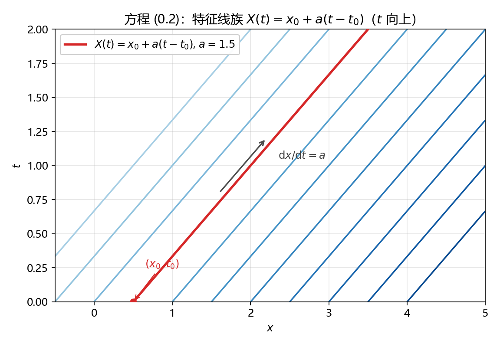
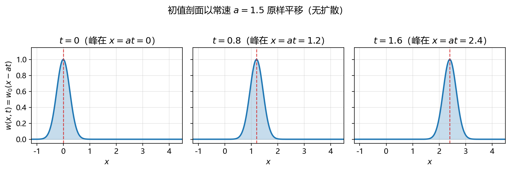
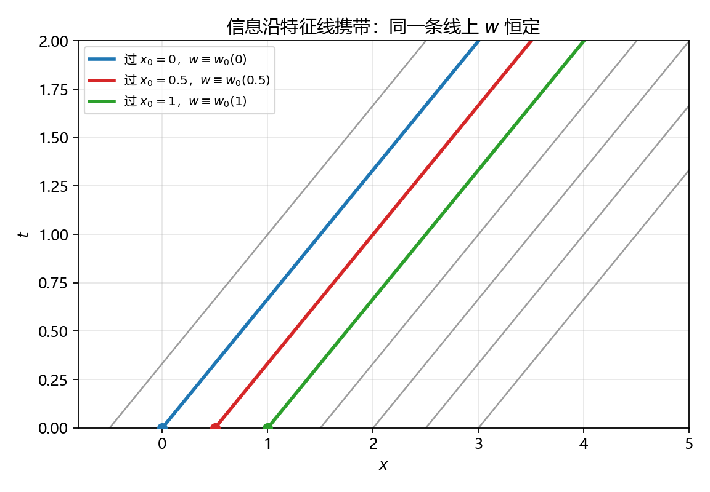
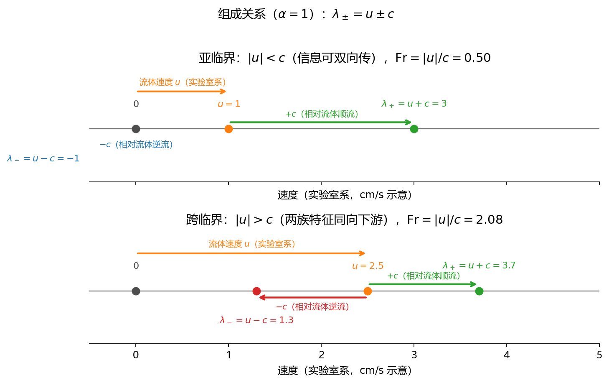
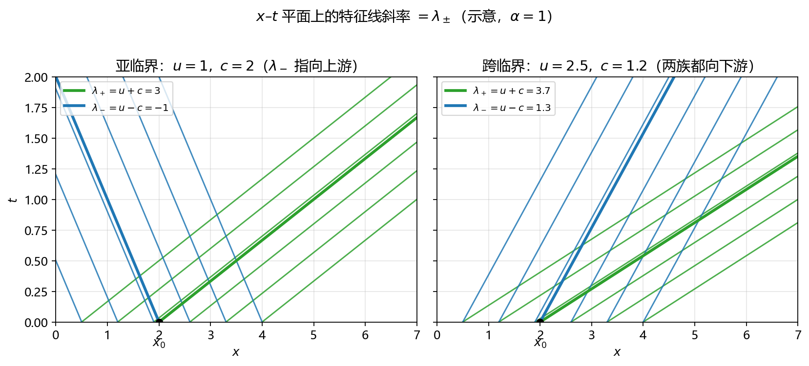
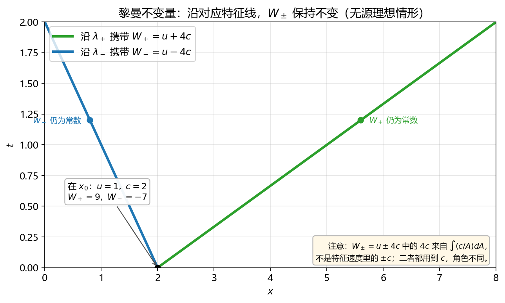

# 方向 B：特征变量（Riemann 不变量）边界 — 数学原理与实现说明

本文整理 `SimuCoronary/navier_stokes_1d.py` 中方向 B 的边界改进：由「面积零梯度 / 出口仅定压改 $A$」改为**特征相容边界**（characteristic-compatible / non-reflecting in the weak sense of Riemann invariants）。实现入口为 `_apply_boundaries`；配套函数为 `_characteristic_speeds`、`_riemann_invariants`、`area_from_flow_and_w_minus`、`_outlet_flow_from_w_plus`。算法摘要亦见 [`navier_stokes_1d.md`](navier_stokes_1d.md) §5；诊断背景见 [`当前算例问题与改进方向.md`](当前算例问题与改进方向.md) §8.2。

> **读者背景**：假定已掌握线性代数（特征值 / 对角化）、数学分析（偏导数与链式法则）与常微分方程（初值问题）。**不**假定已学过偏微分方程或双曲守恒律。§0 从该背景出发，系统给出一阶双曲方程、特征线与黎曼不变量的定义与直观；§1 起回到本仓库的边界问题。
>
> **读本文前需知**：方向 B 是**算法正确性**改进，不是狭窄喉部壅塞 / 大质量残差的「银弹」。§10 给出实测负结果；§3–§8 说明即便如此，该形式在亚临界端仍是适定双曲系统应采用的边界。

---

## 0. 预备知识：一阶双曲方程、特征线与黎曼不变量

本节只使用线性代数、数学分析与 ODE。目标是回答三个问题：

1. 什么叫**一阶双曲型**微分方程？
2. 什么是**特征线**，它如何把 PDE「降成」ODE？
3. 什么是**黎曼不变量**，它与边界条件有何关系？

### 0.1 从 ODE 到 PDE：未知函数多了一个自变量

常微分方程研究的是 $t\mapsto \mathbf{y}(t)$，例如

$$
\frac{\mathrm{d}\mathbf{y}}{\mathrm{d}t}=\mathbf{f}(t,\mathbf{y}).
$$

一维管流中，未知量同时依赖**空间** $x$ 与**时间** $t$，例如截面积 $A(x,t)$、流量 $Q(x,t)$。对两个自变量的函数求偏导数，就得到偏微分方程（PDE）。

「一阶」指方程中出现的最高阶导数是一阶（只有 $\partial/\partial t$、$\partial/\partial x$，没有 $\partial^2/\partial x^2$ 这类项）。本仓库的控制方程在主部上正是一阶的；粘性摩擦等以**零阶源项**出现，不改变下文的双曲分类。

### 0.2 标量原型：一阶线性输运方程

最简单的一阶 PDE 是常系数**输运（对流）方程**：

$$
\frac{\partial w}{\partial t}+a\frac{\partial w}{\partial x}=0,
\qquad a\in\mathbb{R}\ \text{为常数}.
\tag{0.1}
$$

| 符号 | 含义 |
|------|------|
| $w=w(x,t)$ | 待求的标量场 |
| $a$ | 常数传播速度；$a>0$ 表示信息向 $x$ 增大方向传 |

**特征线法**（与你熟悉的 ODE 初值问题直接衔接）：在 $x$–$t$ 平面上找曲线 $x=X(t)$，使 $w$ 沿着该曲线对 $t$ 的全导数满足一个 ODE。由链式法则（全微分推导），

$$
\frac{\mathrm{d}}{\mathrm{d}t}w\bigl(X(t),t\bigr)
=\partial_t w+X'(t)\,\partial_x w.
$$

若取 $X'(t)=a$，即

$$
\frac{\mathrm{d}X}{\mathrm{d}t}=a
\quad\Leftrightarrow\quad
X(t)=x_0+a(t-t_0),
\tag{0.2}
$$

则沿该曲线有

$$
\frac{\mathrm{d}}{\mathrm{d}t}w\bigl(X(t),t\bigr)
=\partial_t w+a\,\partial_x w=0.
$$

因此 $w$ 在每条直线 $x-at=\mathrm{const}$ 上是**常数**：初值 $w(x,0)=w_0(x)$ 给出显式解

$$
w(x,t)=w_0(x-at).
$$

此处的$w_0(x-at)$是指函数 $w_0(x)$ 中的自变量取值为 $x-at$，而不是 $w_0$ 乘上 $x-at$ 

**定义（标量情形的特征线）**：曲线族 $\mathrm{d}x/\mathrm{d}t=a$ 称为方程 (0.1) 的**特征线**。PDE 沿特征线退化为 ODE $\mathrm{d}w/\mathrm{d}t=0$。

直观图像：初值剖面以速度 $a$「原样平移」；信息只沿特征线走，不会横向扩散（没有二阶粘性项）。下图均取常速 $a=1.5$，对应方程 (0.2)。







### 0.3 变系数标量：特征线一般是曲线

若传播速度依赖位置或时间，

$$
\partial_t w+a(x,t)\,\partial_x w=0,
$$

则特征线由 ODE 初值问题

$$
\frac{\mathrm{d}X}{\mathrm{d}t}=a\bigl(X(t),t\bigr),\qquad X(t_0)=x_0
$$

决定；沿解曲线仍有 $\mathrm{d}w/\mathrm{d}t=0$（无源时）。这里你只需要「ODE 存在唯一解」的标准结论（$a$ 适当光滑时）。

### 0.4 一阶方程组与拟线性形式

本仓库有两个未知量，写成向量

$$
\mathbf{U}(x,t)=\begin{pmatrix}U_1(x,t)\\ U_2(x,t)\end{pmatrix}
\quad\text{（具体常取 }U_1=A,\;U_2=Q\text{）}.
$$

#### 守恒型（conservation form）

**定义**：称方程组是**守恒型**（也称散度型 / balance law），若它可写成

$$
\partial_t\mathbf{U}+\partial_x\mathbf{F}(\mathbf{U})=\mathbf{S}(\mathbf{U},x),
\tag{0.3}
$$

其中：

| 符号 | 名称 | 含义 |
|------|------|------|
| $\mathbf{U}$ | 守恒变量（状态） | 待求向量场；本仓库常取 $(A,Q)^\mathsf{T}$ |
| $\mathbf{F}(\mathbf{U})$ | **通量**（flux） | 仅依赖 $\mathbf{U}$（可不显含 $x,t$）的向量函数；$\partial_x\mathbf{F}$ 表示沿 $x$ 的净流出率 |
| $\mathbf{S}(\mathbf{U},x)$ | **源项**（source） | 非散度贡献：摩擦、重力、侧支质量汇等；$\mathbf{S}\equiv\mathbf{0}$ 时称**齐次守恒律** |

积分意义（与 ODE 无关、但便于记忆）：在任意区间 $[x_1,x_2]$ 上，

$$
\frac{\mathrm{d}}{\mathrm{d}t}\int_{x_1}^{x_2}\mathbf{U}\,\mathrm{d}x
=\mathbf{F}(\mathbf{U}(x_1))-\mathbf{F}(\mathbf{U}(x_2))
+\int_{x_1}^{x_2}\mathbf{S}\,\mathrm{d}x.
$$

即：区间内 $\mathbf{U}$ 的总量变化 = 左端流入 − 右端流出 + 源的积分。有限体积法正是离散这一积分守恒陈述；本仓库边界面取物理通量 $F(\mathbf{U}_b)$，内部面取 HLL 数值通量。

> **注意**：「守恒型」指**方程写法**（时间导数 + 通量散度），不等于「物理量一定全局守恒」。有源项 $\mathbf{S}\neq\mathbf{0}$ 时总量可变；即使 $\mathbf{S}=\mathbf{0}$，边界通量也可向域外带走质量/动量。

#### 通量 $\mathbf{F}$ 与源项 $\mathbf{S}$ 的写法不唯一

同一套物理方程，把哪些贡献放进 $\mathbf{F}$、哪些放进 $\mathbf{S}$，**可以有不止一种写法**。只要在光滑解上微分形式等价，就都合法；差别主要在弱解含义与数值离散。

**代数机制**：能写成「某个量对 $x$ 的导数」的项，既可并入通量散度 $\partial_x\mathbf{F}$，也可留在源项里（符号相反）。例如乘积法则

$$
\frac{A}{\rho^*}\partial_x p
=\partial_x\!\left(\frac{pA}{\rho^*}\right)
-\frac{p}{\rho^*}\partial_x A.
$$

于是一维管流动量方程至少有两种**光滑解上等价**的守恒型拆分（质量方程通常仍取 $F_0=Q$）：

| 写法 | 动量通量 $F_1$ | 动量源项中与压力有关的部分 |
|------|----------------|----------------------------|
| **A（本仓库现行）** | $\alpha Q^2/A$（仅对流） | $-\dfrac{A}{\rho^*}\partial_x p$（另加摩擦等） |
| **B（压力进通量）** | $\alpha Q^2/A+\dfrac{pA}{\rho^*}$ | $+\dfrac{p}{\rho^*}\partial_x A$（另加摩擦等） |

写法 A、B 由上式互推，**在光滑解上等价**。危险在于「半套替换」：若采用 B 的通量却**漏掉**几何源项 $+(p/\rho^*)\partial_x A$，变截面处会出现虚假轴向力——本仓库旧版曾犯此错，见 [`navier_stokes_1d.md`](navier_stokes_1d.md) §3.1.1。

**为何仍要选定一种？**

| 考虑 | 说明 |
|------|------|
| 有限体积离散 | 界面只「看见」通量 $\mathbf{F}$；$\mathbf{S}$ 在单元内积分。$\mathbf{F}/\mathbf{S}$ 拆分一变，数值格式就变，即使连续方程等价 |
| 静平衡 / well-balanced | 希望 $A\equiv A_0$、$Q=0$ 时残差接近机器零；压力放在单元中心源项（写法 A）往往更易与 tube law 一致 |
| 约定清晰 | 「守恒型」本身不规定唯一拆分；唯一性来自**额外约定**（本仓库：对流进 $F$，压力梯度与摩擦进 $S$） |

**小结**：

1. $\mathbf{F}$ 与 $\mathbf{S}$ **可以有多种等价写法**（彼此差一项可写成 $\partial_x(\cdots)$ 的贡献）。
2. 换写法必须**整组**替换 $F$ 与 $S$，不能只改一侧。
3. 本文与代码一律按写法 A；后文的雅可比 $\mathcal{A}=D\mathbf{F}$、特征速度亦针对该选定的 $\mathbf{F}$（压力不进通量时，$\mathcal{A}$ 的压力信息通过波速 $c$ 与源项路径进入分析，见 §3 与主文档 §3.1）。

#### 拟线性形式（quasilinear form）

若通量 $\mathbf{F}$ 对 $\mathbf{U}$ 可微，链式法则给出

$$
\partial_x\mathbf{F}(\mathbf{U})
=D\mathbf{F}(\mathbf{U})\,\partial_x\mathbf{U},
$$

其中 $D\mathbf{F}(\mathbf{U})$ 是 $\mathbf{F}$ 关于 $\mathbf{U}$ 的**雅可比矩阵**（Jacobian）：第 $(i,j)$ 元为 $\partial F_i/\partial U_j$。于是 (0.3) 等价于

$$
\partial_t\mathbf{U}+\mathcal{A}(\mathbf{U})\,\partial_x\mathbf{U}=\mathbf{S},
\qquad
\mathcal{A}(\mathbf{U}):=D\mathbf{F}(\mathbf{U}).
\tag{0.4}
$$

**定义**：形如

$$
\partial_t\mathbf{U}+\mathcal{A}(x,t,\mathbf{U})\,\partial_x\mathbf{U}
=\mathbf{G}(x,t,\mathbf{U})
$$

的一阶方程组称为**拟线性的**（quasilinear）：对未知量的**最高阶导数**（此处即 $\partial_t\mathbf{U}$、$\partial_x\mathbf{U}$）是**线性**的，但系数矩阵 $\mathcal{A}$ 与右端可以依赖 $\mathbf{U}$ 本身（以及 $x,t$）。

##### 右端 $\mathbf{G}$ 不能含微分项（与守恒型「$F/S$ 不唯一」不同）

标准拟线性形式把方程拆成：

| 位置 | 允许出现什么 | 不允许出现什么 |
|------|--------------|----------------|
| **左端（主部）** | 全部最高阶导数 $\partial_t\mathbf{U}$、$\partial_x\mathbf{U}$，以及对它们线性的系数 $\mathcal{A}$ | — |
| **右端 $\mathbf{G}$** | 只依赖 $(x,t,\mathbf{U})$ 的**零阶项**（摩擦、侧支汇、$Q/A$ 等代数源） | **未知量的任何导数**（$\partial_x\mathbf{U}$、$\partial_t\mathbf{U}$、$\partial_x p(A)$ 若未展开等） |

因此：**不能**像守恒型里挪动 $F$ 与 $S$ 那样，随意把带 $\partial_x\mathbf{U}$ 的项留在拟线性方程的「右边」。若右端出现例如 $\mathbf{B}(\mathbf{U})\partial_x\mathbf{U}$，它仍属最高阶项，必须并入左边：

$$
\partial_t\mathbf{U}+\bigl(\mathcal{A}(x,t,\mathbf{U})-\mathbf{B}(\mathbf{U})\bigr)\partial_x\mathbf{U}
=\cdots,
$$

得到的新系数矩阵才是真正的主部；特征速度是**合并之后**的矩阵的特征值，不是「随便哪一种右端写法」的特征值。

> **易混点**：上一小节说守恒型的 $\mathbf{F}$ 与 $\mathbf{S}$ **可以有多种等价拆分**；那是针对**守恒型**的积分/通量叙述。  
> **拟线性标准形**则要求：所有一阶导数进左端，$\mathbf{G}$ 不含导数。两种说法不矛盾——从守恒型变到拟线性时，凡能写成 $D\mathbf{F}\,\partial_x\mathbf{U}$ 的贡献都应进入 $\mathcal{A}$，而不是留在 $\mathbf{G}$ 里冒充「另一种源项写法」。

**与本仓库压力项的关系**（避免二次误解）：数值实现采用写法 A，把 $-(A/\rho^*)\partial_x p$ 放在有限体积的「源项」里计算；但因 tube law 有 $p=p(A)$，

$$
\partial_x p=\frac{\mathrm{d}p}{\mathrm{d}A}\partial_x A,
$$

故在**光滑的拟线性主部**中，该贡献属于 $\partial_x\mathbf{U}$ 一侧，已反映在波速 $c$ 与特征速度 $\lambda_\pm$ 中（§3）。口诀：**离散上可当源项积；分析主部时归入 $\mathcal{A}$（或 $c$），不把含 $\partial_x p$ 的项当成拟线性右端 $\mathbf{G}$ 的合法成员。**

与相近术语的对比：

| 类型 | 典型写法 | 要点 |
|------|----------|------|
| **线性** | $\partial_t\mathbf{U}+\mathcal{A}(x,t)\,\partial_x\mathbf{U}=\mathbf{G}$ | $\mathcal{A}$ **不**依赖 $\mathbf{U}$；$\mathbf{G}$ 仍为零阶 |
| **半线性** | $\partial_t\mathbf{U}+\mathcal{A}(x,t)\,\partial_x\mathbf{U}=\mathbf{G}(x,t,\mathbf{U})$ | 主部线性，非线性只在零阶 $\mathbf{G}$ |
| **拟线性** | $\partial_t\mathbf{U}+\mathcal{A}(x,t,\mathbf{U})\,\partial_x\mathbf{U}=\mathbf{G}$ | 主部对导数线性，$\mathcal{A}$ 可依赖 $\mathbf{U}$；**$\mathbf{G}$ 仍不含导数** |
| **全非线性** | 对最高阶导数也非线性 | 本文不涉及 |

| 符号 | 含义（线性代数） |
|------|------------------|
| $\mathcal{A}(\mathbf{U})$ | $2\times 2$（或 $m\times m$）实矩阵，可依赖 $\mathbf{U}$；本仓库由通量雅可比得到 |
| $D\mathbf{F}$ | 与 $\mathcal{A}$ 相同：把「通量的 $x$ 导数」变成「状态的 $x$ 导数」前的系数 |
| $\mathbf{G}$ | 拟线性标准形的右端：仅 $(x,t,\mathbf{U})$，**无** $\partial\mathbf{U}$ |

**守恒型与拟线性形式的关系**：

- 光滑解上二者**等价**（由链式法则互推），但**规范形状的约束不同**：守恒型允许 $F/S$ 多种拆分；拟线性标准形要求导数全在左、$\mathbf{G}$ 无导数；
- **守恒型**便于积分守恒与有限体积离散；
- **拟线性形式**便于定义特征值 / 特征线 / 双曲性（§0.5–§0.6），因为特征速度就是（合并后的）$\mathcal{A}$ 的特征值。

真正的零阶源（摩擦、侧支汇等）留在 $\mathbf{G}$ 中，**不进入** $\mathcal{A}$，因而不改变双曲分类与特征方向（可影响黎曼不变量是否严格沿特征守恒）。

### 0.5 什么是「双曲型」：用特征值来定义

回顾线性代数：方阵 $\mathcal{A}$ 若有 $m$ 个线性无关的实特征向量，则它可对角化：存在可逆 $P$ 使 $P^{-1}\mathcal{A}P=\mathrm{diag}(\lambda_1,\ldots,\lambda_m)$。

**定义（一阶拟线性系统的双曲性）**：称 (0.4) 在状态 $\mathbf{U}$ 处是**双曲的**（hyperbolic），若雅可比 $\mathcal{A}(\mathbf{U})$ 的全部特征值 $\lambda_1(\mathbf{U}),\ldots,\lambda_m(\mathbf{U})$ 为**实数**，且存在完备的特征向量基（即可对角化）。若特征值两两不同，常称**严格双曲**。

| 对比（只需建立直觉） | 主部典型行为 |
|----------------------|--------------|
| **双曲** | 有限速度传播；信息沿特征线；适定的初边值依赖特征方向 |
| **抛物**（如热方程 $w_t=w_{xx}$） | 瞬时全域影响；需二阶空间导数 |
| **椭圆**（如 Laplace 方程） | 边值问题，无「时间推进」特征 |

本仓库 $m=2$：两个实特征值记为 $\lambda_+,\lambda_-$（见 §3）。「一阶双曲型微分方程」在本文中即指：未知量满足形如 (0.3)–(0.4) 的方程组，且 $\mathcal{A}$ 双曲。

### 0.6 方程组的特征线：$\mathrm{d}x/\mathrm{d}t=\lambda_i(\mathbf{U})$

对严格双曲系统，每个特征值 $\lambda_i(\mathbf{U})$ 对应一族特征方向。在光滑解区域，第 $i$ 族**特征线**满足常微分方程

$$
\frac{\mathrm{d}x}{\mathrm{d}t}=\lambda_i\bigl(\mathbf{U}(x,t)\bigr).
\tag{0.5}
$$

| 符号 | 含义 |
|------|------|
| $\lambda_i$ | 第 $i$ 族特征速度（$\mathcal{A}$ 的第 $i$ 个特征值），量纲与速度相同 |
| $\mathrm{d}x/\mathrm{d}t=\lambda_i$ | 该族信息在时空中的瞬时传播速率 |

注意：$\lambda_i$ 一般依赖 $\mathbf{U}$，故特征线是**弯曲**的，且与解耦合（与常系数输运方程的直线特征不同）。数值上仍先由当前状态估计 $\lambda_i$，再判断信息从哪一侧进入边界。

**入射 / 出射（边界语言）**：在左端点 $x=0$，若 $\lambda_i>0$，该族特征指向域内，称为**入射**（信息从边界进入计算域）；若 $\lambda_i<0$，指向域外，称为**出射**（信息从域内带到边界）。右端点 $x=L$ 则符号相反：$\lambda_i<0$ 为入射，$\lambda_i>0$ 为出射。

这直接导出边界条件计数法则（方向 B 的核心）：

> **可人为规定的边界条件个数 = 进入计算域的特征条数；**  
> **其余自由度必须由出射特征从域内带来的信息确定。**

亚临界管流通常 $\lambda_-<0<\lambda_+$：每端恰好一条入射 → 每端只规定一个物理量。

### 0.7 黎曼不变量：沿特征「尽量守恒」的标量

标量输运方程里，$w$ 本身沿特征就是常数。对方程组，一般分量 $A,Q$ **并不**各自沿 $\lambda_\pm$ 守恒，但往往可以找到新的标量函数 $W_i(\mathbf{U})$，使得在无源、系数适当的理想情形下，

$$
\text{沿}\quad \frac{\mathrm{d}x}{\mathrm{d}t}=\lambda_i
\quad\text{有}\quad
\frac{\mathrm{d}}{\mathrm{d}t}W_i\bigl(\mathbf{U}(x,t)\bigr)=0.
\tag{0.6}
$$

**定义（黎曼不变量，Riemann invariant）**：称 $W_i=W_i(\mathbf{U})$ 为对应于第 $i$ 族特征的**黎曼不变量**，若在光滑解上，$W_i$ 沿该族特征线满足 (0.6)（或在有源时满足一个已知的 ODE，而不是随意的 PDE）。等价的微分说法：$W_i$ 的水平集与第 $i$ 个右特征向量的方向相容，使得

$$
\nabla_{\mathbf{U}}W_i\cdot\bigl(\partial_t\mathbf{U}+\lambda_i\partial_x\mathbf{U}\bigr)=0
$$

在无源齐次方程上成立。

| 符号 | 含义 |
|------|------|
| $W_i(\mathbf{U})$ | 状态空间上的标量函数；本仓库记 $W_\pm$ |
| 「不变量」 | 强调沿对应特征传播时保持不变（理想齐次情形） |
| 与「守恒量」的区别 | 守恒量通常指 $\int U\,\mathrm{d}x$ 的积分守恒；黎曼不变量是**沿特征的点态**性质 |

**为何对边界有用**：在边界上，出射族的 $W_i$ 由域内沿特征「带过来」，可从邻近内点外推；入射族的信息则由边界物理条件（定流量、定压等）提供。把「外推的出射不变量」与「规定的入射物理量」联立，唯一确定边界状态 $\mathbf{U}_b$——这就是特征相容边界。

**简单 $2\times 2$ 例子（$\alpha=1$ 的声学型结构）**：若 $\lambda_\pm=u\pm c$，常可取

$$
W_\pm=u\pm\int\frac{c(A)}{A}\,\mathrm{d}A
$$

（推导见 §4）。对本仓库 tube law，积分等于 $4c$，故 $W_\pm=u\pm 4c$。

有摩擦或侧支源项时，$W_\pm$ 沿特征不再严格恒定；工程上仍用邻点的 $W_\pm$ 作一阶外推，作为边界闭包——这是离散实现的标准近似，不是说源项下不变量定理仍精确成立。

### 0.8 用线性代数看清「对角化 = 解耦成输运方程」

设在某状态附近冻结系数 $\mathcal{A}$（常系数化），并设 $\mathcal{A}=P\Lambda P^{-1}$，$\Lambda=\mathrm{diag}(\lambda_1,\lambda_2)$。令特征变量 $\mathbf{V}=P^{-1}\mathbf{U}$（局部），则齐次方程变为

$$
\partial_t V_i+\lambda_i\partial_x V_i=0,\qquad i=1,2.
$$

每个 $V_i$ 正是「沿 $\lambda_i$ 传播的」标量——这与黎曼不变量在线性（或局部线性化）理论中的角色一致。非线性问题中 $P$ 依赖 $\mathbf{U}$，全局不变量更精妙，但**边界处仍按各 $\lambda_i$ 的指向决定规定 / 外推**，思想相同。

### 0.9 与本仓库方程的衔接（预告）

| 概念（§0） | 在本仓库中的对应（后文） |
|-----------|-------------------------|
| $\mathbf{U}=(A,Q)^\mathsf{T}$ | 有限体积状态 |
| $\mathcal{A}(\mathbf{U})$ 的特征值 | $\lambda_\pm=\alpha u\pm\sqrt{c^2+\alpha(\alpha-1)u^2}$（§3） |
| 弹性波速 $c$ | $c=\sqrt{\beta\sqrt{A}/(2\rho^*)}$（§3） |
| 黎曼不变量 $W_\pm$ | $W_\pm=u\pm 4c$（§4；$\alpha=1$ 标准形式） |
| 入射条件个数 | 亚临界时入口定 $Q_{\mathrm{in}}$，出口定 $P_{\mathrm{lumen}}$（§5–§6） |
| 出射信息 | 入口外推 $W_-$，出口外推 $W_+$ |

若跳过推导细节，只需记住三句话：

1. 方程是一阶双曲的 $\Leftrightarrow$ 信息以有限特征速度 $\lambda_\pm$ 传播；  
2. 特征线是 $\mathrm{d}x/\mathrm{d}t=\lambda_i$；  
3. 黎曼不变量是沿对应特征携带的标量信息，边界上「入射规定、出射外推」。

---

## 1. 改进在解决什么问题

### 1.1 一维双曲系统在边界上需要什么

沿用 §0 的语言。求解变量为

$$
\mathbf{U}(x,t)=\begin{pmatrix} A(x,t)\\ Q(x,t)\end{pmatrix},
\qquad x\in[0,L],
$$

其中：

| 符号 | 含义 | 单位（本仓库 CGS） |
|------|------|-------------------|
| $A$ | 管腔瞬时截面积 | $\mathrm{cm}^2$ |
| $Q$ | 体积流量（截面平均速度 $\times$ 面积） | $\mathrm{mL/s}=\mathrm{cm}^3/\mathrm{s}$ |
| $x$ | 沿血管轴向坐标，入口 $x=0$，出口 $x=L$ | $\mathrm{cm}$ |
| $t$ | 时间 | $\mathrm{s}$ |
| $L$ | 血管段长度 | $\mathrm{cm}$ |

管腔压 $p$ **不是**独立未知量，而由 tube law 从 $A$ 闭合（见 §3）。主部是**一阶拟线性双曲型**（§0.4–§0.5）：信息沿特征线 $\mathrm{d}x/\mathrm{d}t=\lambda_\pm$ 传播。在边界上，**可规定的物理条件个数必须等于进入计算域的特征条数**，其余信息必须从域内沿出射特征以黎曼不变量的形式带出（§0.6–§0.7）。这是方向 B 的理论根基（Toro《Riemann Solvers》§6；Formaggia–Lamponi–Quarteroni 2003）。

### 1.2 旧边界的缺陷（为何「有必要」改）

旧实现（概念上）相当于：

| 端点 | 旧做法 | 问题 |
|------|--------|------|
| 入口 $x=0$ | $Q(0)=Q_{\mathrm{in}}(t)$，且 $A(0)=A(1)$（面积零梯度） | 只正确施加了**一条**入射信息（定流量）；另一条本应来自出射特征的信息被「复制邻点面积」伪造，一般**不满足**出射 Riemann 不变量 |
| 出口 $x=L$ | Windkessel 定 $P_{\mathrm{lumen}}$ → tube law 改 $A(L)$，**保留** PDE 演化出的 $Q(L)$ | 定压对应入射特征；出射特征携带的流量信息未被写回边界状态 |

本求解器在边界界面取**物理通量** $F(\mathbf{U}_b)$（而非再解一次黎曼问题）。因此 $\mathbf{U}_b$ 必须本身就是「给定入射条件 + 出射不变量」的相容状态；否则 $F(\mathbf{U}_b)$ 不是该边界条件对应的相容通量，会向域内注入与特征理论不一致的反射（数值上可表现为虚假振荡、边界附近质量/动量不平衡）。

> **必要性的层次**  
> 1. **适定性**：亚临界时每端恰好 1 个入射自由度 → 只能规定 1 个物理量，另一个必须外推。  
> 2. **通量一致性**：边界用 $F(U_b)$ 时，$U_b$ 必须与出射不变量相容。  
> 3. **0D–1D 耦合**：出口 $Q(L)$ 应驱动 Windkessel；该 $Q(L)$ 应与从上游传来的 $W_+$ 一致，而不是随意留下 PDE 值或误写成 $P_{\mathrm{wk}}/R_d$。

方向 B 正是把上述三条落实到入口 / 出口的具体代数闭包。

### 1.3 改进不声称解决什么

喉部跨临界（某处 $\lambda_->0$）时，特征方向在**管内**改变；两端若仍亚临界，改边界**无法**消除喉部壅塞或与钳位相关的质量残差。这已由方向 A/B 实测确认（§10）。因此「必要性」指**边界处算法与特征理论一致**，不是「狭窄算例所有病理都会消失」。

---

## 2. 完整符号表

### 2.1 几何与状态

| 符号 | 含义 |
|------|------|
| $A_0(x)$ | 参考（舒张）截面积；代码 `area_ref` |
| $A(x,t)$ | 瞬时截面积；状态分量 $U_0$ |
| $Q(x,t)$ | 体积流量；状态分量 $U_1$ |
| $u=Q/A$ | 截面平均轴向速度 $\mathrm{cm/s}$ |
| $n_x$ | 轴向节点数；节点 $j=0,\ldots,n_x-1$ |
| $\Delta x$ | 网格间距 $L/(n_x-1)$ |
| $\mathbf{U}_j$ | 节点 $j$ 的状态 $(A_j,Q_j)$ |

### 2.2 管壁与压力（tube law）

| 符号 | 含义 | 单位 |
|------|------|------|
| $p$ | 管腔标量压 | $\mathrm{mmHg}$ |
| $P_{\mathrm{ref}}$ | tube law 参考压（代码 `p_ref_mmhg`） | $\mathrm{mmHg}$ |
| $\beta$ | 管壁刚度参数 | $\mathrm{mmHg/cm}$ |
| $\rho$ | 血液密度 | $\mathrm{g/cm}^3$ |
| $\rho^*$ | 与 mmHg 压力配对的有效密度 $\rho/\mathrm{MMHG\_TO\_DYNE}$ | 使 $(A/\rho^*)\partial p/\partial x$ 与 CGS 动量式一致 |
| $c$ | 局部弹性波速（小扰动传播速度） | $\mathrm{cm/s}$ |

tube law：

$$
p(A,x)=P_{\mathrm{ref}}+\beta(x)\bigl(\sqrt{A}-\sqrt{A_0(x)}\bigr).
$$

### 2.3 通量、特征与不变量

（双曲性、特征线、黎曼不变量的定义见 §0。）

| 符号 | 含义 |
|------|------|
| $F(\mathbf{U})$ | 物理通量；本仓库质量分量 $F_0=Q$，动量对流分量 $F_1=\alpha Q^2/A$（压力梯度进源项） |
| $\mathcal{A}=D\mathbf{F}$ | 通量雅可比；双曲 $\Leftrightarrow$ 特征值全实且可对角化（§0.5） |
| $\alpha$ | 动量修正系数（层流剖面常取 $1.1$）；特征速度公式含 $\alpha$ |
| $\lambda_\pm$ | 两族特征速度（$\mathcal{A}$ 的特征值）；特征线满足 $\mathrm{d}x/\mathrm{d}t=\lambda_\pm$（§0.6） |
| $W_\pm$ | 黎曼不变量（对 $\alpha=1$ 的标准 tube-law 系统；§0.7、§4） |

### 2.4 入口 / 出口与 Windkessel

| 符号 | 含义 |
|------|------|
| $Q_{\mathrm{in}}(t)$ | 入口规定流量 |
| $W_-$ | 出射（离开入口、指向域外）族不变量；由邻点外推 |
| $W_+$ | 出射（离开出口、指向域外）族不变量；由邻点外推 |
| $R_p,R_d,C$ | 三元 RCR：近端阻力、远端阻力、顺应性 |
| $P_{\mathrm{wk}}$ | Windkessel 电容节点压 |
| $P_{\mathrm{lumen}}$ | 出口管腔压 $=P_{\mathrm{wk}}+R_p Q(L)$（冻结或预测步） |
| $Q_{\mathrm{venous}}=P_{\mathrm{wk}}/R_d$ | 微循环侧出流；**不是** $Q(L)$ |
| $Q_{\mathrm{drive}}$ | 写入边界并用于推进 $P_{\mathrm{wk}}$ 的出口流量（特征相容后的 $Q(L)$） |

### 2.5 代码下标约定

| 下标 / 名字 | 含义 |
|-------------|------|
| $j=0$ | 入口节点 |
| $j=1$ | 入口相邻内点（外推 $W_-$） |
| $j=n_x-2$ | 出口相邻内点（外推 $W_+$） |
| $j=n_x-1$ | 出口节点 |
| `advance=False` | RK 子步中「冻结」出口 0D（`dt=0` 预测 $P_{\mathrm{lumen}}$） |
| `advance=True` | 完整步，用 $\Delta t$ 显式欧拉推进 $P_{\mathrm{wk}}$ |

---

## 3. 流体速度、局部弹性波速与特征速度

口语里常笼统说「波速」，本仓库应严格区分下面三个量。它们单位都是 $\mathrm{cm/s}$，但**参照系与角色不同**。

### 3.0 三者对照（先看这张表）

| 名称 | 符号 | 一句话定义 | 参照系 | 主要用途 |
|------|------|------------|--------|----------|
| **流体速度**（截面平均流速） | $u$ | 血液沿管轴的对流速度 $u=Q/A$ | 相对固定的血管轴 $x$（实验室系） | 对流、组成 $\lambda_\pm$ 与 $W_\pm$ |
| **局部弹性波速**（小扰动波速） | $c$ | 管壁弹性决定的、**相对流体**的压力–面积扰动传播速率 | 相对当地流体微团 | 构造 $c(A)$、$W_\pm=u\pm 4c$、特征速度 $\lambda_\pm$ |
| **特征速度**（特征值 / 常被混称「波速」） | $\lambda_\pm$ | 拟线性主部雅可比 $\mathcal{A}$ 的特征值；信息在 $x$–$t$ 平面上的传播斜率 | 相对固定的 $x$ 轴 | 入射/出射、边界条件个数、CFL / HLL |

关系（$\alpha=1$ 时最清晰）：

$$
\lambda_\pm = u \pm c.
$$

即：**特征速度 = 流体把扰动「吹」走的速度 ± 扰动相对流体传开的弹性波速**。有动量修正 $\alpha\neq 1$ 时公式略改（§3.3），但「对流 + 弹性」的结构不变。

> **命名提醒**：文献与口语中的「波速」有时指 $c$，有时指 $\lvert\lambda\rvert$ 或 $\lvert u\rvert+c$。本文尽量写全称；代码里 `_wave_speed` 返回的是 **$c$**，`_characteristic_speeds` 返回的是 **$\lambda_\pm$**。

#### 可视化：三者如何拼在一起（$\alpha=1$）

下图在**速度数轴**上（实验室系）标出 $0$、$u$，再从流体微团出发相对流体加上 $\pm c$，得到落在数轴上的 $\lambda_\pm=u\pm c$。上图亚临界（$\lambda_-$ 可指向上游），下图跨临界（两族都向下游）。



下图在 **$x$–$t$ 平面**上：特征线的**瞬时斜率**就是当地的 $\lambda_\pm$。亚临界时一族倾向下游、一族可指向上游；跨临界时两族都向下游。



> **特征线不一定是直线。**  
> 定义始终是 ODE $\mathrm{d}x/\mathrm{d}t=\lambda_\pm\bigl(\mathbf{U}(x,t)\bigr)$（§0.3、§0.6）。  
> - 仅当 $\lambda$ 为**常数**（如常系数输运 $w_t+a w_x=0$，或上图故意取固定的 $u,c$）时，特征线才是直线。  
> - 一般 $\lambda_\pm=\lambda_\pm(\mathbf{U})$，而 $\mathbf{U}$ 随 $x,t$ 变化，故特征线是**曲线**，且与解耦合（要边解方程边“长”出特征线）。  
> - 上图画成平行直线，只为看清 $\lambda_-<0$ 与 $\lambda_->0$ 的定向差别，**不是**声称真实冠脉算例里特征都是直线。数值上通常也不显式积分整条特征线，而是用当地 $\lambda_\pm$、$W_\pm$ 做边界外推。

---

### 3.1 流体速度 $u$

**定义**：

$$
u(x,t)=\frac{Q(x,t)}{A(x,t)}.
$$

| 符号 | 含义 | 单位 |
|------|------|------|
| $Q$ | 体积流量（单位时间穿过截面的体积） | $\mathrm{cm}^3/\mathrm{s}$ |
| $A$ | 瞬时管腔截面积 | $\mathrm{cm}^2$ |
| $u$ | 将该流量均摊在截面上的**平均轴向速度** | $\mathrm{cm/s}$ |

物理图像：一维模型不解析截面内速度剖面，只用一个平均速度 $u$ 代表「血液整体往下游走多快」。入口定流量时规定的是 $Q$，对应的 $u=Q/A$ 随当地面积变化。

注意：

- $u$ **不是**特征速度，也不是弹性波速；
- $u>0$ 表示流向 $+x$（本仓库约定近端→远端）；
- 动量通量中的对流项含 $\alpha u$（或 $\alpha Q^2/A$），$\alpha$ 修正剖面形状，默认 $1.1$。

---

### 3.2 局部弹性波速 $c$（为何要算它）

**定义（一般）**：由压力–面积关系对面积的敏感度给出相对流体的小扰动传播速率。对以 $(A,Q)$ 为变量、压力进入动量主部的一维管流，

$$
c^2=\frac{A}{\rho^*}\frac{\mathrm{d}p}{\mathrm{d}A}.
\tag{3.1}
$$

| 符号 | 含义 |
|------|------|
| $p=p(A)$ | tube law 管腔压（本仓库为 mmHg） |
| $\mathrm{d}p/\mathrm{d}A$ | 面积微增引起的压强微增；管壁越硬，该导数越大 |
| $\rho^*$ | 与 mmHg 配对的动量有效密度（见主文档 §3.1） |
| 「局部」 | $c=c(x,t)$ 随当地 $A(x,t)$（及 $\beta(x)$）变化，不是全局常数 |
| 「弹性」 | 来源于管壁可扩张，不是气体热力学声速；数学角色类似声速 |

对本仓库 tube law $p=P_{\mathrm{ref}}+\beta(\sqrt{A}-\sqrt{A_0})$，有 $\mathrm{d}p/\mathrm{d}A=\beta/(2\sqrt{A})$，故

$$
\boxed{\;c=\sqrt{\dfrac{\beta\sqrt{A}}{2\rho^*}}\;}
=\gamma\,A^{1/4},
\qquad
\gamma=\sqrt{\dfrac{\beta}{2\rho^*}}.
$$

| 符号 | 含义 |
|------|------|
| $\gamma$ | 波速前置因子；代码 `_wave_speed(A=1.0, beta, rho*)`（$A=1$ 时即 $\gamma$） |
| $A^{1/4}$ | 使 $c\propto A^{1/4}$；积分 $\int(c/A)\,\mathrm{d}A=4c$ 的来源 |

**为何必须算 $c$**：

1. **拼出特征速度**：$\lambda_\pm$ 需要 $c$（见 §3.3）；
2. **黎曼不变量**：$W_\pm=u\pm\int(c/A)\,\mathrm{d}A=u\pm 4c$（§4），方向 B 边界外推的就是它；
3. **组成 $\lambda_\pm$ 与亚临界判据**：看 $\lambda_-$ 符号（$\lambda_-<0<\lambda_+$ 为亚临界）；
4. **CFL / HLL**：时间步与数值波速估计用到 $\lvert u\rvert+c$ 量级。

物理一句话：$c$ 是管壁软硬决定的「弹性尺子」——扰动相对血液传多快；没有这把尺子，就无法谈 $\lambda$ 与 $W$。详见 [`波速计算.md`](波速计算.md)。

---

### 3.3 特征速度 $\lambda_\pm$（特征值）

**定义**：将系统写成拟线性形式 $\partial_t\mathbf{U}+\mathcal{A}(\mathbf{U})\partial_x\mathbf{U}=\cdots$（零阶源项不进入主部）后，$\mathcal{A}(\mathbf{U})$ 的**特征值**称为特征速度：

$$
\det\bigl(\mathcal{A}(\mathbf{U})-\lambda I\bigr)=0
\quad\Rightarrow\quad
\lambda=\lambda_\pm(\mathbf{U}).
$$

几何含义：第 $i$ 族特征线满足

$$
\frac{\mathrm{d}x}{\mathrm{d}t}=\lambda_i,
$$

即信息在实验室系 $x$–$t$ 平面上的瞬时传播速率（§0.5–§0.6）。

本仓库采用的显式公式（与适定性诊断同一式，含动量修正 $\alpha$）为

$$
\boxed{\;
\lambda_{\pm}
=\alpha u\pm\sqrt{c^{2}+\alpha(\alpha-1)u^{2}}
\;}.
$$

当 $\alpha=1$ 时根号内第二项消失，退化为教材中最常见的形式

$$
\lambda_\pm = u \pm c,
$$

即：**顺流特征** $u+c$ 与 **逆流特征** $u-c$。浅水中的 $u\pm\sqrt{gh}$、一维气体中的 $u\pm a$ 属于同一结构，只是局部波速 $c$（或 $a$）的物公式不同。

| 符号 | 含义 |
|------|------|
| $\lambda_+$ | 通常指向下游（$u>0,\,c>0$ 时 $\lambda_+>0$） |
| $\lambda_-$ | $u<c$ 时为负，可指向上游（亚临界逆流特征） |
| $\alpha$ | 动量修正；默认 $1.1$，边界黎曼不变量仍常用 $\alpha=1$ 的 $W_\pm=u\pm 4c$ |

**$u$、$c$、$\lambda$ 谁决定边界？** 看的是 $\lambda_\pm$ 的符号（入射/出射）。

| 流态 | 判据 | 入口处特征 | 出口处特征 |
|------|------|------------|------------|
| **亚临界** | $\lambda_-<0<\lambda_+$ | $\lambda_+>0$ 入射，$\lambda_-<0$ 出射 | $\lambda_+>0$ 出射，$\lambda_-<0$ 入射 |
| **跨临界** | $\lambda_->0$（某处） | 两条特征可同向 | 定压 BC 可能与特征方向矛盾 |

**亚临界时每端恰好一条入射特征 → 每端只能规定一个物理量。**

---

## 4. Riemann 不变量 $W_\pm$：含义与公式 $u\pm 4c$

通用定义见 §0.7。这里先讲**含义**，再算 tube law 下为何是 $4c$。

### 4.0 $W_\pm$ 是什么、不是什么

**定义（回顾）**：黎曼不变量 $W_\pm=W_\pm(\mathbf{U})$ 是状态 $(A,Q)$（或 $(A,u)$）上的标量函数，使得在无源、系数适当的理想情形下，沿对应特征线

$$
\frac{\mathrm{d}x}{\mathrm{d}t}=\lambda_\pm
\quad\text{有}\quad
\frac{\mathrm{d}W_\pm}{\mathrm{d}t}=0.
$$

| 问题 | 回答 |
|------|------|
| **是什么** | 沿 $\lambda_+$ 族特征「原样携带」的那一包信息叫 $W_+$；沿 $\lambda_-$ 族携带的叫 $W_-$ |
| **单位** | 与速度相同（$\mathrm{cm/s}$），因为由 $u$ 与 $c$ 组合而成 |
| **不是什么** | **不是**特征速度 $\lambda_\pm$ |
| **和 $u\pm c$ 的关系** | $\lambda_\pm=u\pm c$ 描述**路径走多快**；$W_\pm=u\pm 4c$ 描述**沿该路径携带的状态组合**。都出现 $\pm c$，但一个是「斜率」，一个是「载荷」 |
| **边界上干什么** | 出射族的 $W$ 从域内邻点外推；入射族由物理 BC 提供；二者联立定边界状态（方向 B） |

$$
\begin{aligned}
\lambda_+ &= u+c && \text{（路径：顺流特征速度）},\\
W_+ &= u+4c && \text{（载荷：沿该路径守恒的组合）},\\
\lambda_- &= u-c && \text{（路径：逆流特征速度）},\\
W_- &= u-4c && \text{（载荷：沿该路径守恒的组合）}.
\end{aligned}
$$



### 4.1 一般构造（$\alpha=1$）

对 $\alpha=1$ 的一维弹性管方程，特征速度为 $\lambda_\pm=u\pm c$。按 §0.7，存在黎曼不变量 $W_\pm(\mathbf{U})$，在无源、均匀 $\beta$ 的理想情形下沿对应特征满足 $\mathrm{d}W_\pm/\mathrm{d}t=0$。标准构造为

$$
W_{\pm}=u\pm\int\frac{c(A)}{A}\,\mathrm{d}A.
$$

直观理解：$u$ 是对流部分；$\int(c/A)\,\mathrm{d}A$ 把「面积扰动」换算成与速度同量纲的弹性贡献，使两者的组合恰好沿 $\lambda_\pm$ 传播。因子不是 $1$ 而是积分结果（下一小节得 $4c$），所以 **$W$ 里是 $4c$，特征速度里是 $1\cdot c$**，不要混用。

### 4.2 积分计算（tube law → 因子 4）

代入 $c=\gamma A^{1/4}$：

$$
\int\frac{c}{A}\,\mathrm{d}A
=\gamma\int A^{-3/4}\,\mathrm{d}A
=\gamma\cdot\frac{A^{1/4}}{1/4}
=4\gamma A^{1/4}
=4c.
$$

因此

$$
\boxed{\;W_+=u+4c,\qquad W_-=u-4c\;}.
$$

### 4.3 与浅水方程的对比（常见混淆）

| 系统 | 波速 | $\displaystyle\int\frac{c}{A}\,\mathrm{d}A$ 的角色 | 不变量 |
|------|------|------------------------------------------------------|--------|
| 浅水（水深 $h$） | $c=\sqrt{gh}$ | $\int c/h\,\mathrm{d}h=2c$ | $u\pm 2c$ |
| 本仓库 tube law | $c=\gamma A^{1/4}$ | $\int c/A\,\mathrm{d}A=4c$ | $u\pm 4c$ |

**不得**把浅水的 $2c$ 直接套到冠脉 1D 管方程。

### 4.4 关于 $\alpha\neq 1$

严格含 $\alpha$ 的不变量更复杂。本实现约定：

- **通量 / 特征速度诊断**使用参数 $\alpha$（默认 $1.1$）；
- **边界相容**采用文献常用的 $\alpha=1$ 标准不变量 $W_\pm=u\pm 4c$（Sherwin et al. 2003；Formaggia et al. 2003）。

$\alpha$ 接近 1 时，这是工程上可接受的相容近似；代码注释与 [`navier_stokes_1d.md`](navier_stokes_1d.md) §5.1 写明了这一选择。

---

## 5. 入口边界的数学闭包

### 5.1 规定什么、外推什么

亚临界入口：

- **入射** $\lambda_+$：规定物理条件 $Q(0,t)=Q_{\mathrm{in}}(t)$；
- **出射** $\lambda_-$：从相邻内点 $j=1$ 外推

$$
W_-=u_1-4c_1
=\frac{Q_1}{A_1}-4c(A_1).
$$

（一阶外推：取邻点值；更高阶可用特征插值，本仓库用邻点。）

### 5.2 联立方程

在 $x=0$ 要求边界状态同时满足定流量与出射不变量：

$$
\frac{Q_{\mathrm{in}}}{A(0)}-4c\bigl(A(0)\bigr)=W_-.
$$

> **关于 \(W_-(j{=}0)\) 与邻点 \(W_-(j{=}1)\) 的近似相等**  
> 空间位置一律用节点下标 \(j\)（§2.5）：\(j=0\) 为入口节点（连续坐标 \(x=0\)），\(j=1\) 为相邻内点。上式右端的 \(W_-\) 取自 \(j=1\)（§5.1），即实现上令
> \[
> W_-\bigl(j{=}0,\,t\bigr)\;\approx\;W_-\bigl(j{=}1,\,t\bigr)
> =u_1-4c_1.
> \]
> 特别在 **\(t=0\)**，入口节点与第一内点上的出射黎曼不变量按此式**近似相等**（求出 \(A_{j=0}\) 并写入边界后，由构造在该时刻满足相等）。  
> **近似理由**（本仓库为一阶/常数外推）：
> 1. **特征携带**：无源理想情形下 \(W_-\) 沿 \(\lambda_-\) 特征守恒；出射信息应由域内带到 \(j=0\)，邻点 \(j=1\) 是最近的域内样本。
> 2. **依赖域 / CFL**：一个时间步内 \(|\lambda_-|\Delta t\lesssim\Delta x\)，边界 \(W_-\) 的依赖大致落在「\(j=0\)～\(j=1\)」这一格，用邻点值作常数外推与格式依赖域相容（并不声称邻点信息在 \(\Delta t\) 内恰好传到 \(j=0\)）。
> 3. **初场光滑时更贴**：构造初值常取 \(A\approx A_0\)、入口附近 \(Q_{j=0}=Q_{j=1}=Q_{\mathrm{in}}(0)\)（`_main_flow_profile`），故 \(t=0\) 时两点 \(W_-\) 本身已接近；上式是在定流量下把 \(A_{j=0}\) 调到使 \(W_-(j{=}0)\) 与 \(W_-(j{=}1)\) 一致。
>
> 更高阶可沿特征回溯插值；此处为零阶近似，不是恒等式。

令 $\gamma=\sqrt{\beta/(2\rho^*)}$，$c=\gamma A^{1/4}$，即

$$
\frac{Q_{\mathrm{in}}}{A}-4\gamma A^{1/4}=W_-.
$$

| 符号 | 在本方程中的角色 |
|------|------------------|
| $Q_{\mathrm{in}}$ | 已知（入口波形） |
| $W_-$ | 已知（由 $j=1$ 外推；与 $W_-(j{=}0)$ 近似相等，见上） |
| $A=A(0)$ | **未知**，需求解 |

### 5.3 唯一性与数值求根

当 $Q_{\mathrm{in}}>0$ 时，左端

$$
g(A)=\frac{Q_{\mathrm{in}}}{A}-4\gamma A^{1/4}
$$

对 $A>0$ **严格递减**（两项均随 $A$ 增大而减小），故至多一个正根。代码 `area_from_flow_and_w_minus` 用二分法求根；若根低于面积下限 $A_{\min}=\texttt{MINIMUM\_AREA\_RATIO}\cdot A_0(0)$（比例 0.05，纯数值保护），则钳到下限（与 tube law 钳位一致，此时不变量无法精确满足）。

特殊情形：$Q_{\mathrm{in}}\approx 0$ 且 $W_-<0$ 时，可显式

$$
A=\Bigl(\frac{-W_-}{4\gamma}\Bigr)^4.
$$

### 5.4 与旧零梯度的对比

旧：$A(0)=A(1)$。一般有

$$
\frac{Q_{\mathrm{in}}}{A(1)}-4c(A(1))\;\neq\;W_-=\frac{Q_1}{A_1}-4c(A_1),
$$

因为 $Q_{\mathrm{in}}$ 通常不等于 $Q_1$。故零梯度面积**破坏** $W_-$ 的连续性，却仍用 $F(U_0)$ 作为边界通量 → 不相容。

新：先定 $Q(0)=Q_{\mathrm{in}}$，再解 $A(0)$ 使 $W_-$ 成立 → 边界状态与出射特征一致。

### 5.5 入口无出射特征时的回退

若邻点 $\lambda_-\ge 0$（没有指向域外的 $-$ 特征，例如入口附近已壅塞），无法从域内带来 $W_-$，代码回退：

$$
A(0)\leftarrow A(1),\qquad Q(0)\leftarrow Q_{\mathrm{in}}.
$$

这是适定性破坏时的工程回退，不是亚临界理论解。

---

## 6. 出口边界：$W_+$ 与 RCR 联立

出口比入口多一层 **0D Windkessel**，因此闭包是「1D 特征条件 + 0D 代数/ODE」的联立，而不是单一标量方程。本节按「先直觉 → 再方程 → 再与旧实现对比 → 再对应代码」展开。

### 6.1 亚临界出口：谁进域、谁出域

在出口 $x=L$、亚临界时（邻点 $\lambda_+>0>\lambda_-$ 的典型情形）：

| 特征 | 方向（相对计算域） | 信息应如何得到 |
|------|--------------------|----------------|
| $\lambda_-$ | **入射**（从域外指向域内） | 由物理/0D 模型**规定**：本仓库用 RCR 给出管腔压 $P_{\mathrm{lumen}}$ |
| $\lambda_+$ | **出射**（从域内指向域外） | 由域内沿特征带来：邻点外推黎曼不变量 $W_+$ |

因此出口只能**人为规定一个**物理量（这里是压力路径），另一个自由度（流量）必须由出射不变量闭合。  
tube law 把压力与面积绑在一起：$P_{\mathrm{lumen}}\leftrightarrow A(L)$，所以「定压」在 1D 状态里最终体现为定 $A(L)$；但**完整边界状态还需要 $Q(L)$**。

### 6.2 旧出口 vs 新出口（最容易混淆的一点）

两种实现**都会**用 Windkessel 的 $P_{\mathrm{lumen}}$ 经 tube law 改写 $A(L)$。差别不在「有没有 $A(L)$」，而在 **$Q(L)$ 是否与出射特征相容**。

| | 旧出口 | 新出口（方向 B） |
|--|--------|------------------|
| $A(L)$ | $P_{\mathrm{lumen}}\xrightarrow{\text{tube law}}A(L)$ | 相同 |
| $Q(L)$ | **保留** PDE 演化留下的值 $Q_{\mathrm{PDE}}(L)$ | 用 $W_+$ 与 RCR **联立反解** $Q^\star$，再写回 |
| 驱动 0D 的流量 | $Q_{\mathrm{PDE}}(L)$ | 特征相容后的 $Q^\star$（失败则退回旧做法） |
| 特征意义 | 入射定压已施加；出射信息**未**写回 $Q$ | 入射定压 + 出射 $W_+$ 同时满足 |

旧写法可以记成：

$$
A(L)=A_{\mathrm{tube}}\bigl(P_{\mathrm{lumen}}(Q_{\mathrm{PDE}})\bigr),\qquad
Q(L)=Q_{\mathrm{PDE}}.
$$

一般地

$$
Q_{\mathrm{PDE}}\;\neq\;A(L)\bigl(W_+-4c(A(L))\bigr),
$$

于是边界状态 $(A(L),Q(L))$ 与出射不变量不一致，但边界面仍取物理通量 $F(U_b)$ → 通量不相容。

新写法则强制第二式成立（在牛顿收敛时）。

> **不要记成**：「新方法 = 旧 PDE 流量再叠加上 $A(L)/P_{\mathrm{lumen}}$ 的影响」。  
> **应记成**：「$A(L)$ 旧时就由 $P_{\mathrm{lumen}}$ 决定；新方法改的是 **$Q(L)$ 的决定方式**——从纯 PDE 改为 $W_+$–RCR 代数闭包」。

### 6.3 出射不变量从哪里来

邻点取出口内侧一格 $j=n_x-2$（代码 `u[:, -2]`）：

$$
W_+=u_{n_x-2}+4c_{n_x-2}
=\frac{Q_{n_x-2}}{A_{n_x-2}}+4c(A_{n_x-2}).
$$

这是一阶（常数）外推：假定沿出射特征 $W_+$ 在「邻点 → 边界」上近似不变。  
更高阶做法可沿 $\mathrm{d}x/\mathrm{d}t=\lambda_+$ 回溯插值；本仓库与入口侧一样，只用邻点。

前提：邻点 $\lambda_+>0$（确实有指向域外的 $+$ 特征）。若 $\lambda_+\le 0$，无法从域内带来 $W_+$，进入 §6.8 回退。

### 6.4 RCR（三元 Windkessel）在出口扮演什么角色

电路类比（从管腔看向微循环）：

```text
  1D 管腔出口                     静脉侧
  P_lumen ---- R_p ----●---- R_d ---- (≈0 参考)
                       |
                       C
                       |
                      GND
```

| 符号 | 含义 | 方程角色 |
|------|------|----------|
| $R_p$ | 近端（特征）阻力 | $P_{\mathrm{lumen}}=P_{\mathrm{wk}}+R_p Q(L)$ |
| $C$ | 顺应性 | $C\dot P_{\mathrm{wk}}=Q(L)-P_{\mathrm{wk}}/R_d$ |
| $R_d$ | 远端微循环阻力 | 静脉侧出流 $Q_{\mathrm{venous}}=P_{\mathrm{wk}}/R_d$ |
| $P_{\mathrm{wk}}$ | 电容节点压力 | 0D **状态变量**，跨时间步携带 |

要点：

1. **入射物理条件**是管腔压 $P_{\mathrm{lumen}}$（再经 tube law ↔ $A$），不是直接规定 $Q$。  
2. $P_{\mathrm{lumen}}$ 依赖试探流量 $Q$，因为近端压降 $R_p Q$ 与（推进步中）$P_{\mathrm{wk}}$ 的更新都含 $Q$。  
3. $P_{\mathrm{wk}}/R_d$ 是静脉侧出流，**不是**应写入 1D 边界的 $Q(L)$（见 §6.7）。

### 6.5 完整非线性闭包（一步步）

已知量（本子步开始时）：

- 外推的 $W_+$（来自邻点）；
- 当前 0D 状态 $P_{\mathrm{wk}}$，以及参数 $R_p,R_d,C$；
- 出口几何 / tube law：$A_0(L),\beta,P_{\mathrm{ref}}$。

未知量：标量 $Q$（出口流量）。每给一个试探 $Q$，按下面三条链算出「特征相容要求的流量」，再要求二者相等。

**链 1 — RCR 给出管腔压**

- 冻结子步（`advance=False`，`dt=0`）：不更新 $P_{\mathrm{wk}}$，

$$
P_{\mathrm{lumen}}(Q)=P_{\mathrm{wk}}+R_p Q.
$$

- 推进子步（`advance=True`，`dt=\Delta t`）：用与 `OutletWindkesselState.advance` **相同**的显式欧拉预测

$$
P_{\mathrm{wk}}^{\mathrm{pred}}(Q)
=P_{\mathrm{wk}}+\frac{\Delta t}{C}\Bigl(Q-\frac{P_{\mathrm{wk}}}{R_d}\Bigr),
\qquad
P_{\mathrm{lumen}}(Q)=P_{\mathrm{wk}}^{\mathrm{pred}}(Q)+R_p Q.
$$

**链 2 — tube law 给出面积**

$$
A(Q)=A_{\mathrm{tube}}\bigl(P_{\mathrm{lumen}}(Q);\,A_0(L),\beta,P_{\mathrm{ref}}\bigr).
$$

**链 3 — 出射不变量给出相容流量**

由 $W_+=u+4c$ 在边界上成立：

$$
u(L)=W_+-4c\bigl(A(Q)\bigr)
\quad\Rightarrow\quad
Q_{\mathrm{char}}(Q)
:=A(Q)\Bigl(W_+-4c\bigl(A(Q)\bigr)\Bigr).
$$

**闭包方程**（未知数仍是同一个 $Q$）：

$$
\boxed{\;
Q - Q_{\mathrm{char}}(Q)=0
\;}
\quad\text{即}\quad
Q-A(Q)\Bigl(W_+-4c\bigl(A(Q)\bigr)\Bigr)=0.
$$

直观：左边是「我假设流出管腔的流量」；右边是「在该流量导致的 $A$ 下，$W_+$ 要求的流量」。二者一致才是特征相容的出口状态。

求根成功得 $Q^\star$ 后：

$$
Q_{\mathrm{drive}}=Q^\star,\qquad
A(L)=A(Q^\star),\qquad
Q(L)=Q^\star,
$$

并用**同一个** $Q_{\mathrm{drive}}$ 推进（或冻结）Windkessel，保证「写回 1D 的 $Q$」与「喂给 0D 的 $Q$」一致。

### 6.6 与 SSP-RK2 子步的对应（代码顺序）

实现入口：`_apply_boundaries`；求根：`_outlet_flow_from_w_plus`。

```text
输入 state（含 PDE 留下的 Q(L) 作为初猜 q_pde）
        │
        ├─ 邻点 (-2)：算 λ+；若 λ+≤0 → 回退（§6.8）
        ├─ 外推 W+ = u + 4c
        ├─ 牛顿求 Q* = arg{ Q = A(Q)(W+ − 4c(A(Q))) }
        │     · advance=False：P_lumen = P_wk + Rp·Q      （冻结）
        │     · advance=True ：先欧拉预测 P_wk，再 + Rp·Q （推进）
        ├─ 用 Q_drive（=Q* 或失败时的 q_pde）调用 outlet.advance / apply_substep
        │     → 得到真正写回用的 P_lumen，并（推进时）更新 P_wk
        ├─ A(L) ← tube law(P_lumen)
        └─ 若求根成功：Q(L) ← Q_drive；否则保留 q_pde
```

RK2 中通常：

1. 第一子步：`advance=False`，闭包里冻结 $P_{\mathrm{wk}}$，0D 不前进；  
2. 第二子步：`advance=True`，闭包与 `outlet.advance` 使用同一 $\Delta t$ 与同一 $Q_{\mathrm{drive}}$。

边界面通量随后取 $F\bigl(A(L),Q(L)\bigr)$，不再对出口面做 MUSCL/HLL。

### 6.7 为何不能把 $Q(L)$ 写成 $P_{\mathrm{wk}}/R_d$

$P_{\mathrm{wk}}/R_d$ 是电容后方的**静脉侧出流** $Q_{\mathrm{venous}}$。脉动时

$$
C\dot P_{\mathrm{wk}}=Q(L)-Q_{\mathrm{venous}},
$$

仅在准稳态 $\dot P_{\mathrm{wk}}\approx 0$ 时才有 $Q(L)\approx Q_{\mathrm{venous}}$。把 $Q_{\mathrm{venous}}$ 写入 1D 边界会：

- 破坏 1D–0D 质量闭合（管腔与静脉侧流量被混用）；  
- 与出射不变量 $W_+$ 无关，不是特征相容条件。

### 6.8 出口回退

下列情形**不**写特征相容的 $Q(L)$，行为与旧出口相同——只按 $P_{\mathrm{lumen}}$ 更新 $A(L)$，保留 PDE 的 $Q(L)$：

1. 邻点 $\lambda_+\le 0$（无出射 $+$ 特征，例如出口附近流态异常）；  
2. `_outlet_flow_from_w_plus` 牛顿/回溯失败，返回 `None`。

这是适定性破坏或代数失败时的工程回退，不是亚临界理论解。

### 6.9 小结卡片（出口）

$$
\begin{aligned}
W_+ &\leftarrow \text{邻点 }u+4c,\\
P_{\mathrm{lumen}}(Q) &\leftarrow \text{RCR（冻结或预测 }P_{\mathrm{wk}}\text{）},\\
A(Q) &\leftarrow \text{tube law},\\
Q &= A(Q)\bigl(W_+-4c(A(Q))\bigr).
\end{aligned}
$$

| 量 | 角色 |
|----|------|
| $W_+$ | 出射信息（已知，外推） |
| $P_{\mathrm{lumen}}$ / $A$ | 入射信息路径（依赖未知 $Q$） |
| $Q(L)$ | 未知；联立求出后写回边界并驱动 0D |

---

## 7. 在有限体积时间推进中的位置

空间：单元中心 FV + MUSCL + HLL；**边界面**通量取 $F(\mathbf{U}_b)$。

每个 SSP-RK2 子步：

1. `_apply_boundaries(state)` → 得到特征相容的 $\mathbf{U}_b$（含入口 / 出口 / 侧支）；
2. `_spatial_operator` 用 $F(U_0)$、$F(U_{n_x-1})$ 与内部 HLL 通量组装残差；
3. 完整步末用特征相容的 $Q_{\mathrm{drive}}$ 推进 Windkessel。

因此方向 B 的数学对象不仅是「边界节点赋值」，而是**整条边界通量路径**的相容性。

示意（亚临界）：

```text
        W− ←── 内点 j=1                 内点 j=nx-2 ──→ W+
              \                               /
               ↓                             ↓
   Q_in + W− → U(0)                     U(L) ← P_lumen + W+
               |                             |
            F(U(0))  ---- 内部 HLL ----  F(U(L))
```

---

## 8. 理论计算支撑（可手算核对的关系）

### 8.1 $\int c/A\,\mathrm{d}A=4c$（已证）

见 §4.2。给定 $\beta,\rho^*,A$ 可算 $c$ 与 $W_\pm=u\pm 4c$，与 `_riemann_invariants` 一致。

### 8.2 入口残差单调性

$$
\frac{\mathrm{d}}{\mathrm{d}A}\Bigl(\frac{Q}{A}-4\gamma A^{1/4}\Bigr)
=-\frac{Q}{A^2}-\gamma A^{-3/4}<0\quad(Q>0),
$$

保证二分法理论收敛到唯一正根（钳位前）。

### 8.3 特征计数（适定性）

亚临界 $\lambda_-<0<\lambda_+$：

| 边界 | 进入域的特征数 | 应规定的物理条件数 | 本实现 |
|------|----------------|--------------------|--------|
| $x=0$ | 1（$\lambda_+$） | 1 | $Q_{\mathrm{in}}$ |
| $x=L$ | 1（$\lambda_-$） | 1 | $P_{\mathrm{lumen}}$（RCR） |

出射信息分别由 $W_-$、$W_+$ 闭合。这与 Formaggia et al. (2003) §4 的稳定性讨论一致：错误个数的边界条件会导致不适定或强反射。

### 8.4 边界质量通量

连续方程通量的质量分量就是 $Q$。特征形式要求

$$
Q(0)=Q_{\mathrm{in}},\qquad
Q(L)=A(L)\bigl(W_+-4c(A(L))\bigr).
$$

旧出口「只改 $A$、留 PDE 的 $Q$」一般不满足第二式；新出口强制满足（在牛顿收敛时）。

### 8.5 相关文献

| 文献 | 支撑点 | 链接 |
|------|--------|------|
| Sherwin, Franke, Peiró, Parker, *J. Eng. Math.* **47**:217–250 (2003). *One-dimensional modelling of a vascular network in space-time variables* | 血管网络中用特征变量施加边界；$W_\pm=u\pm 4c$ | [DOI](https://doi.org/10.1023/B:ENGI.0000007979.32871.e2) · [作者页 PDF](https://kparker.bg-research.cc.ic.ac.uk/homepage/Sherwin_paper.pdf) · [Imperial Spiral](https://spiral.imperial.ac.uk/entities/publication/1f47ddae-c00e-4bb1-8d37-b13678e02c16) |
| Formaggia, Lamponi, Quarteroni, *J. Eng. Math.* **47**:251–276 (2003). *One-dimensional models for blood flow in arteries* | 1D 管方程、分支耦合与边界稳定性条件 | [DOI](https://doi.org/10.1023/B:ENGI.0000007980.01347.29) · [EPFL infoscience](https://infoscience.epfl.ch/record/102952) · [Springer 页面](https://link.springer.com/article/10.1023/B:ENGI.0000007980.01347.29) |
| Toro, *Riemann Solvers and Numerical Methods for Fluid Dynamics* (3rd ed., Springer, 2009), 尤其 **§6**（边界条件） | 双曲守恒律特征边界的一般理论 | [DOI](https://doi.org/10.1007/b79761) · [Springer 书页](https://link.springer.com/book/10.1007/b79761) |
| 本仓库 [`navier_stokes_1d.md`](navier_stokes_1d.md) §5、§9.6；[`当前算例问题与改进方向.md`](当前算例问题与改进方向.md) §8.2 | 实现约定、跨临界诊断与方向 B 实测 | 仓库内文档 |


---

## 9. 小结公式卡片

**波速与不变量**

$$
c=\sqrt{\frac{\beta\sqrt{A}}{2\rho^*}},\qquad
W_\pm=u\pm 4c,\qquad
u=\frac{Q}{A}.
$$

**入口（亚临界）**

$$
Q(0)=Q_{\mathrm{in}}(t),\qquad
\frac{Q_{\mathrm{in}}}{A(0)}-4c(A(0))=W_-\Big|_{j=1}.
$$

**出口（亚临界）**

$$
W_+\Big|_{j=n_x-2}\ \text{已知},\quad
P_{\mathrm{lumen}}=P_{\mathrm{wk}}+R_p Q(L)\ \text{（或含 $\Delta t$ 预测）},
$$
$$
A(L)=A_{\mathrm{tube}}(P_{\mathrm{lumen}}),\quad
Q(L)=A(L)\bigl(W_+-4c(A(L))\bigr).
$$

**勿混淆**

$$
Q(L)\;\neq\;\frac{P_{\mathrm{wk}}}{R_d}=Q_{\mathrm{venous}}
\quad\text{（除非准稳态）}.
$$

---
